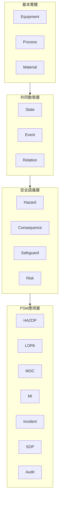
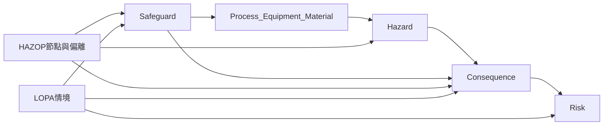
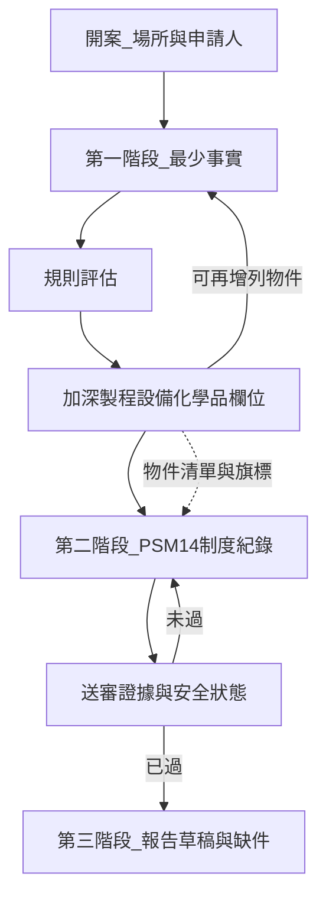
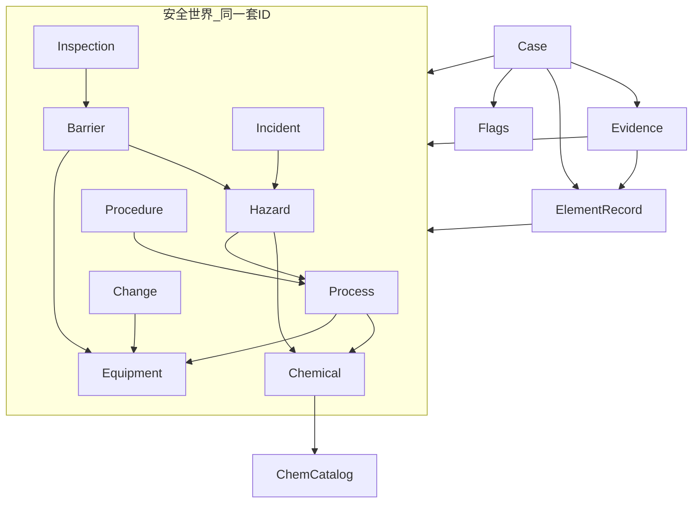
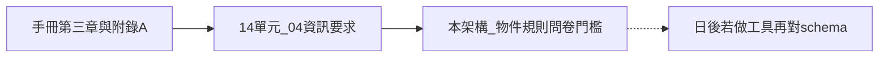

# PSM 通報系統架構

- 狀態：架構探索稿（不做軟體）
- 日期：2026-08-20
- 範圍：單一事業單位、甲類危險性工作場所**初次送審**
- **這一階段：一般系統**（安全資訊模型 + 送審視圖）。**下一階段：Agent 協作**。
- 對需求單位仍用申報草案細表對欄位：[2026-08-20-psm-14單元細表-討論稿.md](./2026-08-20-psm-14單元細表-討論稿.md)
- 內部原則：[psm-設計原則.md](./psm-設計原則.md)
- 法規對應：《製程安全評估定期實施辦法》第四條附表一至十四；手冊第三章 3.1–3.14 與附錄 A
- 資訊要求底稿：[14單元/00_資訊要求總表.md](../14單元/00_資訊要求總表.md)、各單元 `04_資訊要求.md`

---

## 1. 這套架構在解決什麼

場所裡的安全世界由三原耦合撐住（宇宙學對比，內部用語）：**空間＝設備，時間＝製程（物質怎麼移動），物質＝化學物。** 危害從三原交互長出，不是從單張表長出。另有神聖時間線記錄世界被改過什麼。手冊表都是掛在三本主檔上的掛件；HAZOP 是擾動一原、檢查另外兩原與防護。變動時：時間線記一筆，映射拉出要確認的紀錄，並標出哪些平行世界要重檢。

表單只是呈現方式（送審冊、手冊第三章表）。系統要能回答：誰、在什麼製程、操作什麼設備、使用什麼物質、產生什麼危害、有哪些保護層、依據什麼程序、如何確認有效、發生什麼變更、變更後平行世界是否仍然安全。

送審資料有兩層，不該混成一張超長表，也不該做成 14 個互不記得的表單倉：

1. **安全世界（同一套實體）**：製程、設備、物質、危害、保護層、程序、變更、檢查、事故。全域 ID 只有一份。
2. **14 項 PSM（從世界投影出來的制度視圖）**：怎麼管、做過什麼、留下什麼證據。14 項都要填，不能因為「目前沒承攬」就把附表六拿掉。項與項必須能互相指向（咬住），不是各填各的。

目標路徑分三段，**不要一次做完**：

1. **本階段一般系統**：場所識別 + 安全實體主檔（人工維護）+ 14 項制度紀錄綁在同一批實體上 + 證據鏈 + 組送審草稿。需求討論仍用細表語言；內部實作不是 14 張孤立問卷。
2. **後期規則／查詢**：過壓／毒性規則、CAS 查 H-code、問卷深度隨事實增減、影響分析沿關係邊展開。
3. **再後期 Agent**：小而專的協作（HAZOP／MOC／MI／SOP／事故／訓練），共享本階段已定死的同一個世界；不取代責任，只管理人的注意力。

本文件只定資訊架構、物件、關係與門檻，不定技術堆疊、畫面或程式模組。

### 1.1 四層（有沒有這個概念）

有。下面這四層就是同一個世界，只是先前用中文主檔／時間線／掛件在講。英文名對齊如下。

| 層 | 我們已有的名字 | 齊不齊 |
|---|---|---|
| Equipment / Process / Material | 設備、製程、化學品（CAS） | 齊。Material＝化學品 |
| Event | 神聖時間線／編排器寫入 | 齊。唯一寫入口 |
| Relation | 所屬製程、掛件槽、型別映射 | 齊 |
| State | 主檔的「現在」、缺口狀態、案件狀態、安全狀態（派生） | **半套**：有現況，還沒把 State 當成與 Event 對等的一等物件 |
| Hazard / Safeguard | 危害、保護層（Barrier） | 架構有主檔；第一版開槽仍以三本核心為先 |
| Consequence / Risk | HAZOP 工作表的後果／風險欄 | **還嵌在應用層**，沒獨立出來給事故、應變共用 |
| HAZOP / LOPA / MOC / MI / Incident / SOP / Audit | 單元 02（HAZOP／FMEA；LOPA 若有做則同掛）、10／08／11／04／13 | 齊。LOPA 不是另一個世界，見 1.2 |

規則：應用層不得自造 Equipment／Material 名稱；語義層的 Hazard／Safeguard 必須指向基本實體；Event 改變 State，並經 Relation 找到要確認的掛件。

### 1.2 HAZOP 與 LOPA 怎麼掛

兩者都是應用層方法，讀同一組語義物件，不各建一套設備名。

- **HAZOP**：從製程開平行世界（節點 × 偏離）。產出 Hazard、Consequence、既有 Safeguard、建議。既有防護欄只能選已存在的設備／程序／保護層 ID。
- **LOPA（保護層分析）**：通常只對 HAZOP 裡後果夠嚴重的情境再定量。同一筆 Consequence 往下掛：起始事件頻率、條件修飾、獨立保護層（IPL）、各層 PFD、緩解後頻率對目標。IPL 是 Safeguard 的子集——必須獨立、可稽核、有效；HAZOP 寫的「操作員注意」多半不能當 IPL。
- **MI／連鎖**：表 3.1-9、釋壓裝置、SIS 若被 LOPA 算進 IPL，必須能指回 Equipment；檢查逾期＝該 IPL 的 State 不可信，Risk 要重算。
- **MOC**：改空間或物質時，時間線記一筆，拉出用到該 Safeguard 的 HAZOP 節點與 LOPA 情境，一併重檢。

手冊單元 02 舉 HAZOP／FMEA 為評估方法；附錄實務亦見 HAZOP/LOPA。送審不強制每案都做 LOPA。系統要能掛；沒做則聲明無。第一版可先存工作表並強制掛 Consequence／Safeguard ID；定量與獨立性檢核放完全體。

---

## 2. 已確認原則

| 原則 | 含義 |
|---|---|
| 單一場所、一案 | 第一版只考慮一個事業單位的一個甲類送審案件 |
| 同一個世界 | 設備、製程、物質、危害只有一份主檔；14 項與後續 Agent 都指向同一 ID |
| 14 項全填且互相咬住 | 主問卷不省略；沒有該情形時改填「聲明／空白表單／其他場所案例」。項與項要能交叉驗證，不是填完就算 |
| 動態的是深度不是範圍 | 規則決定「還要問哪些欄位、哪些子題」，不決定「哪一項 PSM 可以不做」 |
| 人可以改清單 | 製程、設備可隨時新增；刪除前須看是否已被問卷、保護層、變更或附件引用 |
| 規則依第一階段答案 | 例如：是否過壓、化學品是否高毒性、是否特殊製程 |
| 證據可追溯 | 每個應檢附項與每條安全結論要對得到：來源實體 → 答案／判斷 → 附件／表號／規範 |
| 狀態重於完成率 | 完成率可輔助送審；真正要能讀出製程是否仍處於可接受安全狀態 |
| 本階段無 Agent | 先做一般系統；Agent 協作明確列下一階段 |

不在本階段：乙丙類、多廠權限、向主管機關線上申報、用模型代替規則決定要交什麼、自動派工 Agent。

---

## 3. 整體流程

三階段不可跳過順序上的依賴，但制度紀錄內部允許跳著填：

1. 沒有製程／設備／化學品等安全實體，14 項無法綁物件，也組不出 PSI／MI／SOP。
2. 14 項未達各單元最低證據，不算可送審；另應能看出未關閉變更、未追蹤建議、逾期檢查等狀態（本階段可先人工標，後期再算）。
3. 報告只是把已填內容依手冊章節投影，不另發明資料。

---

## 4. 資訊物件

一個**案件（Case）**底下是同一個安全世界：實體、關係、14 項制度紀錄、證據。表單欄位是這些物件的視圖。

本階段就要能表達的「互相咬住」（先存關係，不必先自動推理）：

| 從 | 到 | 意義 |
|---|---|---|
| 製程安全資訊 | HAZOP | PSI 可被危害分析使用 |
| HAZOP 節點／建議 | SOP、保護層、檢查要求 | 分析結果進入操作與完整性 |
| 設備變更 | MOC | 變更不是只改設備主檔 |
| MOC | 是否重做 HAZOP、是否更新 SOP | 變更關閉條件 |
| 事故／近失 | 危害、PHA | 回饋風險評估 |
| 檢查缺失 | 設備完整性、風險狀態 | 缺失不是孤立紀錄 |

### 4.0 全域識別

同一設備在設備清單、HAZOP、MOC、檢查裡必須是同一個 ID。允許別名（tag、俗稱），主鍵只有一個。刪除實體前檢查所有引用。

### 4.1 案件 Case

- 場所名稱、甲類範圍描述、申請義務人
- 案件狀態：事實蒐集中／問卷進行中／可組報告／已匯出草稿
- 規則快照：本次評估用了哪些規則與版本（手冊若改，舊案可對照）

### 4.2 製程 Process

最少欄位（第一眼就要）：

- 名稱、連續或批次
- 有無化學反應
- 有無過壓／需要超壓保護
- 是否特殊製程（裂解、強放熱、異常反應風險等，細目可再定）

規則通過後才出現的例子：

- 方塊流程／PFD 是否已有
- 安全上下限是否已建立（溫度、壓力、流量、組成）
- 若有反應：反應熱、失控條件

一個案件可有多個製程；問卷 01、02、04、05、12 等多用「每個製程一列／一塊」。

### 4.3 設備 Equipment

最少欄位：

- 名稱
- 類型：壓力容器與儲槽、管線、釋放及排放、緊急停車、控制系統、泵浦／轉動、其他
- 是否安全關鍵

規則通過後才出現的例子：

- 過壓相關：設計壓力／溫度、釋壓裝置
- 法定危險性設備：是否需 3.1.3.9 證明；若全案都沒有此類，在單元 01 做場所級註記
- 屬於哪一張 P&ID、檢查頻率／程序書編號（供單元 08）

設備可歸屬一個或多個製程。

### 4.4 化學品 Chemical 與參照表 ChemCatalog

化學品維持**兩張表**，查詢鍵是 **CAS**（不是 CNS）：

- **參照表 ChemCatalog**：以 CAS 為主鍵，存 H-code、相容族群、毒性摘要、建議 PPE。分類依據仍是 CNS 15030／GHS 的危害警告訊息。
- **案件化學品表**：最少填名稱、角色、製程、**CAS**；輸入 CAS 後從參照表帶回 H-code，再判斷相容性、毒性加深、PPE。

查不到 CAS：手填 H-code，並可寫回參照表。**這段查詢與自動判斷屬後期**；申報草案階段案件表可先手填 CAS、名稱、存量，H-code 可空白或從 SDS 抄。

規則通過後才出現的案件欄位仍包括：最大存量、SDS、不相容檢核（表3.2-2）、處理方法（表3.2-3）、單元 12 物質控制。

### 4.5 危害、保護層、程序、變更、檢查、事故

這些與製程／設備／化學品同屬安全世界，本階段一般系統就要有主檔，不能等到「問卷欄位」才出現。最少先能建列、綁 ID；細欄位可隨 14 項制度紀錄加深。

| 物件 | 最少要能說什麼 | 主要咬住 |
|---|---|---|
| Hazard | 哪個製程／物質、什麼危害情境 | 單元 01、02、11、12 |
| Barrier（保護層） | 對應哪台設備或哪項措施、保護哪個危害 | 單元 02、08、檢查 |
| Procedure | 哪個製程、哪種操作（含七階段 SOP） | 單元 04、05 |
| Change（MOC／重大修改） | 改了哪個實體、是否涉及安全功能、是否關閉 | 單元 07、10 |
| Inspection | 檢查哪個保護層／設備、結果、缺失、再確認 | 單元 08 |
| Incident | 近失或事故、回饋哪個危害／PHA | 單元 02、11 |

檢查一筆不是「完成」旗標，而是鏈：設備 → 失效模式 → 保護層 → 檢查項目 → 結果 → 缺失 → 改善 → 再確認。

變更一筆至少預留「影響清單」欄位（可能影響的 HAZOP 節點、SOP、檢查、訓練），本階段可人工勾選；沿邊自動展開屬後期。

### 4.6 衍生旗標 DerivedFlags

規則寫入案件，供問卷條件使用。第一批建議只這幾類：

- `hasOverpressure`
- `hasHighToxicity`（可由 H-code 帶出，填寫者可覆寫）
- `hasSpecialProcess`
- `hasStatutoryDangerousEquipment`
- `hasContractors`（可後補；即使 false，附表六仍要填「無承攬」聲明與近五年表）
- `hasHotWork`（同上，附表九仍在）
- `hasIncidentIn5Years`（影響單元 11 是空白表單還是實案報告）

旗標是**建議與顯示控制**，不是刪除單元的開關。

### 4.7 制度紀錄 ElementRecord 與證據 Evidence

- 14 個單元各一份制度紀錄（程序／結果／表單），全部指向第 4.0–4.5 節的實體，不是獨立資料倉
- 題目分三層：單元必填、條件子題（依旗標）、重複區塊（依製程、設備、保護層、變更實例）
- 證據指向手冊表號（如 3.1-4、3.2-4）或上傳檔；存廠備查項標記「不進送審冊、只記有／無」
- 安全結論（例如某設備有高壓洩漏風險）必須能指回：製程、設備、危害、HAZOP 節點、歷史事件、規範或程序、專家判斷之至少一項

---

## 5. 第一階段：最少資料與擴減

### 5.1 為什麼要最少

手冊要求的欄位極多，但很多欄位對「還沒說有沒有過壓的製程」沒意義。先問能觸發規則的事實，再長出對應欄位，避免空白表嚇跑填寫者，也避免不相關設備被硬填。

### 5.2 擴與減的定義

- **擴**：新增欄位、新增一筆建議設備／化學品（例如有過壓但尚未列釋壓裝置）、問卷子題由隱藏改為必填。
- **減**：子題改為選填或改為「本場所無此情形＋理由」；**不刪** 14 個主單元。使用者刪除某台設備＝減事實，須檢查引用。

擴減在每次事實變更後重算。已填的加深欄位，若旗標後來變 false，答案保留但標「目前不納入報告」，避免資料消失。

### 5.3 第一批規則（探索用，可再改條件）

**過壓為是**

- 該製程／相關設備：設計壓力、釋壓系統、P&ID 須能對到釋放及排放類
- 單元 01：表 3.1-2、3.1-6、3.1-9 深度提高
- 單元 08：釋放及排放系統須有檢查測試紀錄（法定五欄）
- 單元 07：PSSR 檢查表須含超壓保護相關確認

**高毒性或特殊危害為是**（可手勾，後期可由 CAS→H-code 帶出）

- 該化學品：SDS、暴露、不相容、最大存量
- 單元 01：表 3.2-1／2／3 不可只填範本結構
- 單元 12：物質控制、急救搜救、外部醫療表加深；PPE 以參照表建議為底、可覆寫
- 單元 06：危害告知不得流於概括（若有承攬）

**CAS／H-code 查詢（後期）**

- 輸入 CAS → 參照表帶回 H-code 清單
- 用 H-code 對相容族群、毒性加深、建議 PPE（見第 10.3 節）
- 同一案件內，不相容族群衝突的兩筆化學品要列出，供表 3.2-2 檢核

**特殊製程為是**

- 單元 01：化學反應資料、偏移後果須寫控制失效後最終最壞合理結果
- 單元 02：HAZOP／同等方法完整評估包（簽認、會議、P&IDs、改善追蹤）
- 單元 04：七階段 SOP 對該製程必出

**法定危險性設備**

- 至少一種證明，或場所級註明無此類型（3.1.3.9）

以上規則之後應寫成獨立規則表（條件／作用對象／影響欄位／影響問卷），不要散在各單元說明裡。

---

## 6. 第二階段：14 項制度紀錄如何跟著物件走

每個單元固定三塊，對應手冊共通要求：

1. 管理程序或做法  
2. 執行結果  
3. 表單或執行紀錄（含附錄 A 自我檢核）

再加上「條件子題」與「按物件重複的區塊」。

| 單元 | 永遠必填的骨架 | 主要綁定物件 | 條件加深（示例） |
|---|---|---|---|
| 01 製程安全資訊 | 資訊管理做法 | 製程、設備、化學品 | 過壓→釋壓／連鎖；毒性→SDS 與存量 |
| 02 製程危害控制 | 評估程序＋完整紀錄包門檻 | 製程 | 特殊製程→HAZOP 包；所有製程都要事故納入與改善現況 |
| 03 勞工參與 | 年度計畫＋兩份不同項目紀錄 | 案件 | 須涵蓋製程危害分析協商 |
| 04 標準作業程序 | 程序管理＋七階段 | 每個製程一塊 | 有過壓→操作界限與安全系統功能加深 |
| 05 教育訓練 | 初訓／在職課程與測驗紀錄 | 製程操作人員（可後補名冊） | 有承攬／派遣→對象與應訓已訓 |
| 06 承攬管理 | 程序＋近五年職災表 | 案件；有承攬才加深選商與告知 | 無承攬：聲明＋空表仍完成 |
| 07 啟動前安全檢查 | 程序＋重大修改定義＋一件案例 | 變更／設備 | 過壓設備案例優先 |
| 08 機械完整性 | 程序＋六大類與關鍵性兩份清單 | 設備（按類型） | 只對「事實庫出現的類型」要求該類各一紀錄；未出現的類型填「本場所無」 |
| 09 動火許可 | 程序＋許可證要項 | 案件 | 無動火：聲明＋空白許可格式 |
| 10 變更管理 | 程序＋類型定義含製程修改 | 案件 | 本場所無案可用其他場所案件 |
| 11 事故調查 | SOP＋近五年統計 | 案件 | 無事故：空白報告＋溝通做法 |
| 12 緊急應變 | 組織、流程、演練計畫 | 製程／化學品 | 高毒性→物質控制與醫療資源 |
| 13 符合性稽核 | 程序＋計畫＋稽核員 | 14 單元覆蓋 | 尚未第一次：預定計畫；「一次」＝14 單元都稽過 |
| 14 商業機密 | 取得路徑＋必要時協議 | 案件 | 列出哪些 PSI／PHA 列機密 |

建議填寫順序（依賴，不是鎖死畫面）：

1. 01 → 02（沒有現況 P&ID 與化學品事實，評估包不成立）  
2. 04、05、08 與 01 交叉（SOP／訓練／MI 引用 PSI）  
3. 07、10 引用 02 與 08  
4. 06、09、11、12、13、14 可與制度面並行  
5. 03 須能指向 02 的勞工參與證據  

單元 08 的「減」是：**沒有泵浦就不要求泵浦類檢查紀錄**，但機械完整性這張問卷還在，且六大類要表態「有／無」。

---

## 7. 完成度與「可以組報告」

案件可組報告，當且僅當：

- 至少一個製程、與該製程相關的設備／化學品事實已通過「該物件的最少欄位＋已觸發規則的加深欄位」
- 14 個單元各自達到最低證據（見各單元 `04_資訊要求.md` 的應檢附精簡清單，作為門檻表，不是實作清單）
- 附錄 A 各單元至少完成自我檢核註記（等級或 NA 理由）
- 跨單元一致性抽查（探索階段先列，細則後補）：
  - 表 3.1-4 的 P&ID 與單元 02 評估用圖一致
  - 安全上下限不是品質操作界限
  - 單元 13「一次稽核」覆蓋 14 單元

未過門檻時，輸出的是**缺件清單**，不是半份假裝完整的報告。

---

## 8. 第三階段：報告怎麼組（邏輯，非檔案格式）

報告結構對齊手冊，不另創章名：

1. 申請與場所（手冊第一章相關，本架構第一版可只留場所識別，細節後補）  
2. 安全衛生管理基本資料（第二章；承攬、事故調查可註明參閱附表六、十一）  
3. 第三章 3.1–3.14：由對應問卷答案＋綁定物件清單灌入  
4. 附錄 A 檢核結果  
5. 附件目錄：表號、檔名、對應單元  

組版規則：

- 重複區塊按製程或設備實例展開成表列  
- 條件子題若旗標為假：寫入手冊允許的「無此情形」句，或略過該小節並在缺件清單註明「已聲明無」  
- 存廠備查項只在附件目錄標「備查」，不塞進送審正本  

產出物定義（探索）：**內部可審的報告草稿 + 缺件清單**。不宣稱勞動檢查機構必然受理。

---

## 9. 與手冊整理的關係

手冊是法規與送審要求的來源；`04_資訊要求.md` 是「每單元要交什麼」的萃取；本架構是「先問什麼、何時加深、如何組回送審結構」。三者不一致時，以手冊原文為準，回頭改本文件與總表。

---

## 10. 製程表與設備表欄位（供審閱）

這三張是**事實庫主表**，不是送審報告裡所有附表的總和。P&ID 清單、釋壓彙整、防爆區域、表3.2-1 細格等另表，用製程／設備／化學品 ID 去連。

欄位分三層：

- **最少**：第一階段每一列都要
- **條件**：規則為真才出現（仍屬事實庫，不是 14 項問卷）
- **問卷回填**：第一階段可不填，14 項填完後寫回主表，方便組報告

### 10.1 製程表

| 層 | 欄位 | 說明 | 對應 |
|---|---|---|---|
| 最少 | 製程編號 | 案件內唯一 | 內部 |
| 最少 | 製程名稱 | | 表3.8-1 製程區域之上一層 |
| 最少 | 連續或批次 | | SOP 七階段是否適用 |
| 最少 | 有無化學反應 | 是／否 | 觸發反應資料 |
| 最少 | 有無過壓或需超壓保護 | 是／否 | `hasOverpressure` |
| 最少 | 是否特殊製程 | 是／否；若是可再註裂解／強放熱／其他 | `hasSpecialProcess` |
| 條件（有反應） | 製程描述 | 短文 | 3.1.2.2 |
| 條件（有反應） | 反應機制／反應式 | | 3.1.2.2 |
| 條件（有反應） | 放熱或吸熱 | | 3.1.2.2 |
| 條件（有反應） | 影響操作之因素 | | 3.1.2.2 |
| 條件（有反應） | 失控條件 | | 3.1.2.2 |
| 條件（過壓或特殊） | 主要安全上下限是否已建立 | 是／否；細值在設備表 | 3.1.2.4 |
| 條件 | 方塊流程圖或簡化 PFD | 有／無＋圖號 | 圖3.1-1 |
| 條件 | 質能平衡 | 有／無；完整存廠 | 圖3.1-2 |
| 問卷回填 | 偏移後果評估連結 | 連到單元 02 紀錄 | 3.1.2.5 |
| 問卷回填 | SOP 清單連結 | 連到單元 04 | 表3.4-1 |

不進程程主表、另表關聯：化學品最大存量（表3.1-1）、該製程的 P&ID 清單（表3.1-4）。

### 10.2 設備表

對齊手冊表3.8-1（分類）與表3.8-2（安全關鍵，多兩欄）。一列一台／一套；安全關鍵為是時自動加頻率與程序書欄。

| 層 | 欄位 | 說明 | 對應 |
|---|---|---|---|
| 最少 | 設備編號 | | 表3.8-1、表3.1-2 |
| 最少 | 設備名稱 | | 表3.8-1、表3.1-3 |
| 最少 | 設備類型 | 六大類之一或「其他」：壓力容器與儲槽；管線（含閥）；釋放及排放；緊急停車；控制系統（監測／感應／警報／連鎖）；泵浦／轉動；其他 | 表3.8-1；自我檢核 8.2 |
| 最少 | 所屬製程 | 可多選 | 表3.8-1 製程區域 |
| 最少 | 是否安全關鍵 | 是／否 | 決定要不要走表3.8-2 |
| 條件 | 製程區域／位置 | 比「所屬製程」更細的現場位置 | 表3.8-1 |
| 條件 | 內容物 | | 表3.8-1 |
| 條件 | PFD 編號 | | 表3.8-1 |
| 條件 | P&ID 圖號 | | 表3.8-1、表3.1-4 |
| 條件（安全關鍵＝是） | 檢查及測試頻率 | | 表3.8-2 |
| 條件（安全關鍵＝是） | 檢查測試程序書編號 | | 表3.8-2 |
| 條件（過壓＝是，或類型為釋放及排放／壓力容器） | 設計壓力 | kg/cm²G | 表3.1-2 |
| 條件（同上） | 設計溫度 | ℃ | 表3.1-2 |
| 條件（過壓） | 安全上／下限（壓力、溫度；流量／組成若適用） | 非品質操作界限 | 表3.1-2 |
| 條件（類型＝釋放及排放，或過壓） | 釋壓裝置編號、類型、設定壓力、設計排放量、P&ID 編號 | 細項可另開釋壓子表，主表只留有無與編號 | 表3.1-6 |
| 條件 | 建造材料或規格 | 材質、腐蝕裕度可後補 | 表3.1-3 |
| 條件 | 是否法定危險性設備 | 是／否／不確定 | 3.1.3.9 |
| 條件（法定＝是） | 法令證明種類與文件 | 型檢、熔接、構造、竣工、定期等；或註明檢附一種 | 3.1.3.9 |
| 問卷回填 | 設計規範及標準 | | 表3.1-8 |
| 問卷回填 | 是否納入防爆區域 | 連表3.1-5 | 3.1.3.3 |
| 問卷回填 | 是否屬安全連鎖／ESD | 連表3.1-9 | 3.1.3.8 |

全案沒有任何「法定危險性設備＝是」時，不在設備列上消失，而在單元 01 做場所級註記「無此類型」。

類型從未出現的六大類（例如沒有泵浦）：設備表沒有該列；單元 08 問卷用「本場所無此類型」表態，不在設備表造假列。

### 10.3 化學品：案件表＋CAS 參照表

化學品維持獨立主表，而且要**另外維持一張參照表**。**申報草案**先手填案件表；CAS→H-code 自動判斷屬後期。

分類依據是 **CNS 15030**；**查詢鍵是 CAS**。

查無資料：手填 H-code，允許寫回參照表。帶出值可覆寫。SDS 不能用 H-code 取代危害七項全文。

#### 10.3.1 化學品參照表 ChemCatalog（後期維護）

| 欄位 | 說明 |
|---|---|
| CAS No. | 主查詢鍵 |
| 中文名稱／英文名稱／化學式 | |
| GHS 分類摘要 | 依 CNS 15030 |
| H-code 清單 | 可多個 |
| P-code 清單 | 選填 |
| 相容族群 | 見 10.3.3 |
| 毒性摘要 | 由 H-code 派生 |
| 建議 PPE | 由 H／P 派生 |
| 資料來源與日期 | SDS 版次 |

#### 10.3.2 案件化學品表 Chemical（草案就要有）

一列一種物質。**CAS 為最少欄位**。

| 層 | 欄位 | 說明 | 草案就要？ |
|---|---|---|---|
| 最少 | 編號、名稱、角色、所屬製程、CAS | | 要 |
| 帶出（後期） | H-code、相容族群、高毒性建議、建議 PPE | 查參照表 | 草案可空白或手抄 SDS |
| 條件 | 相態、濃度、用途 | | 建議有 |
| 條件 | 使用單位、最大存量、計算說明、地點 | 表3.1-1 | 達量或危害物要 |
| 條件 | SDS、危害七項、表3.2-2／3 | 單元 01 | 要 |
| 問卷回填 | TWA／STEL、閃火點等 | | 單元 01 細表 |

混合物：不以單一 CAS 硬套；用混合物 SDS 的 H-code，或拆成分列。同一共儲範圍族群衝突 → 表 3.2-2 必須處理。

#### 10.3.3 H-code 怎麼判斷（第一版對照，可再擴充）

**毒性（帶出 `hasHighToxicity` 或加深七項）**

- 急性：H300、H301、H310、H311、H330、H331
- 特定標的器官／慢性：H370、H372、H373
- 致癌／致突變／生殖：H340、H350、H360
- 嚴重腐蝕／眼傷：H314、H318
- 呼吸致敏：H334

有上列任一碼 → 建議勾高毒性，並展開危害七項與單元 12。僅 H315／H319／H335 等較輕危害 → 不自動勾高毒性，仍可列在化學品表。

**相容族群（先做粗分，供表 3.2-2）**

- 易燃：H224、H225、H226、H228
- 氧化：H270、H271、H272
- 遇水放易燃氣體：H260、H261
- 金屬腐蝕／強腐蝕：H290、H314
- 有機過氧化物：H240、H241、H242
- 毒性（儲運隔離）：H300–H331 系列

衝突示例（同一共儲／共管範圍不可並存，除非工程上已隔離）：易燃 × 氧化；遇水反應 × 水溶液；強腐蝕酸／鹼若另標酸、鹼族群則互衝。細表以後可再拆酸、鹼、鹵素等，第一版不求完整 CRW。

**建議 PPE（有 P-code 先用 P；否則用 H）**

- H314／H318 或 P280：耐化手套、護目或面罩、防護衣
- H330／H331／H334 或 P284：呼吸防護
- H224–H226：防靜電、禁明火（屬作業控制，也一並列建議）
- H300／H310：避免皮膚與食入途徑，完整皮膚防護

建議 PPE 會進單元 04 工作安全衛生標準、單元 12 個人防護具清點；與現場程序不一致時以覆寫＋理由為準。

### 10.4 這些不是「不要進主表」，而是不要只當附件垃圾堆

HAZOP 節點、PSSR、動火、承攬、檢查原始紀錄仍要能指向設備／製程／變更 ID。它們有自己的主檔（見 4.5），不是只能當問卷上傳檔。表 3.2-1A／1B／1C 的完整危害矩陣可留在單元 01 細格，但化學品主表要能連到「已建」。

---

## 11. 刻意未決與階段邊界

本階段不做 Agent。下一階段 Agent 只能掛在第 4 節同一個世界上，並走：監測 → 判斷 → 觸發 → 派工 → 驗證 → 關閉。核心能力是影響分析，不是生成文件。

這些不影響本文件作為探索底稿，但會影響以後若做成工具時的形狀：

- 特殊製程的判定清單要多嚴（僅裂解，或含強放熱、間歇加料等）
- 「過壓」以設計壓力、操作是否可能超壓、還是有無釋壓裝置來定義
- 第二章基本資料要不要納入同一案件流程
- 報告最終載體（Word／PDF）——本階段不選
- H-code 資料要自建參照表，還是接外部 GHS／SDS 資料源（後期）
- 影響邊的第一張完整矩陣（原料變更、設備變更、人員變更各打到哪些實體）

---

## 12. 一句話

**同一個安全世界（製程、設備、物質、危害、保護層、程序、變更、檢查、事故），14 項是它的視圖且必須互相咬住；先把一般系統與證據鏈做對，送審草案是投影，Agent 是下一階段。**
