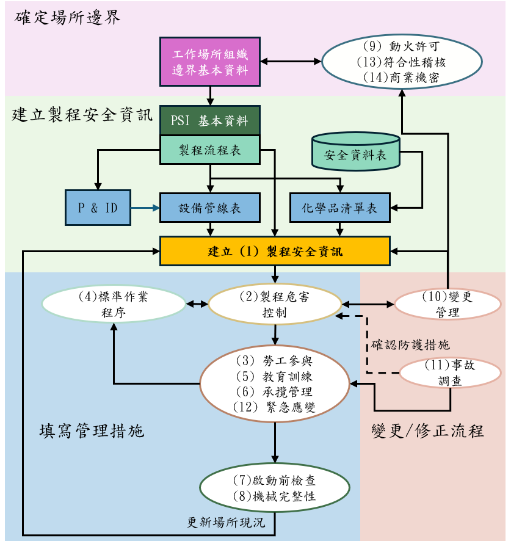

# 石化及化學工廠製程安全管理線上風險評估參考手冊（草案）

勞動部職業安全衛生署高風險事業單位製程安全資料庫與評估技術精進計畫  
工作項：研擬本手冊草案（計畫書 4.5.1）  
草案版本：V7.3（115年9月修訂）  
中華民國 115 年

---

## 編撰說明

### 本手冊目的

本手冊說明甲類工作場所第一次線上填報時，各單元應備之欄位與附件，供事業單位填報及勞動檢查機構審查對照。送審時應說明、應檢附及得存廠備查之事項，仍以現行法令及職安署審查要求為準。廠內書面程序之訂定，得參考職安署《製程安全管理程序參考手冊》。

### 適用對象

本手冊適用於申請甲類危險性工作場所審查之事業單位，以及辦理審查之勞動檢查機構。線上填報以石化、化學或半導體工廠之甲類場所為範圍。

### 適用法規範圍

依勞動檢查法第26條，危險性工作場所非經勞動檢查機構審查或檢查合格，事業單位不得使勞工在該場所作業。甲類場所之審查及十四項製程安全管理資料，依《危險性工作場所審查及檢查辦法》及《製程安全評估定期實施辦法》辦理；該辦法第五條附件一由審查申請程序檢附，本手冊不重複列表。乙類、丙類非本手冊範圍。

章名與操作表號一致：第一章製程安全資訊（PSI）為表1.0、表1.1 至表1.11，第十四章商業機密為表14.1。第一次填報之起點為第一章製程安全資訊（PSI）。該章先建立場所、部門、製程、設備、化學品及廠區區域清單，清單為 PSI 的一部分；列完後再填危害性化學品、製程技術與設備資料。其後各單元自該章選取編號、帶出名稱及已填屬性。同一事實只填一次。化學品表已蒐集危害說明（GHS H 代碼，以下稱危害說明）者，依 CNS 15030 對應製程安全資訊 1.1 之「危」「有」及 1.2 之物理性、健康危害，人員確認或改選。法定應說明、應檢附之內容，不因合併欄位或資料帶入而減少。

本手冊所稱化學品代號，採化學文摘社登記號（CAS No.）。純物質以該物質之 CAS No. 填報；混合物依安全資料表第三項所列成分，按各成分 CAS No. 及比例拆分填報，並保留混合物名稱與安全資料表代號供勾稽。比例拆分僅用於數量歸屬，不取代依安全資料表及 CNS 15030 對混合物整體所作之危害分類。

各表下方「註」說明該表填報項目。欄位依《製程安全評估定期實施辦法》所定製程安全管理資料編列；必填以外之佐證以電子檔上傳，並登錄名稱及日期。

---

## 第一章　前言

### 1.1 靜態申報之現狀

在過去的甲類工作場所定期實施報備實務中，多數事業單位採取檔案式留存：將管線儀表圖、製程安全評估、機械完整性檢測紀錄等十四項資料，壓縮轉換為 PDF 或其他靜態電子檔上傳。系統無法解析檔案內容、交叉勾稽與動態對比，同一設備或同一物質在不同檔案使用不同名稱時，第一次填報即不易確認各項資料是否指向同一製程及現場標的。製程變更、設備劣化等動態資訊因而難以成為可查詢的管理資料。

### 1.2 從檔案備存到可勾稽的資料

本草案將製程安全管理資料整理為可關聯的欄位規格，作為網站建置的基礎。使系統不僅是獨立的檔案上傳，而能將各單元解構為具備關聯性的數位欄位。後續單元選已建立之編號，帶出名稱與已填屬性；計畫、規章、圖檔仍上傳，並登錄名稱及日期。

本手冊建立的填報資料，可進一步分析事業單位製程設備運作失效時機、管線腐蝕劣化及化學不相容性，協助事業單位完成相關風險評估；勞動檢查單位可更好勾稽比對危險性作業場所，例如運作化學品數量、製程操作狀態與危險性設備清單，能更好的管理。

### 1.3 引導式填報

考量事業單位可能面臨的技術門檻，系統儘量減少單頁呈現的多欄位冗長表單，依前置步驟的宣告，引導使用者循序完成填寫。無某類型設備、無承攬、無動火或近五年無事故者，應據實註明，不得為填表而虛構。建議順序為：先完成製程安全資訊（PSI，含清單），再填其他單元。事業單位填寫期間系統會自動帶入相關資訊和建議填寫項目，減少人員填寫困難度。

---

## 系統導引與跨模組數據

本次開發的通報系統適用於石化、化學或半導體工廠之甲類危險性工作場所。

本平台依下列三階段建立單元之間的資料連結。各表導讀說明兩件事：應以欄位填報者；計畫、規章、圖檔等得以附件上傳，並登錄名稱及日期者。第一次填報應備資料仍以現行法令及職安署審查要求為準。審查辦法附件一不在本手冊重複列表。

### 申報架構

第一次線上填報依下圖四個區塊組裝資料。本圖說明各單元資料從何而來、向何而去，不是審查日程，也不代替各章表號。圖中 PSI、MOC、MI 分指製程安全資訊、變更管理、機械完整性。

**【圖一　第一次線上填報申報架構】**

排版時請將圖一置於本段之後、第一階段說明之前。圖檔：`docs/figures/第一次填報申報架構圖.png`。

圖一由上而下、由左而右分為四區。實線表示先有才能建、或必須對上已有編號；虛線表示確認防護措施，不是可選填報。

一、確定場所邊界（圖上方）  
先建立工作場所組織邊界基本資料：甲類範圍、場所名稱、部門及權責。動火許可、符合性稽核及商業機密（第九、十三、十四章）不以製程、設備、化學品清單為填報主體，但依附已確定之場所邊界；圖上以雙向箭頭表示得回看場所範圍與權責，不得另打一套廠區或部門名稱。

二、建立製程安全資訊（圖中段）  
場所邊界確定後，建立 PSI 基本資料及製程流程表。製程流程表一方面展開為管線儀表圖（P&ID），據以建立設備管線表；一方面結合安全資料表，建立化學品清單表。設備管線、化學品清單與製程流程收斂為「建立（1）製程安全資訊」。安全資料表供化學品清單引用，亦得供動火、稽核、商業機密作業時查閱危害資訊，但不改寫安全資料表本文。未完成 PSI 清單（表1.0-1 至表1.0-5）前，不得進入 1.1 至 1.11 及第二至十四章之引用欄。

三、填寫管理措施（圖左下方）  
PSI 齊備後，填製程危害控制措施（2），並與標準作業程序（4）相互對照。勞工參與、教育訓練、承攬管理及緊急應變（3、5、6、12）依危害控制結果與作業程序辦理。其後辦理啟動前安全檢查（7）及機械完整性 MI（8）。檢查與完整性結果用於更新場所現況，回寫 PSI，使清單、圖資與現場一致。

四、變更／修正流程（圖右下方）  
變更管理 MOC（10）與製程危害控制雙向銜接：變更前應評估風險並確認防護；變更後應更新受影響之 PSI、作業程序與訓練，必要時辦理啟動前安全檢查。事故調查（11）以虛線「確認防護措施」回饋危害控制；調查結果亦得進入勞工參與、教育訓練、承攬及緊急應變之檢討。MOC 不得僅登錄案號而未對到受影響之製程、設備或化學品編號。

### 第一階段：以製程安全資訊（PSI）為基礎

以製程安全資訊（PSI）為基礎，連結危害控制措施、標準作業程序與變更管理（MOC）等單元，降低重複輸入。後續單元凡需指明哪一條製程、哪一台設備、哪一種化學品、哪一個部門、哪一處區域，一律選取第一章已建立之編號；名稱、類型、危害說明、建造材料、所在區域、操作或維護部門隨編號帶出。帶入後得由人員確認或改填。

同一製程有哪些設備、哪些化學品，依設備與化學品已填之「所屬製程」帶出。某一台設備的內容物，於該單元自該製程已列化學品選取確認，不得將該製程全部化學品自動寫入每一台設備。

適當位置提供職安署危險性工作場所資訊管理系統「設備管線劣化機制查詢」連結，供機械完整性（MI）填寫時參考。連線帶出建議之前，須先備齊該查詢所需條件，見第八章。

### 第二階段：變更管理（MOC）與啟動前安全檢查的銜接

針對變更管理（MOC）與啟動前安全檢查建立資料關係。有 MOC 案件時，應能對到標準作業程序修訂、教育訓練及啟動前安全檢查結案紀錄。此階段只寫資料應能對上，不寫自動裁罰。

### 第三階段：機械完整性（MI）與劣化機制查詢

當機械完整性（MI）已備齊設備材質類別、操作溫度及內容物後，人員於職安署危險性工作場所資訊管理系統「設備管線劣化機制查詢」畫面勾選介質發生條件、保溫及其他發生條件，系統得帶出可能之劣化機制與檢測方法建議，由人員確認後填入表8.1-1。條件不齊全者，不得連線帶出。查詢結果僅作建議，不匯入線上填報介面，不代替危害控制措施之風險評分，不自動判定漏列，不代填檢查是否逾期。查詢頁之條件與必備欄位見第八章。

### 填報通則

一、設備以設備編號（現場位號）為準，化學品以化學品代號及所屬製程為準，部門以部門編號為準。其他表單自清單選取，不得另打一套名稱。

二、管線儀表圖、廠區位置圖除上傳附件外，應填圖號、版次、制修訂日期及所屬製程或涵蓋設備。未填前開欄位者，該圖不列入製程安全資訊之圖資列。

三、本場所無某一類型設備、無承攬、無動火或近五年無事故者，應據實註明，不得為填表而虛構。

四、各單元應依現行審查要求說明管理程序或做法、執行結果、使用表單或執行紀錄。

五、各單元確認事項以欄位填是或否，必要時附帶說明。緊急應變表12.1-1 列計畫所含緊急狀況並對製程、化學品及區域；表12.1-2 確認事項依直向長表，各項填是或否，填否須寫原因。項次一拆為組織架構、控制中心、運作流程三列。

六、嚴重度、可能性、風險等級、是否適用、改善是否完成、評估方法之選用、確認事項之是或否，以及程序全文、會議紀錄、簽認及訓練測驗等附件內容，不得自清單帶出。危害分析仍由製程安全評估小組完成。

---

## 十四項製程安全管理資料

以下第一章至第十四章對應《製程安全評估定期實施辦法》所定十四項資料。章號與表號一致：第一章製程安全資訊（PSI）為表1.0、表1.1 至表1.11；第七章啟動前安全檢查為表7.1；第八章機械完整性（MI）為表8.0 至表8.2；第十章變更管理（MOC）為表10.1；第十四章商業機密為表14.1。

## 第一章　製程安全資訊（PSI）

本章（PSI）應於執行製程安全評估前完成。後續各單元引用本章之製程清單、設備清單、化學品清單、部門、區域、安全上下限、P&ID、安全系統及緊急停車方案。名稱、編號、使用單位、地點及材質，自本章清單帶入，不得另打一套。內容物自該設備所屬製程已列化學品選取，由人員確認。安全上下限不得填載為品質管制用操作界限。無某類型設備或未規劃防爆區域者，據實註明。

填報順序：先完成本章清單（表1.0-1 至表1.0-5），再填 1.1 至 1.11。清單是製程安全資訊的一部分，不是另一套申報單元。廠區區域（表1.0-5）供設備所在區域、防爆劃分及緊急應變集合點選取，應於填設備清單前建立。

### 清單　場所、製程、設備及化學品

場所是甲類範圍的邊界，部門是操作權責與維護權責的歸屬。製程選操作部門、設備選維護部門，二者得為不同單位。第一次填報應先建立部門資料，再供製程及設備選取。組織系統圖以附件上傳。

**表1.0-1　場所與部門**

| 欄位 | 必填 | 說明 |
| --- | --- | --- |
| 事業單位名稱、場所名稱、甲類範圍 | 是 | 甲類範圍以圖資上傳 |
| 場所勞工人數 | 是 |  |
| 無某設備類型／無承攬／無動火等聲明 | 有則填 | 有聲明者不得再虛構該類列 |
| 部門編號 | 是 | 場所內唯一 |
| 部門名稱 | 是 | 名稱只在此維護 |
| 部門人數 | 是 | 該部門人數 |

註：

一、事業單位名稱、場所名稱、甲類範圍：填本申報所對應之甲類危險性工作場所。甲類範圍以圖資上傳，並與勞動檢查法第26條及審查辦法所定場所邊界一致；得以特定製程區為一個場所，或合併數個製程區。  
二、場所勞工人數：填該甲類範圍內勞工總人數，含承攬人勞工於該場所作業者宜於備註區分。  
三、無某設備類型／無承攬／無動火等聲明：有則填。聲明「無某設備類型」者，設備清單及表4.1-1 不得再出現該類型；聲明無承攬者免填第六章；聲明無動火者第九章確認事項據實填寫。不得為填表而虛構。  
四、部門編號：場所內唯一，後續製程操作權責、設備維護權責、勞工參與、訓練適用單位、稽核受稽核部門均選此編號，不得另打部門名稱。  
五、部門名稱：只在本表維護；帶出後得確認，不得在他表改名而不回寫本表。  
六、部門人數：該部門人數；各部門人數合計得與場所勞工人數核對。  
七、組織系統圖以附件上傳，並登錄名稱及日期。

製程清單應填製程編號、名稱、操作權責部門，以及是否連續或批次、有無化學反應、是否需超壓保護。較複雜之場所得分儲槽、調配、反應、蒸餾、裝卸等分別給號。多製程共用之後段處理應另立製程。

**表1.0-2　製程清單**

| 欄位 | 必填 | 說明 |
| --- | --- | --- |
| 製程編號 | 是 | 場所內唯一 |
| 製程名稱 | 是 |  |
| 操作權責部門 | 是 | 選部門編號 |
| 連續或批次 | 是 | 是非題 |
| 有無化學反應 | 是 | 是非題；填是者應於表1.4-1 說明反應類別與反應式，於表1.5-1 說明反應上下限 |
| 有無過壓或需超壓保護 | 是 | 是非題；填是者應於表1.10-1 說明安全連鎖 |
| 是否後段處理單元 | 建議 | 是非題；該製程是否為汙染控制相關設備 |

註：

一、製程編號：場所內唯一。後續各單元凡指「所屬製程」一律選本表編號。較複雜場所得分儲槽、調配、反應、蒸餾、裝卸等分別給號；多製程共用之後段處理應另立製程。  
二、製程名稱：與現場及 P&ID 用語一致，不得使用僅內部俗稱而無正式名稱。  
三、操作權責部門：選表1.0-1 部門編號，帶出部門名稱；與設備維護權責部門得為不同單位。  
四、連續或批次：必填，選「連續」或「批次」。  
五、有無化學反應：必填，是／否。填是者應於表1.4-1 說明反應類別與反應式，於表1.5-1 說明反應相關安全上下限。填否者表1.4-1 註明無化學反應。  
六、有無過壓或需超壓保護：必填，是／否。填是者應於表1.10-1 說明安全連鎖，並於表1.9-1 說明釋壓（若表1.0-3 已列安全關鍵釋放設備）。  
七、是否後段處理單元：建議填，是／否；指該製程是否為汙染控制、廢氣廢水或尾氣處理等相關單元。

設備清單應填設備編號、名稱、所屬製程、維護權責部門、設備類型及材質類別。設備編號與現場位號相同。設備類型必選其一。控制系統與緊急停車系統應分列。槽組含儲槽與泵者，應分列兩筆。材質類別須對職安署危險性工作場所資訊管理系統「設備管線劣化機制查詢」之材質選項，供第八章連線查詢；建造材料填規格名稱，與 1.6 相同。合格證影本為附件。無某類型者於場所聲明。設備所在區域於表1.0-5 以關聯設備勾選。

**表1.0-3　設備清單**

| 欄位 | 必填 | 說明 |
| --- | --- | --- |
| 設備編號 | 是 | 與現場位號相同 |
| 設備名稱 | 是 | 俗稱另欄，勾稽不用俗稱 |
| 所屬製程 | 是 | 選製程編號，引用表1.0-2 |
| 維護權責部門 | 是 | 選部門編號，引用表1.0-1 |
| 設備類型 | 是 | 必選其一，如壓力容器與儲槽、動力來源、管線系統、緊急停車系統等 |
| 動力型式 | 類型為動力來源時必填 | 泵浦、氣動或其他 |
| 操作分類 | 是 | 液體、氣體或後段處理 |
| 是否安全關鍵 | 是 | 是非題，如破裂片、氣體感測器、排放閥等 |
| 是否職安法第 16 條危險性機械或設備 | 是 | 是非題；是者須有合格證號碼及有效期限，於表1.11-1 說明 |
| 建造材料 | 建議 | 規格名稱，1.6 及後續各表使用 |
| 材質類別 | 是 | 對劣化機制查詢：碳鋼(CS)、低合金、高強度低合金(HSLA)、300系不銹鋼、400系不銹鋼、銅、鎳、鑄鐵、雙相不銹鋼、鈦合金、鋁合金、耐火材料、高分子材料、其他 |

註：

一、設備編號：與現場位號相同，場所內唯一。後續安全上下限、建造材料、P&ID 涵蓋設備、釋壓、連鎖、法令證明、作業程序、啟動前檢查、MI 及失效率均選此編號，不得另編。  
二、設備名稱：正式名稱；俗稱另欄，勾稽不用俗稱。  
三、所屬製程：選表1.0-2 製程編號。槽組含儲槽與泵者，應分列兩筆並分屬正確類型。  
四、維護權責部門：選表1.0-1 部門編號。  
五、設備類型：必選其一，不得自訂。選項為：壓力容器與儲槽；管線系統；釋放及排放系統；緊急停車系統；控制系統；動力來源；裝卸及輸送；其他。控制系統與緊急停車系統應分列。場所已聲明不具之類型，不得列該類型。表4.1-1 依本表已存在類型產生作業程序列。選其他須註明。  
六、動力型式：僅類型為動力來源時必填，選泵浦、氣動或其他。  
七、操作分類：必填，選液體、氣體或後段處理。  
八、是否安全關鍵：必填，是／否。破裂片、氣體感測器、排放閥等屬之；填是者應於表1.9-1 或表1.10-1 說明，並納入第八章 MI 關鍵性設備篩選。  
九、是否職安法第 16 條危險性機械或設備：必填，是／否。填是者須有合格證號碼及有效期限，於表1.11-1 說明。  
十、建造材料：建議填規格名稱（如 SS316L），與表1.6-1 相同，只填一次。  
十一、材質類別：必填，須對職安署危險性工作場所資訊管理系統「設備管線劣化機制查詢」之材質選項，供第八章連線查詢。選項為：碳鋼(CS)；低合金；高強度低合金(HSLA)；300系不銹鋼；400系不銹鋼；銅；鎳；鑄鐵；雙相不銹鋼；鈦合金；鋁合金；耐火材料；高分子材料；其他。規格名稱不得代替材質類別。  
十二、合格證影本為附件。設備所在區域不在本表另開欄，於表1.0-5 以關聯設備勾選。

化學品清單併入原混合物拆分欄，不再另開對應表。一列對應一張安全資料表所載之純物質，或混合物安全資料表第三項所揭露之每一成分。

純物質：化學品代號（CAS No.）、所屬製程、SDS 代號各填一筆；混合物名稱及成分比例免填，成分歸屬量填該物質數量。混合物：同一 SDS、同一製程，第三項每一揭露成分一列；同一成分於同一混合物及製程僅列一次。安全資料表未揭露或依法保留之成分，不虛構 CAS No.。

後續單元（1.1、1.2、設備內容物等）選取化學品時，以「CAS No.＋所屬製程」為準，不得另打品名。同一物質用於不同製程者，分列。同一 CAS 於同一製程來自數種混合物、因而本表有多列者，選取清單合併為一筆；帶入數量為各列成分歸屬量加總。

數量原則上以混合物總量乘以成分比例；總量與比例基準不同時，依密度等換算並記錄公式及來源。比例為範圍者，歸屬量採上限估算並標示為估算值。比例拆分只供成分數量歸屬。混合物整體之 GHS 分類、危害聲明、閃火點、沸點、不相容及防護具，仍以該混合物安全資料表及人員確認為準。危害說明用於帶入 1.1、1.2 定性欄，不據以判斷防護、材質或評估是否缺漏。化學品名稱或 CAS 不足以直接對上劣化機制查詢的介質發生條件（例如胺液、硫化氫銨沉積）；該等條件於劣化機制查詢畫面勾選，作為建議來源，不匯入線上填報介面。

**表1.0-4　化學品清單**

| 欄位 | 必填 | 說明 |
| --- | --- | --- |
| 純物質或混合物 | 是 | 決定後續欄是否填寫 |
| 所屬製程 | 是 | 選表1.0-2 |
| SDS 代號 | 是 | 與上傳之安全資料表勾稽 |
| 混合物名稱 | 混合物必填 | 純物質免填 |
| 化學品代號 | 是 | 成分 CAS No. |
| 名稱、角色 | 是 | 原料、中間產物、產物、副產物、觸媒、清洗劑等 |
| 成分危害說明 | 是 | 例：H314；混合物整體分類另依該 SDS。得填多筆，採下拉選單（附中英文對照） |
| 成分比例下限 | 混合物必填 | 純物質免填 |
| 成分比例上限 | 混合物必填 | 範圍者歸屬量採上限 |
| 比例基準 | 混合物必填 | 重量比、體積比或重量／體積比 |
| 混合物總量 | 混合物必填 | 純物質免填 |
| 成分歸屬量 | 是 | 純物質填該物質數量；混合物為總量×比例 |
| 換算式及資料來源 | 總量與比例基準不同時必填 | |

註：

一、純物質或混合物：必填，選「純物質」或「混合物」，決定後續欄是否填寫。  
二、所屬製程：選表1.0-2。同一物質用於不同製程者分列。  
三、SDS 代號：與上傳之安全資料表勾稽；未上傳對應檔案者，該列未完成。  
四、混合物名稱：混合物必填，純物質免填。  
五、化學品代號：成分 CAS No.。安全資料表未揭露或依法保留之成分，不虛構 CAS No.，其處理見第十四章。  
六、名稱、角色：必填。角色選：原料；中間產物；產物；副產物；觸媒；清洗劑；其他。填「原物料」視同「原料」。選其他須註明。  
七、成分危害說明：必填，得複選 GHS H 代碼（下拉，附中英文對照）。SDS 有而選單無之代碼，選「其他」並填該代碼，不得自創。用於帶入 1.1、1.2 定性欄，不據以判斷防護、材質或評估是否缺漏。  
八、成分比例下限／上限：混合物必填，純物質免填。範圍者歸屬量採上限估算並標示為估算值。  
九、比例基準：混合物必填，選重量比、體積比或重量／體積比。  
十、混合物總量：混合物必填。  
十一、成分歸屬量：純物質填該物質數量；混合物原則為總量×比例。總量與比例基準不同時，依密度等換算並於「換算式及資料來源」記錄公式及來源。  
十二、後續單元選取化學品以「CAS No.＋所屬製程」為準。同一 CAS 於同一製程來自數種混合物、因而本表有多列者，選取清單合併為一筆，帶入數量為各列成分歸屬量加總。  
十三、比例拆分只供成分數量歸屬。混合物整體之 GHS 分類、閃火點、沸點、不相容及防護具，仍以該混合物安全資料表及人員確認為準。化學品名稱或 CAS 不足以直接對上劣化機制查詢的介質發生條件；該等條件於查詢畫面勾選，不匯入線上填報介面。

安全資料表應填代號、純物質或混合物名稱、所列成分 CAS No.、版本及制修訂日期，並上傳電子檔。防護衣等級、濾罐型式得自第 8 項帶入應變表；未帶入者，應變表仍須由人員填寫，不得僅上傳檔案。

危害說明與 CNS 15030 為同一套分類。《危害性化學品標示及通識規則》所稱危險物、有害物，即該標準之物理性危害與健康危害（環境危害併入有害物）。1.1「危」「有」與此通用，不另建勾選邏輯。化學品清單已填危害說明後，依下表帶入，人員得改勾或改選。同一物質兼具物理性與健康（或環境）危害者，「危」「有」均勾。

| 已填之危害說明 | CNS 15030 | 1.1 帶入 | 1.2 帶入 |
| --- | --- | --- | --- |
| H2xx（物理性危害，含 H290 金屬腐蝕） | 物理性危害 | 「危」（危險物） | 對應之物理性危害類（例：H226 易燃液體；H220 易燃氣體） |
| H3xx（健康危害） | 健康危害 | 「有」（有害物） | 對應之健康危害類（例：H314 腐蝕／嚴重損傷；H330 急性毒性） |
| H4xx（環境危害） | 環境危害 | 「有」（有害物） | 1.2 無環境欄，僅勾 1.1「有」 |
| H260、H261 | 物理性危害（禁水） | 「危」 | 「與空氣或水不相容或放熱」建議勾是 |
| H220、H221、H222、H223 | 物理性危害 | 「危」；另建議勾選「高燃」 | 物理性危害：易燃氣體或氣溶膠 |
| H300、H301、H310、H311、H330、H331 | 健康危害 | 「有」；另建議勾選「高毒」 | 健康危害：急性毒性 |

註：

一、本表為危害說明帶入規則，不是另開填報表。化學品清單已填 H 代碼後依本表帶入，人員得改勾或改選。  
二、H2xx（含 H290 金屬腐蝕）帶入 1.1「危」及 1.2 對應物理性危害類。  
三、H3xx 帶入 1.1「有」及 1.2 對應健康危害類。  
四、H4xx 帶入 1.1「有」；1.2 無環境欄，不帶入 1.2。  
五、H260、H261 另建議勾選 1.2「與空氣或水不相容或放熱」。  
六、H220 至 H223 另建議勾選 1.1「高燃」；H300、H301、H310、H311、H330、H331 另建議勾選 1.1「高毒」。「高燃」「高毒」依《高壓氣體勞工安全規則》，與規定不符時以人員改勾為準。  
七、同一物質兼具物理性與健康（或環境）危害者，「危」「有」均勾。

「高燃」「高毒」依高壓氣體勞工安全規則，危害說明僅作建議勾選，與規定不符時以人員改勾為準。

特化及優先管理化學品基本資料表供選取成分 CAS No. 後帶入物化性質、不相容、不適材質及建議防護具，作為 1.2 及緊急應變器材之參考。混合物仍應以其安全資料表記載之整體分類與物化性質為準。本項資料得自動帶入表1.2-1。

| 化學品代號 | 名稱 | 特化 | 優先管理 | 危害說明 | TWA／STEL／最高容許濃度 | 閃火點、沸點、爆炸界限 | 不相容 | 可能不適材質 | 建議防護衣 | 建議濾罐 |
| --- | --- | --- | --- | --- | --- | --- | --- | --- | --- | --- |
| 7647-01-0 | 氯化氫（水溶液） | 視濃度 | 視公告 | H314、H335 | 依公告 | 不燃 | 鹼、氧化劑、多數金屬 | 碳鋼、鍍鋅 | C／B 級（依濃度） | 酸性氣體 |

註：

一、本表為特化及優先管理化學品基本資料之參考帶入格式，不是事業單位另建之一套品名清單。選取成分 CAS No. 後得帶入物化性質、不相容、不適材質及建議防護具，作為表1.2-1 及緊急應變器材之參考。  
二、混合物仍應以其安全資料表記載之整體分類與物化性質為準，不得以成分列取代混合物整體。  
三、特化、優先管理依主管機關公告及濃度門檻判定；「視濃度」「視公告」僅為示例，填報時以公告為準。  
四、建議防護衣、建議濾罐得帶入表12.2-1，由人員確認。未帶入者，應變表仍須由人員填寫，不得僅上傳檔案。  
五、危害通識計畫為附件。清單以本章化學品列及安全資料表代號勾稽。

危害通識計畫為附件。清單以本章化學品列及安全資料表代號勾稽，不得另建一套品名。

廠區區域是場所內的空間單元，供後續單元關聯設備所在位置、緊急應變集合點及人數。區域編號場所內唯一。後續各單元提及廠區區域皆以本表為準。關聯製程選表1.0-2；關聯設備、關聯化學品先依該製程帶出候選，得再自行加入。

**表1.0-5　廠區區域**

| 欄位 | 必填 | 說明 |
| --- | --- | --- |
| 區域編號 | 是 | 流水號或自定義 |
| 區域名稱 | 是 | 作業區域名稱 |
| 關聯製程項目 | 是 | 選表1.0-2 |
| 關聯設備項目 | 是 | 先依製程帶出設備清單候選，得自行加入 |
| 關聯化學品 | 是 | 先依製程帶出化學品清單候選，得自行加入 |
| 勞工／承攬商工作人數 | 是 | 該區域工作人數；僅巡檢者填 0 |
| 是否有集合點 | 是 | 是非題 |
| 圖面／版次 | 是 | 上傳檔案 |

註：

一、區域編號：場所內唯一。後續設備所在位置、防爆劃分、緊急應變集合點及人數統計均選本表。  
二、區域名稱：作業區域名稱，與廠區位置圖一致。  
三、關聯製程項目：選表1.0-2，必填。  
四、關聯設備項目：先依該製程帶出表1.0-3 候選，得再自行加入；設備所在區域以本欄勾選，不在設備清單另開所在區域欄。  
五、關聯化學品：先依製程帶出表1.0-4 候選，得再自行加入。  
六、勞工／承攬商工作人數：該區域工作人數；僅巡檢、無常駐者填 0。  
七、是否有集合點：必填，是／否。填是者，表12.1-1 集合點得選本區域。  
八、圖面／版次：必填，上傳檔案並登錄圖號及版次。

### 1.1 危害性化學品清單（製造、處置、使用情形）

自表1.0-4 選已建立之化學品代號，帶出中文名稱、英文名稱及 CAS No.；使用單位帶出該製程操作權責部門；地點帶出所在區域。已填成分歸屬量者，同一 CAS 與製程有多列時加總後帶入最大存量，與現場不符時應修正。平均每月使用量及最大庫存以危害成分總量計算，由人員填寫。

已填危害說明者：物理性危害（H2xx）勾選「危」，健康危害（H3xx）或環境危害（H4xx）勾選「有」，與 CNS 15030 及標示及通識規則之危險物、有害物相同；兼具兩者則兩欄均勾。H220 至 H223 另建議勾選「高燃」，H300、H301、H310、H311、H330、H331 另建議勾選「高毒」，人員得依高壓氣體勞工安全規則改勾。管制法規由人員填寫。

**表1.1-1　危害性化學品之製造、處置、使用情形**

| 危害物質中文名稱 | 英文名稱 | CAS No. | 製造、處置、使用單位 | 最大存量（公斤） | 平均每月使用量（公斤） | 危 | 有 | 高燃 | 高毒 | 地點 | 管制法規 |
| -------- | ---- | ------- | ---------- | -------- | ----------- | - | - | -- | -- | -- | ---- |
|          |      |         |            |          |             |   |   |    |    |    |      |

註：

一、危害物質中文名稱、英文名稱、CAS No.：自表1.0-4 選已建立之化學品代號帶出，不得另打品名。  
二、製造、處置、使用單位：帶出該製程操作權責部門（表1.0-1／表1.0-2），與現場不符時應修正部門或製程歸屬。  
三、最大存量（公斤）：指化學品任一時間存在於運作場所之最大數量。已填成分歸屬量者，同一 CAS 與製程有多列時加總後帶入，與現場不符時應修正。  
四、平均每月使用量（公斤）：由人員填寫；與最大存量均以化學品危害成分總量計算。  
五、「危」「有」：依已填危害說明帶入，對應《危害性化學品標示及通識規則》所稱危險物、有害物；人員得改勾。  
六、「高燃」「高毒」：依危害說明建議勾選，對應《高壓氣體勞工安全規則》所稱可燃性氣體、毒性氣體；人員得依該規則改勾。  
七、地點：帶出所在區域（表1.0-5），與現場不符時應修正區域關聯。  
八、管制法規：由人員填寫適用之法規名稱，不得自清單自動帶出。  
九、送審時安全資料表僅檢附危險性工作場所審查項目；其餘已建檔者得存廠備查。

### 1.2 高度危害化學品清單與危害

選已建立之化學品代號，帶出名稱及 CAS No.。物理性危害、健康危害依危害說明對應 CNS 15030 帶入（對照見本章清單之危害說明帶入），與 1.1「危」「有」同一套分類。H260、H261 者，「與空氣或水不相容或放熱」建議勾是。濃度得自表1.0-4 成分比例帶入；同一 CAS 與製程有多列者由人員確認。閃火點、沸點、爆炸界限、容許濃度及不相容細節得自安全資料表帶入，由人員確認是否適用於本場所。熱及化學安定性由人員填寫。

**表1.2-1　高度危害化學品清單與危害**

| 中文名稱 | 英文名稱 | CAS No. | 濃度（重量百分比） | 管制數量 | 外觀（固／液／氣） | 氣味 | 蒸氣壓 mmHg | 沸點 ℃ | 閃火點 ℃ | 爆炸界限 % | TWA／STEL／CEILING | 物理性危害（CNS） | 健康危害（CNS） | 與空氣或水不相容或放熱 | 熱及化學安定性 |
| ---- | ---- | ------- | --------- | ---- | ---------- | -- | --------- | ---- | ----- | ------ | ----------------- | ---------- | --------- | ------------ | -------- |
|      |      |         |           |      |            |    |           |      |       |        |                   |            |           |              |          |

註：

一、中文名稱、英文名稱、CAS No.：選已建立之化學品代號帶出。  
二、濃度（重量百分比）：得自表1.0-4 成分比例帶入；同一 CAS 與製程有多列者由人員確認。  
三、管制數量：由人員依適用法規填寫；無管制數量者註明。  
四、外觀：選固、液或氣。  
五、氣味、蒸氣壓、沸點、閃火點、爆炸界限、TWA／STEL／CEILING：得自安全資料表帶入，由人員確認是否適用於本場所之濃度與形態。容許濃度指八小時日時量平均（TWA）、短時間時量平均（STEL）及最高容許濃度（CEILING）。  
六、物理性危害（CNS）、健康危害（CNS）：依危害說明對應 CNS 15030 帶入，與 1.1「危」「有」同一套分類；人員得改選。物理性危害類含爆炸物、易燃氣體、氣膠、氧化性氣體、加壓氣體、易燃液體、易燃固體、自反應物質、發火性液體／固體、自熱物質、遇水放易燃氣體、氧化性液體／固體、有機過氧化物、金屬腐蝕物、退敏感化爆炸物等。健康危害類含急性毒性、皮膚腐蝕／刺激、嚴重損傷／刺激眼睛、致敏、生殖細胞致突變性、致癌性、生殖毒性、特定標的器官系統毒性、吸入性危害等。  
七、與空氣或水不相容或放熱：H260、H261 者建議勾是；其餘由人員依反應性資料填寫。  
八、熱及化學安定性：由人員填寫，不得自清單帶出。宜含反應起始溫度、放熱或熱釋放等關鍵資訊。  
九、本表對應辦法所定高度危險化學品危害資訊：毒性、容許暴露濃度、物理數據、反應性、腐蝕性、熱及化學安定性、不慎混合後果。不相容細節得自安全資料表帶入後確認。

### 1.3 製程概述及線上流程方塊

自表1.0-2 選製程編號，帶出製程名稱。概述為文字。流程方塊於本節線上填寫，每製程最多十五格，不另以附件上傳方塊圖。方塊得選該製程已列於表1.0-3 之設備，帶出名稱；未對到設備者只填方塊名稱。下一序號連同製程內下一方塊，空白表示本製程結束。物流接往另一製程者，選表1.0-2 之下一製程，不得另打名稱。可由方塊追回製程清單。

**表1.3-1　製程概述**

| 所屬製程 | 製程概述 |
| ---- | ---- |
|      |      |

註：

一、所屬製程：選表1.0-2 製程編號，帶出製程名稱，不得另打。  
二、製程概述：文字說明該製程之原料、主要加工順序、產品及與其他製程之銜接。較複雜場所得分區概述，但須對到本表列之製程編號。  
三、每一已列於表1.0-2 之製程均應有概述；不得僅上傳方塊圖而未填本表。

**表1.3-2　線上流程方塊**（每製程最多十五格；不另傳方塊圖）

| 所屬製程 | 方塊序號 | 方塊名稱 | 設備編號 | 說明 | 下一序號 | 下一製程 |
| ---- | ---- | ---- | ---- | -- | ---- | ---- |
| 選表1.0-2 | 1 |      | 選該製程設備，可空 |    |      | 選表1.0-2，可空 |
|  | 2 |      |    |    |      |  |
|  | … |      |    |    |      |  |
|  | 15 |     |    |    |      |  |

註：

一、所屬製程：選表1.0-2。每製程最多十五格；不另以附件上傳方塊圖。  
二、方塊序號：1 至 15，依物流或操作順序。  
三、方塊名稱：必填。得選該製程已列於表1.0-3 之設備，帶出名稱填入；未對到設備者只填方塊名稱。  
四、設備編號：選該製程設備，可空。選取後帶出設備名稱，供與現場位號勾稽。  
五、說明：該方塊操作或物流要點，可空。  
六、下一序號：連同製程內下一方塊；空白表示本製程結束。  
七、下一製程：物流接往另一製程者，選表1.0-2，不得另打名稱。可由方塊追回製程清單。

### 1.4 製程化學反應資料

製程表已填「有無化學反應」者可帶入，無化學反應者註明。有者勾選種類（可複選：氧化、硝化、鹵化、有機金屬化、偶氮化、氫化、裂解／熱分解、聚合、磺化、縮合、其他），並得填反應式及反應熱（最多十五式）。

**表1.4-1　主要反應種類及化學反應式**

| 所屬製程 | 反應種類 | 化學反應式 | 反應熱 |
| ---- | ---- | ----- | --- |
|      |      |       |     |

註：

一、所屬製程：以表1.0-2 已填「有無化學反應」為是者帶入；無化學反應者於本節註明，免列反應式。  
二、反應種類：可複選。選項為：氧化；硝化；鹵化；有機金屬化；偶氮化；氫化；裂解／熱分解；聚合；磺化；縮合；其他。選其他須註明。  
三、化學反應式：得填，最多十五式；宜含反應物、產物及危害關鍵資訊。  
四、反應熱：放熱或吸熱及數值、單位；無法取得者註明資料來源或「未取得」。  
五、宜一併考量導致反應失控之條件，細節得於概述或附件說明。

### 1.5 溫度、壓力、流量或組成等之安全上下限

選設備編號，帶出設備／機台名稱。內容物自該設備所屬製程已列化學品選取，由人員確認實際裝填或流經之物質；無製程化學品者註明。安全上下限數值由人員填寫。不得將該製程全部化學品自動寫入內容物。

**表1.5-1　安全上下限**

| 設備／機台名稱 | 設備編號 | 內容物 | 壓力（最高／低、設計、安全操作上下限，kg/cm²G） | 溫度 ℃ | 流量 M³/hr | 組成 % | 容積 L | 備註 |
| -------- | ---- | --- | --------------------------- | ---- | -------- | ---- | ---- | -- |
|          |      |     |                             |      |          |      |      |    |

註：

一、設備編號：選表1.0-3，帶出設備／機台名稱。  
二、內容物：自該設備所屬製程已列化學品選取，由人員確認實際裝填或流經之物質；無製程化學品者註明。不得將該製程全部化學品自動寫入每一台設備。  
三、壓力：填最高／低、設計、安全操作上下限，單位 kg/cm²G。安全上下限指設備或機台之設計範圍，不得填載為品質管制用操作界限。  
四、溫度 ℃、流量 M³/hr、組成 %、容積 L：依該設備適用者填寫；不適用者於備註註明。溫度供第八章 MI 連線查詢時由人員確認。  
五、備註：其他安全上下限（如失控反應溫度、冷卻水最低流量、最高儲存溫度）填此。  
六、數值由人員填寫，不得自清單帶出。

### 1.6 建造材料、設計規範及標準

選設備編號，帶出設備名稱及建造材料，得確認或修正。設計規範及標準名稱由人員填寫。

**表1.6-1　建造材料、設計規範及標準**

| 設備或適用範圍 | 建造材料或規格 | 設計規範及標準名稱 |
| -------- | ------- | --------- |
|          |         |           |

註：

一、設備或適用範圍：選表1.0-3 設備編號，帶出設備名稱；適用於一類設備或管線規格者，註明範圍。  
二、建造材料或規格：帶出表1.0-3 已填建造材料，得確認或修正；修正後應回寫清單，避免兩套規格。  
三、設計規範及標準名稱：由人員填寫所採用之法令、國家標準或公認工程規範名稱及年版（如適用），不得空白。

### 1.7 製程流程圖（PFD）與管線儀表圖（P&ID）

依表1.0-2、表1.0-3 帶出製程及設備編號。圖檔上傳。未填圖號及日期者，該列未完成。涵蓋設備編號選已建立之設備。

**表1.7-1　P&ID 清單**

| 設備／系統／製程／區域名稱 | P&ID 圖號 | 最新制修訂日期 | 評估紀錄編號 |
| -------------- | ------- | ------- | ------ |
|                |         |         |        |

註：

一、設備／系統／製程／區域名稱：依表1.0-2、表1.0-3 帶出製程及設備編號；涵蓋區域者選表1.0-5。  
二、P&ID 圖號：必填。圖檔上傳。未填圖號及最新制修訂日期者，該列未完成，該圖不列入 PSI 圖資列。  
三、最新制修訂日期：必填。  
四、評估紀錄編號：與第二章製程安全評估紀錄勾稽；尚未評估者註明。  
五、涵蓋設備編號選已建立之設備，不得在圖號欄另打一套位號。製程流程圖（PFD）一併於本節上傳者，同樣登錄圖號、版次及日期。

### 1.8 防爆區域劃分

區域名稱選表1.0-5 廠區區域之區域編號帶出；指標化學品選化學品代號，帶出名稱及安全資料表已列之物化性質，由人員確認。劃分依 CNS 3376-10 或相關國際標準；詳圖得存廠備查。

**表1.8-1　防爆區域劃分**

| 位置 | 樓層 | 區域名稱 | 指標化學品 | 成分 | 閃火點 ℃ | 沸點 ℃ | 相對密度（空氣=1） | 爆炸界限 Vol% | 自燃溫度 ℃ | 通風型式 | 通風等級 | 可用度 | 洩漏等級 | 危險區域 | 設備選用等級 |
| -- | -- | ---- | ----- | -- | ----- | ---- | ---------- | ---------- | ------ | ---- | ---- | --- | ---- | ---- | ------ |
|    |    |      |       |    |       |      |            |            |        |      |      |     |      |      |        |

註：

一、位置、樓層：與廠區圖一致。  
二、區域名稱：選表1.0-5 區域編號帶出；未規劃防爆區域者據實註明，免填本表。  
三、指標化學品：選化學品代號，帶出名稱及安全資料表已列之物化性質，由人員確認。  
四、成分、閃火點、沸點、相對密度（空氣=1）、爆炸界限、自燃溫度：得自安全資料表帶入後確認。  
五、通風型式：N 自然；A 人工。  
六、通風等級：VH 高度；VM 中度；VL 低度。  
七、通風可用度（有效性）：A 良好；B 中等；C 差。  
八、洩漏等級：C 連續；P 主要；S 次要。  
九、危險區域：依 CNS 3376-10 或相關國際標準，填 0／1／2 區，得複選。  
十、設備選用等級：填氣體群組及溫度等級（例：IIC T1）。  
十一、劃分詳圖得存廠備查；本表未填前開欄位者，該區域劃分未完成。

### 1.9 釋壓系統設計及設計依據

引用表1.0-3 已標為安全關鍵之設備，帶入後應說明裝置類型、計算依據與文件編號。釋放物選化學品代號，帶出名稱。安裝位置帶出該設備所在區域（表1.0-5）。P&ID 編號得自 1.7 帶入。計算書、設定壓力及設計排放量由人員填寫。表1.0-3 未列安全關鍵設備者，於本節註明，免填本表。

**表1.9-1　釋壓系統設計及設計依據**

| 釋壓裝置編號 | 類型 | 計算書標號 | 規格文件編號 | P&ID 編號 | 安裝位置 | 釋放物 | 流相 | 設定壓力 kg/cm² | 設計排放量 m³/hr | 出入口尺寸 mm | 過壓計算情境 | 設計依據 |
| ------ | -- | ----- | ------ | ------- | ---- | --- | -- | ----------- | ------------ | --------- | ------ | ---- |
|        |    |       |        |         |      |     |    |             |              |           |        |      |

註：

一、引用表1.0-3 已標為安全關鍵之設備。表1.0-3 未列安全關鍵設備者，於本節註明，免填本表。  
二、釋壓裝置編號：與現場位號或儀表編號一致；得與設備編號相同或為其子號。  
三、類型：選安全閥（彈簧式）、安全閥（先導式）、爆破片、爆破片與安全閥組合、呼吸閥、緊急排放閥或其他。選其他須註明。  
四、計算書標號、規格文件編號：對應上傳之計算書及規格；計算書、設定壓力及設計排放量由人員填寫，不得僅上傳檔案而未填數值。  
五、P&ID 編號：得自表1.7-1 帶入。  
六、安裝位置：帶出該設備所在區域（表1.0-5）。  
七、釋放物：選化學品代號，帶出名稱。  
八、流相：選氣體、液體、氣液兩相或固體。  
九、設定壓力 kg/cm²、設計排放量 m³/hr、出入口尺寸 mm：依計算書填寫。  
十、過壓計算情境、設計依據：說明所採過壓情境及規範名稱。

### 1.10 安全系統（安全連鎖、偵測或抑制）

自表1.0-3 選對應系統或單元之設備編號，於下表詳述安全連鎖名稱、操作設定與應變過程。連鎖型式、安全功能及各項設定值由人員填寫。緊急停車條件見表4.3-1。

**表1.10-1　安全連鎖、偵測或抑制系統**

| 系統／單元 | 安全連鎖編號／名稱 | 連鎖型式（硬體／軟體） | 安全功能描述 | 正常操作設定值 | 預警設定值及動作 | 警報設定值及動作 | 復歸（自動／手動） |
| ----- | --------- | ----------- | ------ | -------- | -------- | -------- | ---------- |
|       |           |             |        |          |          |          |            |

註：

一、系統／單元：自表1.0-3 選對應系統或單元之設備編號，帶出名稱。  
二、安全連鎖編號／名稱：場所內可識別之連鎖或 SIS／偵測抑制系統名稱。  
三、連鎖型式：選硬體或軟體。  
四、安全功能描述：由人員填寫該連鎖要達成之安全功能，不得自清單帶出。  
五、正常操作設定值、預警設定值及動作、警報設定值及動作：各項設定值由人員填寫。  
六、復歸：選自動或手動。  
七、緊急停車條件見表4.3-1，得與本表啟動條件對照，但緊急停車步驟仍於第四章填寫。

### 1.11 製程設備符合法令規定之證明

無此類型者註明。自表1.0-3 引用已勾選職業安全衛生法第十六條者之設備名稱及編號，填寫設備類別、合格證號碼及有效期限。與設備清單為同一編號，不得另編。

**表1.11-1　法令證明文件**

| 設備名稱 | 設備編號 | 危險性設備類別 | 合格證有效期限 | 檢查合格證號碼 |
| ---- | ---- | -------- | -------- | ------- |
|      |      |          |          |         |

註：

一、僅表1.0-3 已勾選職業安全衛生法第十六條者之設備填本表；無此類型者於本節註明。  
二、設備名稱、設備編號：引用表1.0-3，同一編號，不得另編。  
三、危險性設備類別：依《危險性機械及設備安全檢查規則》第二條。危險性機械：固定式起重機；移動式起重機；人字臂起重桿；升降機；營建用提升機；吊籠。危險性設備：鍋爐；壓力容器；高壓氣體特定設備；高壓氣體容器。  
四、合格證有效期限、檢查合格證號碼：必填；影本為附件。

---

## 第二章　製程危害控制措施

本單元引用製程安全資訊之製程清單與概述、設備清單、1.9 釋壓及 1.10 安全系統。可帶出上傳檔所屬製程，以及高嚴重度及改善列之設備名稱與編號。仍須本單元填寫或判定：評估方法、各方法數量、風險準則、情境、防護與改善。嚴重度與可能性由製程安全評估小組判定，不自清單帶出。高嚴重度情境及改善追蹤見 2.4、2.5。

### 2.1 製程安全評估方法及考量因素

請挑選使用之方法（可複選），並說明考量因素。方法由場所依製程特性選定。

1. 檢核表分析（Checklist）  
2. 如果－結果分析（What If）  
3. 如果－結果／檢核表分析（What If／Checklist）  
4. 危害及可操作性分析（HAZOP）  
5. 失誤模式與影響分析（FMEA）  
6. 故障樹分析（FTA）  
7. 其他經中央主管機關認可之方法（須說明）

**表2.1-1　評估方法及考量因素**

| 評估方法 | 是否採用 | 考量因素 |
| ---- | ---- | ---- |
| 檢核表分析 |      |      |
| 如果－結果分析 |      |      |
| 如果－結果／檢核表分析 |      |      |
| 危害及可操作性分析（HAZOP） |      |      |
| 失誤模式與影響分析（FMEA） |      |      |
| 故障樹分析（FTA） |      |      |
| 其他（說明） |      |      |

註：

一、七種方法固定列出，不得刪列。方法由場所依製程特性選定，可複選。  
二、是否採用：各列填是或否。填是者應於「考量因素」說明為何採用及涵蓋哪些製程或單元。  
三、其他：須為經中央主管機關認可之方法，並說明方法名稱及認可依據。  
四、未採用之方法，「是否採用」填否，考量因素可空。嚴重度、可能性、風險等級及評估方法之選用，不得自清單帶出。

### 2.2 各評估方法之數量

依已選方法填寫對應數量。未採用之方法該列空白。數量僅供登錄；詳細分析紀錄於 2.3 上傳。

**表2.2-1　各評估方法數量**

| 評估方法 | 數量名稱 | 數量 |
| ---- | ---- | -- |
| 檢核表分析 | 問題項目數量 |  |
| 如果－結果分析 | 問題項目數量 |  |
| 如果－結果／檢核表分析 | 問題項目數量 |  |
| 危害及可操作性分析（HAZOP） | 節點數量 |  |
| 失誤模式與影響分析（FMEA） | 設備元件數量 |  |
| 故障樹分析（FTA） | 頂端事件數量 |  |
| 其他經中央主管機關認可之方法 | 說明及數量 |  |

註：

一、僅就表2.1-1 已選採用之方法填寫數量；未採用之方法該列空白。  
二、數量名稱固定：檢核表、如果－結果、如果－結果／檢核表為「問題項目數量」；HAZOP 為「節點數量」；FMEA 為「設備元件數量」；FTA 為「頂端事件數量」；其他為「說明及數量」。  
三、數量僅供登錄；詳細分析紀錄、工作表於表2.3-4 上傳，不得以本表數量代替評估內容。

### 2.3 風險評估準則及評估紀錄

請填入嚴重度等級數量、可能性等級數量、風險等級數量，並依下列格式填寫準則。不得僅上傳圖片而未填等級。檢核表得無矩陣，改填風險等級說明。危害分析詳細紀錄、工作表、簽認、會議、合格人員證明及評估用現況圖，於本節上傳；每一檔登錄文件名稱、日期、所屬製程（選製程編號）及評估方法。

**表2.3-1　嚴重度等級分類（範例）**

| 嚴重性等級分類 | 嚴重性描述與說明 | 備註 |
| ------- | -------- | -- |
| 1.重大 | 1.一人或多人死亡。2.系統或設施損失。3.化學品洩漏，具有立即及持續環境或公眾健康的衝擊。 | 得依場所分面向 |

註：

一、本表為嚴重度等級之填報格式；列數依場所自訂之等級數量，不得僅上傳圖片而未填等級。  
二、嚴重性等級分類、嚴重性描述與說明：由製程安全評估小組訂定，範例列僅供參考，應改為該場所實際準則。  
三、備註：得依場所分人員傷亡、環境、資產等面向。  
四、檢核表分析得無矩陣，改於風險等級說明。

**表2.3-2　可能性等級分類（範例）**

| 可能性等級分類 | 頻率描述與說明 | 備註 |
| ------- | ------- | -- |
| A.頻繁的 | 1.超過 1％。2.f > 10⁻²。 | 得依場所採一種以上計算方式 |

註：

一、列數依場所自訂之可能性等級數量。範例列僅供參考。  
二、頻率描述得採定性（頻繁、可能、罕見等）或定量（如超過 1％、f > 10⁻²），得採一種以上計算方式，於備註說明。  
三、不得自設備清單或化學品清單帶出可能性。

**表2.3-3　風險等級（範例）**

| 風險等級 | 改善建議描述與說明 | 備註 |
| ---- | --------- | -- |
| 1.非常高 | 須立即採取風險降低設施，在風險降低前不應開始或繼續作業。 |  |

註：

一、列數依場所自訂之風險等級數量。應說明各等級對應之改善要求（如立即停止、限期改善、維持監控）。  
二、範例列僅供參考。風險等級由評估小組判定，不得自清單帶出。

**表2.3-4　評估紀錄上傳**

| 文件名稱 | 日期 | 所屬製程 | 評估方法 |
| ---- | -- | ---- | ---- |
|      |    |      |      |

註：

一、危害分析詳細紀錄、工作表、簽認、會議、合格人員證明及評估用現況圖，於本表每一檔一列登錄。  
二、文件名稱、日期：必填。  
三、所屬製程：選表1.0-2 製程編號。  
四、評估方法：對應表2.1-1 已採用之方法。  
五、未登錄名稱及日期之檔案，不列入評估紀錄。

### 2.4 高嚴重度及高風險情境

請依據製程安全評估結果列出高嚴重度及高風險情境與現有防護措施。設備編號選表1.0-3，帶出設備名稱。使用者應說明風險評估結論及現有防護措施。

**表2.4-1　高嚴重度及高風險情境**

| 項次 | 設備／系統／單元 | 高嚴重度及高風險情境 | 現有防護措施 | 備註 |
| -- | --------- | ---------- | ------ | -- |
|    |           |            |        |    |

註：

一、項次：流水號。  
二、設備／系統／單元：設備編號選表1.0-3，帶出設備名稱；屬系統或單元者註明對應設備編號。  
三、高嚴重度及高風險情境：依評估結果由人員填寫，不得自清單帶出。  
四、現有防護措施：說明工程、管理或應變等既有控制；後續 MOC 或事故調查確認防護時，應能對回本欄。  
五、備註：得註評估方法、節點或工作表編號。

### 2.5 改善建議及追蹤

登錄改善建議數量、已完成數量、尚未完成數量。

**表2.5-1　改善建議及追蹤**

| 項次 | 設備／系統／單元 | 現有防護措施 | 改善建議 | 預定完成日期 | 追蹤檢核結果 | 備註 |
| -- | --------- | ------ | ---- | ------ | ------ | -- |
|    |           |        |      |        |        |    |

註：

一、另登錄改善建議數量、已完成數量、尚未完成數量（得於表前或本表彙總列）。  
二、設備／系統／單元：選表1.0-3 或對應系統，帶出名稱。  
三、現有防護措施、改善建議：由人員填寫。  
四、預定完成日期、追蹤檢核結果：尚未完成者填預定日期及目前狀態；已完成者填完成日期及檢核結果。  
五、改善是否完成不得自清單帶出。

---

## 第三章　勞工參與

本單元引用製程安全資訊之部門。下列十三項固定列出，不得刪列。依表1.0-1 部門名稱，填入參與人員或部門，說明十四項在各部門之參與狀態，並於備註填寫參與形式。3.1「參與人員或部門」選部門編號，帶出部門名稱。

### 3.1 各製程安全項目之勞工參與方式說明

下列十三項固定列出，不得刪列。

**表3.1-1　各製程安全項目之勞工參與方式**（範例）

| 製程安全管理項目 | 參與方式或主要參與活動 | 參與人員或部門 | 備註 |
| -------- | ----------- | ------- | -- |
| 1.製程安全資訊 | 反映與實際運作不一致之書面資訊 | 所有勞工 |  |
| 2.製程危害控制措施 | 參與製程安全評估研討分析 | 製造、維護、研發等部門勞工 | 研討分析會議紀錄 |
| 3.標準作業程序 | 參與標準作業程序之檢討修正 | 製造部門勞工 |  |
| 4.教育訓練 | 提供在職訓練頻率及課程規劃等建議 | 製造部門人員 |  |
| 5.事故調查 | 參與事故調查 | 事故部門勞工及其代表 | 事故調查報告 |
| 6.承攬管理 | 提報不安全行為及狀況 | 所有勞工 | 虛驚事故／事件提報單、承攬人違規單 |
| 7.動火許可 | 提報不安全行為及狀況 | 所有勞工 | 虛驚事故／事件提報單、承攬人違規單 |
| 8.變更管理 | 反應未符合規定之變更 | 所有勞工 | 改善提案表 |
| 9.啟動前安全檢查 | 新建／變更活動參與 | 變更與新建相關部門 |  |
| 10.機械完整性 | 參與設備檢查與測試、設備失效檢討及改進建議 | 維護部門 | 改善提案表 |
| 11.緊急應變 | 就演習及實際事故之應變計畫進行意見回饋 | 所有勞工 | 緊急應變演練檢討紀錄 |
| 12.符合性稽核 | 提供規劃稽核計畫及矯正措施等意見 | 所有勞工 |  |
| 13.商業機密 | 取得製程危害分析相關資料，了解製程潛在危害 | 所有勞工 | 勞工保密協議 |

註：

一、十三項固定列出，不得刪列：製程安全資訊；製程危害控制措施；標準作業程序；教育訓練；事故調查；承攬管理；動火許可；變更管理；啟動前安全檢查；機械完整性；緊急應變；符合性稽核；商業機密。  
二、參與方式或主要參與活動：說明該項在各部門之參與狀態；範例列僅供參考，應改為該場所實際做法。  
三、參與人員或部門：選表1.0-1 部門編號，帶出部門名稱；得填「所有勞工」等，但須能對到部門。  
四、備註：填參與形式（會議、提案、調查小組、簽認等）及表單名稱。

### 3.2 上傳勞工參與程序文件

計畫或程序以附件上傳，並登錄名稱及日期。

**表3.2-1　勞工參與程序文件**

| 文件名稱 | 日期 |
| ---- | -- |
|      |    |

註：

一、計畫或程序以附件上傳，每一檔一列。  
二、文件名稱、日期：必填。未登錄者不列入勞工參與程序文件。

---

## 第四章　標準作業程序

本單元引用製程安全資訊之製程清單、設備清單、1.5 安全上下限及 1.10 緊急停車方案。表4.1-1 依設備清單已填之設備類型指派作業程序列；人員得增列或刪減同一類型之程序，但每一已存在之設備類型至少須留一筆。場所已聲明不具某類型者，不產生該類型程序列。表4.2-1 至 表4.5-1 之設備編號選設備清單，帶出名稱、類型及所屬製程，不得另打。程序全文為附件。

### 4.1 標準作業程序清單

系統依表1.0-3 設備清單已填之設備類型，為每一種實際存在之類型預先產生至少一筆作業程序列。人員得為同一類型增列程序，或刪減多餘列；刪至該類型僅剩一筆時不得再刪。場所已聲明不具之類型，不產生列。程序編號場所內唯一。所屬製程選表1.0-2；代表設備編號選該類型已列於設備清單之編號，帶出名稱。

**表4.1-1　標準作業程序清單**

| 項次 | 設備類型 | 程序編號 | 程序名稱 | 所屬製程 | 代表設備編號 | 備註 |
| -- | ---- | ---- | ---- | ---- | ------ | -- |
|    |      |      |      |      |        |    |

註：

一、系統依表1.0-3 已填之設備類型，為每一種實際存在之類型預先產生至少一筆。人員得為同一類型增列程序，或刪減多餘列；刪至該類型僅剩一筆時不得再刪。場所已聲明不具之類型，不產生列。  
二、設備類型：帶出，對應表1.0-3 八類。  
三、程序編號：場所內唯一。  
四、程序名稱：與現場使用之 SOP 名稱一致。  
五、所屬製程：選表1.0-2。  
六、代表設備編號：選該類型已列於設備清單之編號，帶出名稱。  
七、程序全文為附件，並登錄名稱及日期。

### 4.2 臨時操作程序

臨時操作程序應訂有維持短期間物料待料、安全系統或其他系統旁通操作（bypass）、減量／減速、控制系統失效處置、廠務供應短時中斷、停電、取樣、沖吹、因應暫時性變更管理等臨時性操作之步驟。請列出目前訂定的臨時性操作項目。設備編號選表1.0-3，帶出設備名稱、設備類型及所屬製程，不得另打。

**表4.2-1　臨時操作程序**

| 項次 | 設備編號 | 設備名稱 | 設備類型 | 所屬製程 | 臨時性操作項目 | 備註 |
| -- | ---- | ---- | ---- | ---- | ------- | -- |
|    |      |      |      |      |         |    |

註：

一、臨時操作程序應涵蓋短期間待料、安全系統或其他系統旁通（bypass）、減量／減速、控制系統失效處置、廠務供應短時中斷、停電、取樣、沖吹、因應暫時性 MOC 等。無該類操作者據實註明。  
二、設備編號：選表1.0-3，帶出設備名稱、設備類型及所屬製程，不得另打。  
三、臨時性操作項目：列出目前已訂定之項目名稱；步驟全文為附件。

### 4.3 緊急停車條件

應參考製程危害控制措施之評估結果及製程參數，建立緊急停車之條件。請列出目前訂定的緊急停車條件。已於 1.10 填寫緊急停車方案者，得帶入啟動條件供確認。設備編號選表1.0-3，帶出設備名稱、設備類型及所屬製程，不得另打。

**表4.3-1　緊急停車條件**

| 項次 | 設備編號 | 設備名稱 | 設備類型 | 所屬製程 | 緊急停車條件 | 備註 |
| -- | ---- | ---- | ---- | ---- | ------ | -- |
|    |      |      |      |      |        |    |

註：

一、應參考製程危害控制措施之評估結果及製程參數訂定。已於表1.10-1 填寫緊急停車方案者，得帶入啟動條件供確認。  
二、設備編號：選表1.0-3，帶出名稱、類型及所屬製程。  
三、緊急停車條件：由人員填寫可觸發停車之條件（參數、連鎖、現場狀況），不得自清單帶出。

### 4.4 緊急操作程序

緊急操作程序應參考製程危害控制措施之評估結果及製程參數規格，訂出在何種危險條件（例如：異常上升／下降／震動／反應／火災／毒性物質洩漏等）時，操作員應執行之緊急程序，包含應做哪些步驟及各步驟的責任分配。請列出目前訂定的緊急操作程序項目。設備編號選表1.0-3，帶出設備名稱、設備類型及所屬製程，不得另打。

**表4.4-1　緊急操作程序**

| 項次 | 設備編號 | 設備名稱 | 設備類型 | 所屬製程 | 緊急操作程序項目 | 備註 |
| -- | ---- | ---- | ---- | ---- | -------- | -- |
|    |      |      |      |      |          |    |

註：

一、應訂出在何種危險條件（例如異常上升／下降／震動／反應／火災／毒性物質洩漏等）時，操作員應執行之緊急程序，包含步驟及責任分配。  
二、設備編號：選表1.0-3，帶出名稱、類型及所屬製程。  
三、緊急操作程序項目：列出目前已訂定之項目；全文為附件。

### 4.5 操作界限

操作程序應包含超出操作限制時可能導致製程偏移的後果，以及修正或避免製程偏移之矯正程序。請列出主要操作限制及其偏移後果與矯正程序。製程安全操作上下限優先帶入 1.5 已填數值，由人員確認。設備編號選表1.0-3，帶出設備名稱、設備類型及所屬製程，不得另打。

**表4.5-1　操作界限**

| 項次 | 設備編號 | 設備名稱 | 設備類型 | 所屬製程 | 製程安全操作上下限 | 製程偏移後果 | 製程偏移矯正程序 | 備註 |
| -- | ---- | ---- | ---- | ---- | ---------- | ------ | -------- | -- |
|    |      |      |      |      |            |        |          |    |

註：

一、應包含超出操作限制時可能導致製程偏移的後果，以及修正或避免偏移之矯正程序。  
二、設備編號：選表1.0-3，帶出名稱、類型及所屬製程。  
三、製程安全操作上下限：優先帶入表1.5-1 已填數值，由人員確認；確認後與 1.5 不一致者應回寫。  
四、製程偏移後果、製程偏移矯正程序：由人員填寫，不得自清單帶出。

---

## 第五章　教育訓練

本單元引用製程清單、部門及表4.1-1 作業程序。表5.1-1 所屬製程選表1.0-2，對應作業程序選表4.1-1 程序編號，帶出程序名稱。表5.1-2 所屬製程選表1.0-2。適用對象／單位選部門編號，帶出部門名稱。教材、簽到及測驗為附件。

### 5.1 教育訓練課程清單

一、從事或即將從事製程操作勞工（含承攬商）之製程概述及標準作業程序訓練清單。所屬製程選表1.0-2；對應作業程序選表4.1-1，帶出程序名稱與設備類型。  
二、從事製程操作之勞工（含承攬商）須定期接受之在職訓練課程清單。所屬製程選表1.0-2。

**表5.1-1　製程概述及標準作業程序訓練**

| 項次 | 製程訓練課程／類別 | 適用對象／單位 | 時數 | 所屬製程 | 對應作業程序 | 備註 |
| -- | --------- | ------- | -- | ---- | ------ | -- |
|    |           |         |    |      |        |    |

註：

一、對象為從事或即將從事製程操作之勞工（含承攬商）之製程概述及 SOP 訓練。  
二、製程訓練課程／類別、時數：由人員填寫。  
三、適用對象／單位：選表1.0-1 部門編號，帶出部門名稱。  
四、所屬製程：選表1.0-2。  
五、對應作業程序：選表4.1-1 程序編號，帶出程序名稱與設備類型。  
六、教材、簽到及測驗為附件，並登錄名稱及日期。

**表5.1-2　在職訓練**

| 項次 | 在職訓練課程／類別 | 適用對象／單位 | 時數 | 所屬製程 | 備註 |
| -- | --------- | ------- | -- | ---- | -- |
|    |           |         |    |      |    |

註：

一、對象為從事製程操作之勞工（含承攬商）須定期接受之在職訓練。  
二、在職訓練課程／類別、時數：由人員填寫；宜註頻率（如每三年）。  
三、適用對象／單位：選表1.0-1 部門編號。  
四、所屬製程：選表1.0-2。  
五、教材、簽到及測驗為附件。

---

## 第六章　承攬管理

本單元引用製程安全資訊之製程、設備，以及場所「無承攬」聲明。可帶出所涉製程或設備之編號與名稱。仍須本單元填寫：承攬人、期間、事故內容、確認事項。場所已聲明無承攬者，免填本表。選商、告知及評核做法得以附件上傳。6.1「所涉製程或設備」選製程編號或設備編號，帶出名稱。

### 6.1 承攬人職業災害事故一覽表

填寫最近五年內或事業單位自成立至送審日期間，承攬人及其勞工於承攬作業期間所發生之職業災害相關紀錄。無事故據實註明。事故原因得分別說明直接原因、間接原因及基本原因。

**表6.1-1　承攬人職業災害事故一覽表**

| 項次 | 承攬人／廠商 | 承攬期間 | 事故發生日期 | 事故類型 | 事故摘要 | 死亡 | 失能傷害 | 非失能傷害 | 損失日數 | 事故原因 | 改善措施 | 所涉製程或設備 |
| -- | ------- | ---- | ------ | ---- | ---- | -- | ---- | ----- | ---- | ---- | ---- | -------- |
|    |         |      |        |      |      |    |      |       |      |      |      |          |

註：

一、場所已聲明無承攬者，免填本表。  
二、填寫最近五年內，或事業單位自成立至送審日期間，承攬人及其勞工於承攬作業期間所發生之職業災害。無事故據實註明。  
三、承攬人／廠商、承攬期間、事故發生日期：依契約及事故紀錄填寫。  
四、事故類型：選火災、爆炸、化學品外洩、墜落、物體飛落、被夾被捲、感電、虛驚或其他。選其他須註明。  
五、事故摘要：簡述經過。死亡、失能傷害、非失能傷害填人數；損失日數依職業災害統計慣例。  
六、事故原因：得分別說明直接原因、間接原因及基本原因。  
七、改善措施：已採或預定措施。  
八、所涉製程或設備：選表1.0-2 製程編號或表1.0-3 設備編號，帶出名稱。  
九、選商、告知及評核做法得以附件上傳。

---

## 第七章　啟動前安全檢查

本單元引用製程安全資訊之設備、化學品及製程。首次申請甲類危險性工作場所者，應列出各設備之啟動前安全檢查執行紀錄，並說明執行時間、改善建議與追蹤檢核結果。無新建或製程單元重大修改、尚未引入危害性化學品、或無適用案件者，據實註明。設備編號選表1.0-3，帶出名稱及所屬製程。

### 7.1 啟動前安全檢查執行紀錄

設備編號選表1.0-3，帶出設備名稱及所屬製程。各列填執行時間、改善建議、預定完成日期及追蹤檢核結果。無適用案件者據實註明。

**表7.1-1　啟動前安全檢查執行紀錄**

| 項次 | 設備編號 | 設備名稱 | 所屬製程 | 執行時間 | 改善建議 | 預定完成日期 | 追蹤檢核結果 | 備註 |
| -- | ---- | ---- | ---- | ---- | ---- | ------ | ------ | -- |
|    |      |      |      |      |      |        |        |    |

註：

一、首次申請甲類危險性工作場所者，應列出各相關設備之啟動前安全檢查執行紀錄。無新建或製程單元重大修改、尚未引入危害性化學品、或無適用案件者，據實註明。  
二、設備編號：選表1.0-3，帶出設備名稱及所屬製程。  
三、執行時間、改善建議、預定完成日期、追蹤檢核結果：各列填寫。檢查表為附件。  
四、有 MOC 案件時，應能對到本表結案紀錄（見系統導引第二階段）。

---

## 第八章　機械完整性（MI）

本單元（MI）引用製程安全資訊（PSI）之設備清單（編號、類型、材質類別、建造材料、是否安全關鍵）、1.6 建造材料與設計規範、1.7 P&ID、內容物（自該製程化學品選取）、1.5 操作溫度、1.10 安全系統及表1.0-5 廠區區域。本章節可帶出設備名稱與編號、製程、區域、材質、P&ID、內容物候選；操作細節由使用者填報，包含表8.1-1 安全關鍵性篩選結果、損壞機制、檢查測試方法與頻率，以及表8.2-1 失效率。本系統得與職安署危險性工作場所資訊管理系統「設備管線劣化機制查詢」連線，查詢結果僅作建議，由人員確認後填入表8.1-1，不另匯入填報介面。

事業單位應建立機械完整性管理程序，作為規劃及執行設備檢查、測試及預防性維修（ITPM）之依據，以確保下列六大類製程設備的完整性。書面程序、訓練、缺陷矯正及品質保證以附件為主，並註明設備編號。

設備清單八類與六大類之對應：壓力容器與儲槽對壓力容器與儲槽；管線系統對管線(包括管線組件如閥)；釋放及排放系統對釋放及排放系統和設備；緊急停車系統對緊急停車系統；控制系統對控制系統（包括監測設備、感應器，警報及連鎖系統）；動力來源中之泵浦對泵浦(轉動設備)；裝卸及輸送、其他由人員依實際歸入六類之一。編號與第一章設備清單相同，不得另編。

### 8.0 劣化機制查詢前須備齊的資料

職安署危險性工作場所資訊管理系統「設備管線劣化機制查詢」（製程安全管理資訊應用與交流網站，內容參考 API RP 571）公開提供快速篩選、問卷篩選及腐蝕劣化機制總表。快速篩選以材質類別、溫度及發生條件勾選；問卷以「材質是否符合」及「發生條件是否符合」二者皆是，始判定該機制可能發生。總表目前列有硫化、高溫氫攻擊、保溫層下腐蝕、氯化物應力腐蝕龜裂等六十六項機制。

系統得於條件齊全後連線該查詢，帶出可能機制與檢測方法建議。建議由人員確認後填入表8.1-1，查詢結果不匯入線上填報介面，不代替危害控制措施之風險評分，不自動判定漏列。下列資料不齊全者，不得連線帶出。

**表8.0-1　連線查詢必備資料**

| 查詢條件 | 本手冊來源 | 不齊全時 |
| --- | --- | --- |
| 材質類別（碳鋼、低合金、300系不銹鋼等，對查詢頁材質選項） | 第一章設備清單 | 不得帶出建議 |
| 操作溫度（℃） | 1.5 安全上下限之溫度；查詢時由人員確認 | 不得帶出建議 |
| 內容物 | 該設備所屬製程之化學品，由人員確認 | 僅能作部分篩選 |
| 介質發生條件（含硫、含氯離子水溶液、鹽酸、氫氟酸、胺液、H2／H2S、鹼液等，對查詢頁發生條件） | 職安署危險性工作場所資訊管理系統查詢畫面由人員勾選，不另開填報表 | 對應機制不得自動帶出 |
| 保溫包覆或防火包覆 | 職安署危險性工作場所資訊管理系統查詢畫面由人員勾選，不另開填報表 | 保溫層下腐蝕不得自動帶出 |
| 銲道、異種金屬對接、振動、高低溫反覆、高流速等機械條件 | 職安署危險性工作場所資訊管理系統查詢畫面由人員勾選，不另開填報表 | 對應機制不得自動帶出 |

註：

一、本表列出連線職安署危險性工作場所資訊管理系統「設備管線劣化機制查詢」前須備齊之條件，不是另開一套填報主檔。條件不齊全者，不得連線帶出建議。  
二、材質類別：來源為表1.0-3；不齊全時不得帶出建議。  
三、操作溫度：來源為表1.5-1，查詢時由人員確認；不齊全時不得帶出建議。  
四、內容物：該設備所屬製程之化學品，由人員確認；不齊全時僅能作部分篩選。  
五、介質發生條件、保溫包覆或防火包覆、銲道／異種金屬／振動等：於該系統查詢畫面由人員勾選，不另開填報表；未勾選則對應機制不得自動帶出。  
六、化學品 CAS 或危害說明不能代替介質發生條件。查詢結果僅作建議，由人員確認後填入表8.1-1，不匯入線上填報介面，不代替危害控制措施之風險評分，不自動判定漏列。

化學品 CAS 或危害說明不能代替介質發生條件。例如氯化氫水溶液可能對應鹽酸環境，是否構成查詢頁所稱「鹽酸(HCl)」仍由人員勾選。設備建造材料之規格名稱（例如 SS316L）應歸入材質類別（300系不銹鋼）後才能對查詢頁。

### 8.1 關鍵性設備篩選

在執行各類設備檢查及測試程序之前，應依六大類建立設備分類，並進行安全關鍵性設備篩選，作為後續檢查測試之依據。篩選得採風險基礎檢測（RBI）、可靠度導向保養（RCM）、危害及可操作性分析／保護層分析或其他場所風險矩陣，細節得參考職安署《安全關鍵性設備篩選實務手冊》。

先有第一章設備清單，再篩選安全關鍵。不得以全廠設備清單代替關鍵性設備清單。單位／製程、區域、設備名稱與編號、材質類別、建造材料、P&ID、內容物得自製程安全資訊及 1.5、1.7、表1.0-5 帶入。

設備類型（六大類）僅得選下列六項，不得自訂：

一、壓力容器與儲槽  
二、管線(包括管線組件如閥)  
三、釋放及排放系統和設備  
四、緊急停車系統  
五、控制系統（包括監測設備、感應器，警報及連鎖系統）  
六、泵浦(轉動設備)

**表8.1-1　關鍵性設備暨維修保養程序清單**

| 項目 | 單位／製程 | 區域／系統 | 設備名稱 | 設備編號 | 設備類型（六大類） | 內容物 | 材質類別 | 選用材質 | 損壞機制 | 檢查及測試方式 | 檢查及測試頻率 | 檢查測試程序書編號 | P&ID 圖號 |
| --- | --- | --- | --- | --- | --- | --- | --- | --- | --- | --- | --- | --- | --- |
|  |  |  |  |  |  |  |  |  |  |  |  |  |  |

註：

一、先有表1.0-3 設備清單，再篩選安全關鍵。不得以全廠設備清單代替關鍵性設備清單。篩選得採 RBI、RCM、HAZOP／保護層分析或其他場所風險矩陣；細節得參考職安署《安全關鍵性設備篩選實務手冊》。  
二、單位／製程、區域／系統、設備名稱、設備編號、材質類別、選用材質、P&ID 圖號、內容物：得自 PSI 及表1.5-1、表1.7-1、表1.0-5 帶入，由人員確認。  
三、設備類型（六大類）僅得選：壓力容器與儲槽；管線(包括管線組件如閥)；釋放及排放系統和設備；緊急停車系統；控制系統（包括監測設備、感應器，警報及連鎖系統）；泵浦(轉動設備)。不得自訂。八類對六大類：壓力容器與儲槽→壓力容器與儲槽；管線系統→管線；釋放及排放系統→釋放及排放系統和設備；緊急停車系統→緊急停車系統；控制系統→控制系統；動力來源中之泵浦→泵浦；裝卸及輸送、其他由人員歸入六類之一。  
四、損壞機制、檢查及測試方式與頻率：得參考職安署危險性工作場所資訊管理系統「設備管線劣化機制查詢」建議，由人員確認後填入；查詢結果不另匯入填報介面。  
五、檢查及測試方式下拉：目視檢查；超音波測厚；非破壞檢測；功能測試；洩漏測試；試壓；其他。此為填報下拉，不是查詢結果，也不代替「方法與頻率應對應該設備可能之損壞機制」。選其他須註明。  
六、檢查測試程序書編號：對應上傳之程序書。書面程序、訓練、缺陷矯正及品質保證以附件為主，並註明設備編號。

損壞機制、檢查及測試方式得參考職安署危險性工作場所資訊管理系統「設備管線劣化機制查詢」建議，由人員確認後填入本表；查詢結果不另匯入填報介面。檢查及測試方式下拉，含其他。

### 8.2 設備失效率統計

為了解機械完整性管理現況，請就主要或關鍵設備填寫累計使用時間、故障修復次數及失效率。故障修復次數指運轉中設備發生不能正常運行之故障修復，不包含定期保養。設備編號選表1.0-3，帶出名稱及類型。

**表8.2-1　設備失效率**

| 設備名稱 | 設備編號 | 設備類型 | 累計使用時間（小時） | 故障修復次數 | 失效率 | 說明 |
| --- | --- | --- | --- | --- | --- | --- |
|  |  |  |  |  |  |  |

註：

一、就主要或關鍵設備填寫，供了解 MI 管理現況。  
二、設備編號：選表1.0-3，帶出名稱及類型。  
三、累計使用時間（小時）：該設備累計運轉或使用時間。  
四、故障修復次數：運轉中發生不能正常運行之故障修復，不包含定期保養。  
五、失效率：依場所定義計算（例如次數／累計小時），於說明欄寫計算式。  
六、無足夠運轉資料者據實註明，不得為填表而虛構次數。

### 8.3 腐蝕劣化機制（查詢建議，不匯入填報介面）

檢查方法與頻率應依可能發生之腐蝕劣化機制訂定，不是只填一個下拉。事業單位應訂定評估製程設備腐蝕劣化的方法；評估結果由人員確認後，將損壞機制、檢查及測試方式與頻率填入表8.1-1。

職安署危險性工作場所資訊管理系統「設備管線劣化機制查詢」於條件齊全時得帶出可能機制與檢測方法建議。該等建議供人員參考，不匯入線上填報介面，不另建腐蝕環路或檢測點填報表。介質發生條件、保溫及其他發生條件於查詢畫面勾選。

建議做法（廠內分析，不作為系統欄位）：確認主要分析設備及管線 → 確認製程流體、製程條件及材質 → 於 P&ID 上辨識物流群組 → 決定腐蝕機制 → 現場訪視確認。同一物流群組內流體組成、操作溫度與材質相近者得一併評估；溫度、相態或材質明顯不同者應分開。

下列格式僅供廠內整理查詢建議時參考，不匯入系統。

**參考格式（不匯入系統）　腐蝕環路整理**

| 腐蝕環路編號 | 腐蝕環路名稱 | 相關設備編號 | 內容物組成 | 操作溫度範圍（℃） | 材質類別 | 選用材質 | 腐蝕率 | 腐蝕機制 | 介質發生條件 | 保溫或防火包覆 | 銲道或異種金屬 | P&ID 圖號 |
| --- | --- | --- | --- | --- | --- | --- | --- | --- | --- | --- | --- | --- |
|  |  |  |  |  |  |  |  |  |  |  |  |  |

註：

一、本格式僅供廠內整理查詢建議時參考，不匯入線上填報介面，不另建腐蝕環路填報表。實際損壞機制、檢查方法與頻率填入表8.1-1。  
二、相關設備編號應對表1.0-3；內容物、操作溫度、材質類別應對 PSI。  
三、同一物流群組內流體組成、操作溫度與材質相近者得一併評估；溫度、相態或材質明顯不同者應分開。

**參考格式（不匯入系統）　腐蝕控制／檢測策略**

| 項次 | 單元區 | 系統編號 | 腐蝕劣化機制 | 選用材質 | 材質規格 | 腐蝕控制／檢測策略 |
| --- | --- | --- | --- | --- | --- | --- |
|  |  |  |  |  |  |  |

註：

一、不匯入系統。供廠內對照單元區、系統編號與腐蝕劣化機制後，將採行之控制或檢測策略濃縮填入表8.1-1。  
二、選用材質、材質規格應與表1.0-3、表1.6-1 一致。

### 8.4 關鍵設備檢測（查詢建議，不匯入填報介面）

針對安全關鍵性設備，依腐蝕劣化機制、風險排序及相關法令、工程規範（含公認及普遍可被接受之良好工程實務）擬定檢查、測試及預防維護計畫。方法、頻率及所屬設備填入表8.1-1；位置說明及檢測點圖以附件上傳。頻率應依操作與維修保養經驗、檢查測試結果定期檢討。

檢測方法應對應該機制。例如均勻腐蝕或硫化腐蝕常用超音波測厚；局部腐蝕得輔以目視或射線；保溫層下腐蝕須考量拆除保溫或以其他方法確認；沖蝕注意彎管、三通及流速改變處。查詢建議僅供參考，不匯入線上填報介面；實際方法與頻率由人員依規範及現場經驗訂定後填入表8.1-1。

下列格式僅供廠內對照查詢建議時參考，不匯入系統。

**參考格式（不匯入系統）　損壞機制與檢測方法**

| 設備編號 | 腐蝕劣化機制 | 風險等級 | 檢測作業優先順序 | 檢測內容 | 備註 |
| --- | --- | --- | --- | --- | --- |
|  |  |  |  |  |  |

註：

一、不匯入系統。檢測方法應對應該機制（例如均勻腐蝕常用超音波測厚；局部腐蝕得輔以目視或射線；保溫層下腐蝕須考量拆除保溫或以其他方法確認；沖蝕注意彎管、三通及流速改變處）。  
二、風險等級、檢測作業優先順序由場所依 RBI 或既有風險矩陣自訂，確認後將方法與頻率填入表8.1-1。

**參考格式（不匯入系統）　容器或塔槽檢測點**

| 檢測點編號 | 設備編號 | 部位 | 位置描述 | 材質 | 使用厚度 | 檢測方法 | 週期（年） | 說明 |
| --- | --- | --- | --- | --- | --- | --- | --- | --- |
|  |  |  |  |  |  |  |  |  |

註：

一、不匯入系統。檢測位置圖以附件上傳，並登錄圖號及日期，註明所屬設備編號。  
二、檢測點編號、部位、位置描述、使用厚度、週期由廠內檢測計畫訂定。檢查及測試書面紀錄至少載明：日期、執行人員姓名、設備編號、方式說明、結果。

檢測位置圖上傳，並登錄圖號及日期。管線檢測週期、儀表保養項目得以附件上傳，並註明所屬設備編號。

檢查及測試應留存書面紀錄，內容至少載明：檢查或測試日期、執行人員姓名、製程設備編號或其他識別方式、檢查或測試方式說明、檢查或測試結果。程序書一覽及當年度實施計畫以附件登錄。未對超出製程操作或設備規範界限實施矯正前，不得繼續該設備之操作；缺陷矯正及品質保證做法以附件說明，並得檢附驗收或材質檢驗紀錄。

## 第九章　動火許可

本單元不以製程、設備、化學品清單為填報主體。動火對象如需指明設備或區域，得選製程安全資訊已建立之編號。場所已聲明無動火者，確認事項據實填寫。程序全文為附件。

### 9.1 動火許可確認事項

於製程或製程附近實施動火作業前，須核發動火許可。下列各欄填是或否：許可單或程序是否列出火災預防及保護措施；是否包含核可動火作業日期；是否明確指出動火作業對象；是否明確記錄動火作業期間。

**表9.1-1　動火許可確認事項**（各欄填是或否）

| 火災預防及保護措施 | 核可動火作業日期 | 動火作業對象 | 動火作業期間 |
| --- | --- | --- | --- |
|  |  |  |  |

註：

一、本單元不以製程、設備、化學品清單為填報主體。動火對象如需指明設備或區域，得選 PSI 已建立之編號。場所已聲明無動火者，各欄據實填寫。  
二、各欄填是或否：許可單或程序是否列出火災預防及保護措施；是否包含核可動火作業日期；是否明確指出動火作業對象；是否明確記錄動火作業期間。  
三、程序全文為附件，並登錄名稱及日期。

---

## 第十章　變更管理（MOC）

本單元（MOC）引用製程安全資訊（PSI）之製程、設備或化學品。可帶出設備／系統／單元編號與名稱。仍須本單元填寫：變更編號、完成時間、改善與追蹤。程序為附件。10.1「設備／系統／單元」得選製程編號、設備編號或化學品代號，帶出對應名稱。

### 10.1 變更管理執行紀錄

下列各欄依欄位填寫。程序已含辦法所稱「製程修改」定義、全部新建無需變更管理，填是或否；後者為是則執行紀錄免填。

**表10.1-1　變更管理確認及數量**

| 程序已含「製程修改」定義 | 全部新建、無需變更管理 | 改善建議數量 | 已完成數量 | 尚未完成數量 |
| --- | --- | --- | --- | --- |
| 是／否 | 是／否（是則下表免填） |  |  |  |

註：

一、程序已含「製程修改」定義：填是或否。辦法所稱變更涵蓋製程化學品、技術、設備、操作程序或影響製程設施之改變；程序應含製程修改之定義、判斷準則及須執行事項。  
二、全部新建、無需變更管理：填是或否。填是者表10.1-2 免填。  
三、改善建議數量、已完成數量、尚未完成數量：就本場所 MOC 案件之改善追蹤彙總。  
四、MOC 程序為附件。變更後須更新受影響之 PSI、操作程序或規範，並對相關勞工及承攬人辦理訓練。

**表10.1-2　變更管理執行紀錄**

| 項次 | 設備／系統／單元 | 變更管理編號 | 完成變更管理時間 | 改善建議 | 預定完成日期 | 追蹤檢核結果 | 備註 |
| -- | --------- | ------ | -------- | ---- | ------ | ------ | -- |
|    |           |        |          |      |        |        |    |

註：

一、表10.1-1「全部新建、無需變更管理」填是者免填本表。無案件據實註明。  
二、設備／系統／單元：得選製程編號、設備編號或化學品代號，帶出對應名稱，不得只填案號而不對標的。  
三、變更管理編號、完成變更管理時間：依場所 MOC 案號及結案時間。  
四、改善建議、預定完成日期、追蹤檢核結果：與危害控制改善追蹤、啟動前安全檢查應能對上（見申報架構圖右區）。

---

## 第十一章　事故調查

本單元引用製程安全資訊之製程、設備、化學品。可帶出所涉編號與名稱。仍須本單元填寫：事故概述、原因、改善、確認事項。調查程序為附件。無案件據實註明。成立未滿五年者，以成立至送審件數為準。有數個甲類工作場所者於備註寫名稱。11.2「所涉編號」選製程、設備或化學品已建立之編號，帶出名稱。

### 11.1 事故調查制度確認事項

請確認事故調查處理制度之涵蓋範圍與必備事項。各欄填是或否。

**表11.1-1　事故調查制度確認事項**

| 欄位 | 必填 | 說明 |
| --- | --- | --- |
| 制度是否包含虛驚事故 | 是 | 是／否 |
| 制度是否包含製程事件 | 是 | 是／否 |
| 已訂意外事故調查標準作業程序 | 是 | 實施意外事故及虛驚事故調查，並成立調查小組；至少一位成員熟知發生事故之製程。涉及承攬作業者，小組成員應包括一位承攬人勞工；其餘成員應具備適當知識及經驗 |
| 調查報告應包含法定項目並保存五年以上 | 是 | 至少包含：事故發生日期、調查開始日期、事故發生經過、事故發生原因、依調查結果研擬之改善建議 |
| 已建立迅速處理報告結果與建議之系統 | 是 | 解決及矯正措施須予以記錄 |
| 調查報告應與相關作業人員檢討 | 是 | 包含承攬人勞工 |

註：

一、各項必填。制度是否包含虛驚事故、是否包含製程事件：填是或否。  
二、已訂意外事故調查標準作業程序：填是或否。實施意外事故及虛驚事故調查，並成立調查小組；至少一位成員熟知發生事故之製程。涉及承攬作業者，小組成員應包括一位承攬人勞工；其餘成員應具備適當知識及經驗。  
三、調查報告應包含法定項目並保存五年以上：至少包含事故發生日期、調查開始日期、事故發生經過、事故發生原因、依調查結果研擬之改善建議。  
四、已建立迅速處理報告結果與建議之系統：解決及矯正措施須予以記錄。  
五、調查報告應與相關作業人員檢討：包含承攬人勞工。  
六、調查程序為附件。

### 11.2 近五年事故概述一覽表

原因得分列直接、間接及基本原因。事業單位若有數個甲類工作場所，請於備註說明名稱。成立時間未超過五年者，以成立至送審時之件數為準。

**表11.2-1　近五年事故概述一覽表**

| 項次 | 發生日期 | 火災 | 爆炸 | 危害性化學品洩漏 | 虛驚 | 事故摘要 | 死亡 | 失能傷害 | 非失能傷害 | 損失日數 | 原因概述 | 改善措施概述 | 是否與製程有關 | 是否甲類場所 | 所涉編號 | 備註 |
| -- | ---- | -- | -- | -------- | -- | ---- | -- | ---- | ----- | ---- | ---- | ------ | -------- | ------- | ---- | -- |
|    |      |    |    |          |    |      |    |      |       |      |      |        |          |         |      |    |

註：

一、無案件據實註明。成立未滿五年者，以成立至送審之件數為準。有數個甲類工作場所者於備註寫名稱。  
二、發生日期：必填。  
三、火災、爆炸、危害性化學品洩漏、虛驚：各填是或否（得複選為是）。其他類型（墜落、物體飛落、被夾被捲、感電等）於事故摘要或備註註明。  
四、事故摘要、原因概述、改善措施概述：原因得分列直接、間接及基本原因。  
五、死亡、失能傷害、非失能傷害填人數；損失日數依職業災害統計慣例。  
六、是否與製程有關、是否甲類場所：填是或否。  
七、所涉編號：選製程、設備或化學品已建立之編號，帶出名稱。

---

## 第十二章　緊急應變

本單元引用製程安全資訊之製程清單、化學品、安全資料表及表1.0-5 廠區區域。表12.1-1 所列緊急狀況應對製程、化學品及區域；集合點選表1.0-5 已標為集合點之區域。表12.1-2 確認事項各項填是或否，填否須寫原因。12.2「適用化學品」選化學品代號，帶出名稱。防護衣等級及濾罐型式得自安全資料表帶出，由人員確認。應變計畫全文為附件。

### 12.1 緊急應變計畫

請列出緊急應變計畫所包含之緊急狀況。每一列應對製程、化學品及區域；集合點選表1.0-5 已標為集合點之區域編號，帶出名稱。無對應化學品或區域者據實註明。

**表12.1-1　計畫所含緊急狀況**

| 項次 | 緊急狀況 | 所屬製程 | 涉及化學品 | 涉及區域 | 集合點 | 備註 |
| --- | ---- | ---- | ----- | ---- | --- | -- |
|     |      |      |       |      |     |    |

註：

一、每一列應對製程、化學品及區域；無對應化學品或區域者據實註明。  
二、緊急狀況：選火災、爆炸、毒性氣體洩漏、化學品外洩、地震、風災／水災、停電或其他。選其他須註明。應涵蓋計畫中各種可能之緊急狀況。  
三、所屬製程：選表1.0-2。涉及化學品：選化學品代號，帶出名稱。涉及區域：選表1.0-5。  
四、集合點：選表1.0-5 已標為集合點之區域編號，帶出名稱。  
五、應變計畫全文為附件。

應訂定緊急應變計畫，內容至少應包含下列項目。各項填是或否；**填否須寫原因**。項次一拆為 1.1 至 1.3 三列，其餘項次 2 至 13 不變。

**表12.1-2　緊急應變計畫確認事項**

| 項次 | 確認事項 | 是 | 否 | 填否原因 |
| --- | --- | --- | --- | --- |
| 1.1 | 緊急應變組織架構及權責。 |  |  |  |
| 1.2 | 緊急應變控制中心位置及設施。 |  |  |  |
| 1.3 | 緊急應變運作流程及說明。 |  |  |  |
| 2 | 緊急應變程序應指派一人擔任應變協調指揮者，並明確規定其責任。 |  |  |  |
| 3 | 緊急疏散程序及疏散路徑設定。 |  |  |  |
| 4 | 執行重要操作之勞工在疏散前必須遵守之程序。 |  |  |  |
| 5 | 完全疏散後人員再集合清點之程序。 |  |  |  |
| 6 | 執行搶救與醫療之勞工，其搶救及醫療之責任。 |  |  |  |
| 7 | 火災及其他緊急事件之通報方式。 |  |  |  |
| 8 | 各項危害物質之控制程序。 |  |  |  |
| 9 | 急救處理及搜救計畫。 |  |  |  |
| 10 | 緊急應變設備之置備與外援單位之聯繫。 |  |  |  |
| 11 | 災後復原（清空及再進入之程序）。 |  |  |  |
| 12 | 緊急應變演練計畫（應涵蓋各種可能之緊急狀況）與演練紀錄。 |  |  |  |
| 13 | 緊急應變計畫之修正。 |  |  |  |

註：

一、各項填是或否；填否須寫原因。項次一拆為 1.1 至 1.3 三列，其餘項次 2 至 13 不得刪列。  
二、1.1 緊急應變組織架構及權責；1.2 控制中心位置及設施；1.3 運作流程及說明。  
三、項次 2：應指派一人擔任應變協調指揮者，並明確規定其責任。  
四、項次 3 至 5：疏散程序及路徑、重要操作勞工疏散前須遵守之程序、完全疏散後再集合清點。  
五、項次 6 至 9：搶救與醫療責任、通報方式、危害物質控制、急救及搜救。  
六、項次 10 至 13：應變設備與外援聯繫、災後復原（清空及再進入）、演練計畫（應涵蓋各種可能緊急狀況）與紀錄、計畫之修正。  
七、是或否及填否原因不得自清單帶出。

### 12.2 搶救設備與器材清單

羅列廠區準備之緊急應變設備。區域名稱選表1.0-5，以統計各區域存放數量。

**表12.2-1　搶救設備與器材清單**

| 器材名稱 | 區域名稱 | 存放數量 | 合計 | 檢點頻率 | 適用化學品 | 備註 |
| ---- | ---- | ---- | -- | ---- | ----- | -- |
|      |      |      |    |      |       |    |

註：

一、器材名稱：廠區準備之緊急應變設備或器材。  
二、區域名稱：選表1.0-5，以統計各區域存放數量。  
三、存放數量、合計：分區數量及加總。  
四、檢點頻率：如每日、每週、每月。  
五、適用化學品：選化學品代號，帶出名稱。防護衣等級及濾罐型式得自安全資料表帶出，由人員確認。防護衣：A 級；B 級；C 級；D 級；其他。濾罐：有機蒸氣；酸性氣體；氨氣／胺類；粉塵／微粒；多用途；其他。選其他須註明。未帶入者仍由人員填寫，不得僅上傳檔案。

---

## 第十三章　符合性稽核

本單元不以製程、設備、化學品清單為填報主體；稽核範圍得包含製程安全資訊是否已建立。受稽核部門填部門名稱。PSM 單元填十四項單元名稱。尚未第一次稽核者，附預定實施計畫。保存最近二次報告至少三年。

### 13.1 製程安全管理符合性稽核計畫

**表13.1-1　符合性稽核計畫**

| 日期 | 時間 | 受稽核部門 | PSM 單元 | 稽核員 | 備註 |
| -- | -- | ----- | ------ | --- | -- |
|    |    |       |        |     |    |

註：

一、本單元不以製程、設備、化學品清單為填報主體；稽核範圍得包含 PSI 是否已建立。  
二、日期、時間：預定或實際稽核時段。  
三、受稽核部門：填部門名稱，宜選表1.0-1 部門編號帶出。  
四、PSM 單元：選十四項單元名稱：製程安全資訊；製程危害控制措施；勞工參與；標準作業程序；教育訓練；承攬管理；啟動前安全檢查；機械完整性；動火許可；變更管理；事故調查；緊急應變；符合性稽核；商業機密。與表3.1-1 十三項不同，本欄含勞工參與，共十四項。  
五、稽核員：姓名或單位。尚未第一次稽核者，附預定實施計畫。

### 13.2 符合性稽核執行紀錄

下列各欄依欄位填寫。是否初次申請填是或否，是則執行紀錄免填。

**表13.2-1　符合性稽核確認及數量**

| 是否初次申請 | 最近二次稽核時間 | 改善建議數量 | 已完成數量 | 尚未完成數量 |
| --- | --- | --- | --- | --- |
| 是／否（是則下表免填） |  |  |  |  |

註：

一、是否初次申請：填是或否。填是者表13.2-2 免填。  
二、最近二次稽核時間：保存最近二次報告至少三年；初次申請且尚未稽核者本欄空白並附預定計畫。  
三、改善建議數量、已完成數量、尚未完成數量：就不符合或可改進事項之追蹤彙總。

**表13.2-2　符合性稽核執行紀錄**

| 項次 | 不符合事項／可改進事項 | 改善措施 | 負責部門／人員 | 預計完成日期 | 實際完成日期 | 說明編號 | 備註 |
| -- | ----------- | ---- | -------- | ------ | ------ | ---- | -- |
|    |             |      |          |        |        |      |    |

註：

一、表13.2-1 是否初次申請填是者免填本表。  
二、不符合事項／可改進事項、改善措施：依稽核報告填寫。  
三、負責部門／人員：宜對表1.0-1 部門。  
四、預計完成日期、實際完成日期：未完成者實際完成日期空白。  
五、說明編號：對應報告或附件編號。程序及報告為附件。

---

## 第十四章　商業機密

本單元不以製程、設備、化學品清單為填報主體。安全資料表未揭露成分不虛構 CAS No.，其處理見第一章化學品清單。

### 14.1 對商業機密確認事項

下列各欄填是或否：是否提供必要資訊，供製程安全資訊彙整、危害辨識、操作程序制定、事故調查、緊急應變、符合性稽核人員作業；得要求前述人員遵守保密協議；勞工及其指定代表可獲知評估文件中之商業機密，但得要求保密。

**表14.1-1　對商業機密確認事項**（各欄填是或否）

| 提供必要資訊供相關人員作業 | 得要求遵守保密協議 | 勞工代表可獲知但得要求保密 |
| --- | --- | --- |
|  |  |  |

註：

一、本單元不以製程、設備、化學品清單為填報主體。安全資料表未揭露成分不虛構 CAS No.，其處理見第一章化學品清單。  
二、各欄填是或否：是否提供必要資訊，供 PSI 彙整、危害辨識、操作程序制定、事故調查、緊急應變、符合性稽核人員作業；得要求前述人員遵守保密協議；勞工及其指定代表可獲知評估文件中之商業機密，但得要求保密。  
三、協議範本得為附件。

---

## 附錄一　應填表單一覽

| 章 | 單元 | 應填內容 | 附件 |
| - | -- | ---- | -- |
| 前言、系統導引 | （非十四項） | 無填報表 | — |
| 第一章 | 製程安全資訊（PSI） | 表1.0-1 至 表1.0-5；表1.1-1 至 表1.11-1 | 組織圖、合格證、安全資料表、PFD／P&ID、計算書、證明文件 |
| 第二章 | 製程危害控制措施 | 表2.1-1 至 表2.5-1 | 評估工作表、簽認、會議 |
| 第三章 | 勞工參與 | 表3.1-1、表3.2-1 | 程序或計畫 |
| 第四章 | 標準作業程序 | 表4.1-1 至 表4.5-1 | 程序全文 |
| 第五章 | 教育訓練 | 表5.1-1、表5.1-2 | 教材、簽到、測驗 |
| 第六章 | 承攬管理 | 表6.1-1 | 選商及告知 |
| 第七章 | 啟動前安全檢查 | 表7.1-1 | 檢查表 |
| 第八章 | 機械完整性（MI） | 表8.0-1、表8.1-1、表8.2-1 | 程序、檢測紀錄、檢測位置圖 |
| 第九章 | 動火許可 | 表9.1-1 | 程序 |
| 第十章 | 變更管理（MOC） | 表10.1-1、表10.1-2 | 程序 |
| 第十一章 | 事故調查 | 表11.1-1、表11.2-1 | 程序或報告 |
| 第十二章 | 緊急應變 | 表12.1-1、表12.1-2、表12.2-1 | 計畫、路徑圖 |
| 第十三章 | 符合性稽核 | 表13.1-1、表13.2-1、表13.2-2 | 程序及報告 |
| 第十四章 | 商業機密 | 表14.1-1 | 協議範本 |

註：

一、本表對照各章應填表號與主要附件，不是另開填報表。第一次填報仍以各章表下註及現行法令、職安署審查要求為準。  
二、「應填內容」列舉該章操作表號；「附件」為常見佐證，實際應檢附項目以審查辦法及各章註為準。  
三、第八章參考格式（腐蝕環路、檢測點等）不匯入系統，不列入本表應填內容。  
四、裝卸佔用有接入製程者，以裝卸設備、製程及化學品登錄，不另立申報單元。

---

本草案供事業單位及審查參考。法規條文及送審表號如有修正，以主管機關最新公告為準。
