# V7.3 資料表結構（手冊規劃導出）

- 後續版本（檔名沿用，內容已對齊手冊 V8.3）：[`2026-09-17-V8.2-資料表結構.md`](./2026-09-17-V8.2-資料表結構.md)
- 來源：[`2026-09-03-手冊草案-V7.3.md`](./2026-09-03-手冊草案-V7.3.md)
- 導出日期：2026-09-07
- 範圍：甲類工作場所第一次線上填報；十四項對應《製程安全評估定期實施辦法》
- 原則：手冊表是填報視圖；同一事實只填一次。後續單元選第一章已建立之編號，帶出名稱與已填屬性，不得另打一套。

本檔兩層並列：

1. **實體層**：建議正規化資料表（PK／FK／基數），供建庫。
2. **視圖層**：手冊表號與欄位，對到實體層。

不納入系統欄位：第八章腐蝕環路、檢測點等「參考格式（不匯入系統）」；審查辦法附件一安全衛生管理基本資料。

架構圖一律直向、不把多個節點塞進同一橫列；關閉 `useMaxWidth`。關係圖不列欄位（欄位見各節表）。第一次填報另附 DAG（誰必須先存在）；主檔 ER 是骨架，不是同一張圖。PDF：`docs/2026-09-07-V7.3-資料表結構.pdf`。

---

## 1. 架構總覽

填報順序：先完成製程安全資訊清單（表1.0-1～1.0-5），再填 1.1～1.11，其後各單元引用清單編號。平台分三階段建立跨單元連結。

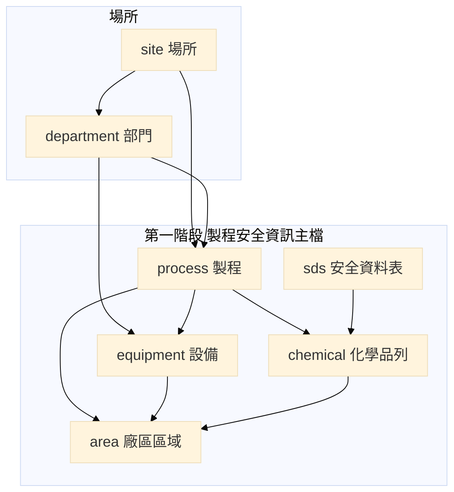

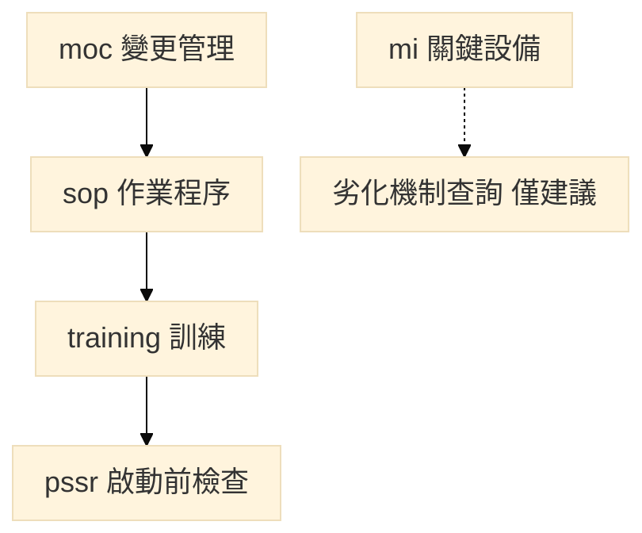

三階段語意（手冊「系統導引與跨模組數據」）：

| 階段 | 做什麼 | 不得做什麼 |
| --- | --- | --- |
| 一 | 以製程、設備、化學品、部門、區域編號為唯一鍵；後續單元選號帶名 | 另打一套名稱；把該製程全部化學品自動寫入每一台設備內容物 |
| 二 | 變更案件能對到 SOP 修訂、訓練及 PSSR 結案 | 自動裁罰 |
| 三 | 材質類別、操作溫度、內容物齊全後，連線劣化機制查詢，人員確認後填入表8.1-1 | 查詢結果匯入填報介面、代替風險評分、自動判定漏列、代填檢查逾期 |

### 1.1 第一次填報 DAG

這張只畫組裝順序：誰必須先存在，下一步才能填。精靈從場所到製程／設備／化學品再到「建立 (1)」，這一段是 DAG；送審快照是凍結的圖。變更回寫 PSI、檢查更新場所現況、事故餵回評估不畫在這裡——那些摺回 (1) 會成環，不是這張圖的切面。

上半部對簡報骨架：場所邊界 → PSI 基本資料／製程流程表 → P&ID 餵設備管線、SDS 餵化學品清單 → 收斂成建立 (1)。實線＝先有才能建；虛線＝不引用三表（不是可選）。下圖直向串接，同層掛件並非運轉先後。

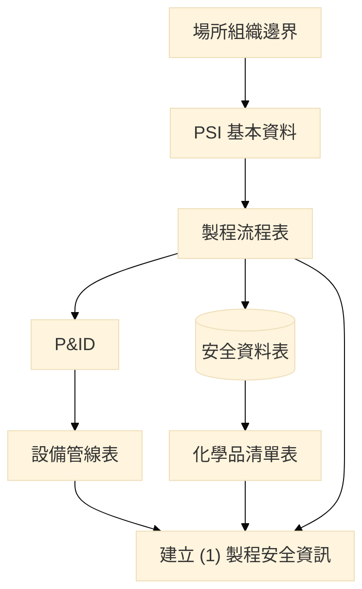

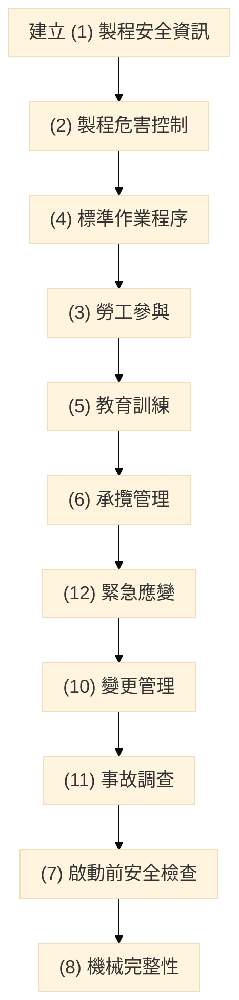

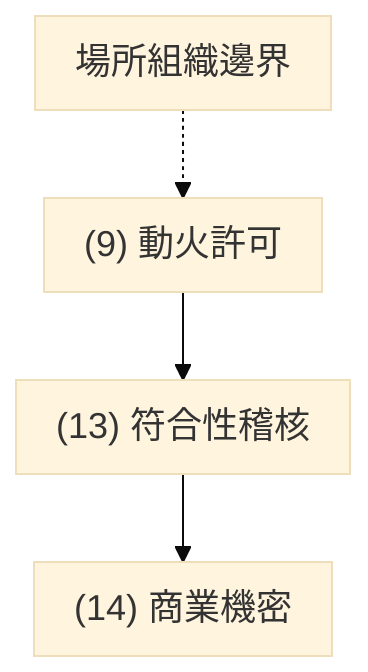

| 區塊 | DAG 上的意思 | 對到實體 |
| --- | --- | --- |
| 場所組織邊界 | 甲類範圍與部門先存在 | `site`、`department` |
| PSI 基本資料／製程流程表 | 製程編號是後面選取的鍵 | `process` |
| P&ID → 設備管線表 | 圖號對位號；設備屬製程 | `equipment`、附件 P&ID |
| SDS → 化學品清單 | 清單引用 SDS，不改寫本文 | `sds`、`chemical` |
| 建立 (1) | 清單齊備後填 1.1～1.11 | 第一章視圖 |
| (2) 及以下掛件 | 第一次把程序／清冊寫上；選 (1) 已有編號 | 第二至十四章 |
| (9)(13)(14) | 不引用製程／設備／化學品三表 | 動火、稽核、機密 |

---

## 2. 核心主檔 ER

主檔五本：場所、部門、製程、設備、化學品。廠區區域與 SDS 為清單配套實體。化學品填報列以「製程＋SDS＋CAS」存一列；後續單元選取時合併為「CAS＋製程」。

欄位見下節實體表。關係改直向流程圖（Mermaid ER 會橫向展開，匯出後字過小）。

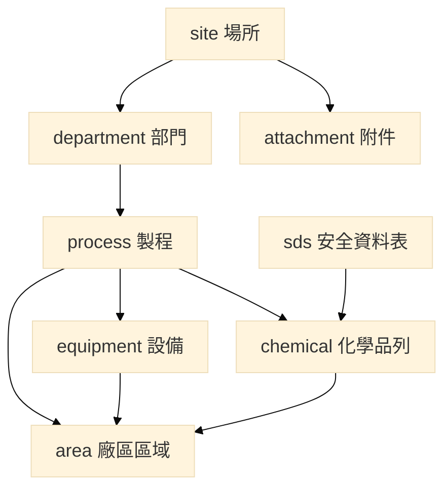

### 2.1 識別鍵（填報通則）

| 對象 | 場所內唯一鍵 | 後續單元選取方式 |
| --- | --- | --- |
| 部門 | `dept_id` | 選部門編號，帶出名稱 |
| 製程 | `process_id` | 選製程編號，帶出名稱、操作部門 |
| 設備 | `equipment_id`（＝現場位號） | 選設備編號，帶出名稱、類型、所屬製程、材質 |
| 化學品（填報列） | `process_id`＋`sds_id`＋`cas` | — |
| 化學品（引用） | `cas`＋`process_id` | 同一 CAS 於同一製程有多列混合物時合併為一筆；數量加總 |
| 區域 | `area_id` | 選區域編號，帶出名稱、是否集合點 |
| SDS | `sds_id` | 與化學品列勾稽；防護衣／濾罐得帶入應變表 |

設備所在區域不在設備清單另開欄，而由 **表1.0-5 關聯設備** 勾選（`area_equipment`）。

---

## 3. 十四項掛件與引用關係

實線＝選編號；虛線＝帶入後人員確認。嚴重度、可能性、風險等級、是／否、附件全文不得自清單帶出。下圖直向拆開。

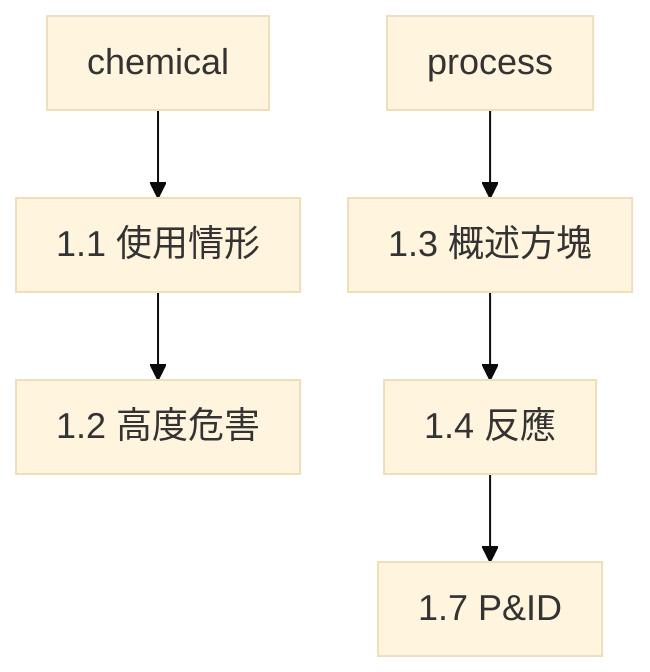

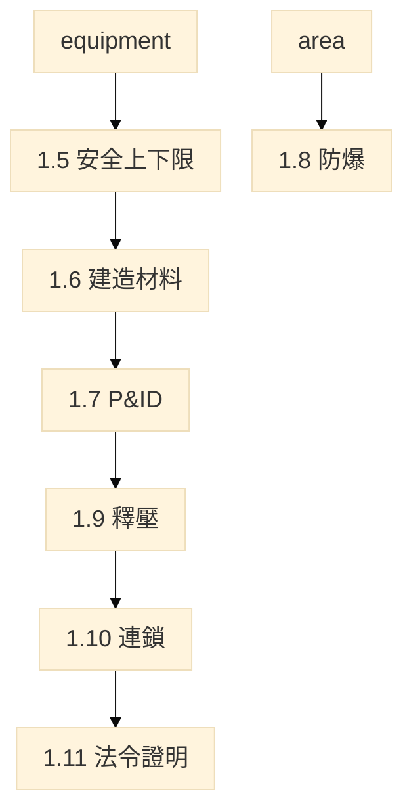

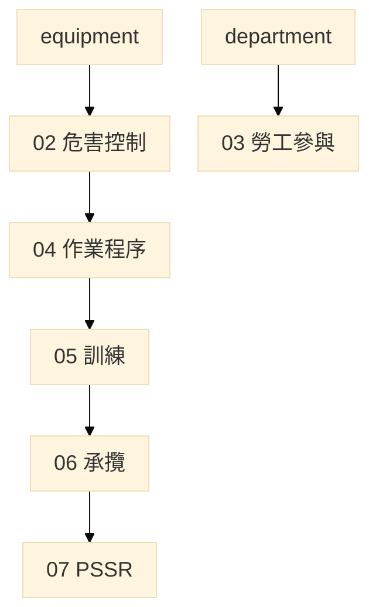

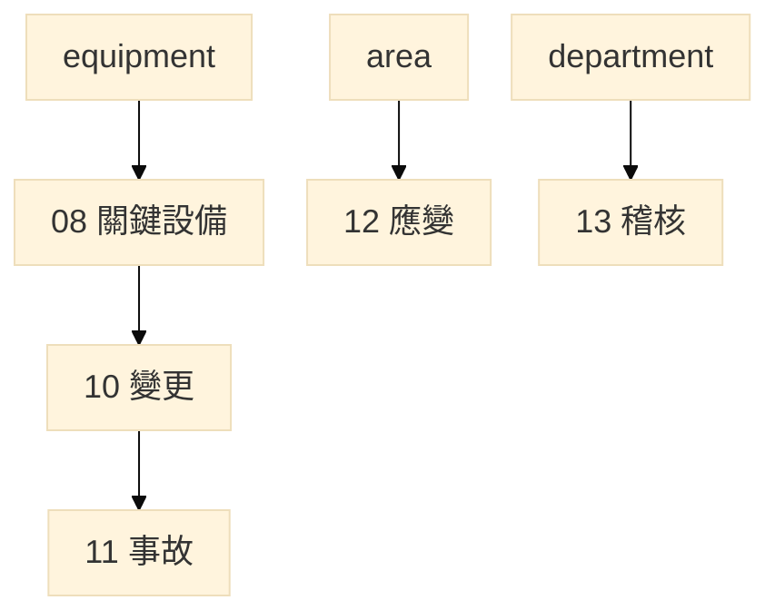

章與主檔依賴：

| 章 | 必引主檔 | 可帶入、人員確認 | 本單元自填、不得帶出 |
| --- | --- | --- | --- |
| 01 製程安全資訊 | 清單自建 | SDS／特化表物化性質、危害說明→危有 | 安全上下限數值、熱安定性、連鎖設定 |
| 02 危害控制 | 製程、設備 | 設備名稱編號 | 評估方法、數量、風險準則、情境、改善 |
| 03 勞工參與 | 部門 | 部門名稱 | 十三項參與方式、程序附件 |
| 04 作業程序 | 製程、設備、1.5、1.10 | 設備類型預產生 SOP 列；1.5 上下限 | 程序名稱、臨時／緊急項目、偏移後果 |
| 05 教育訓練 | 製程、部門、4.1 | 程序名稱、部門名稱 | 課程、時數、對象 |
| 06 承攬 | 製程或設備；場所無承攬聲明 | 編號與名稱 | 承攬人、期間、事故、確認 |
| 07 PSSR | 設備 | 名稱、所屬製程 | 執行時間、改善、追蹤 |
| 08 機械完整性 | 設備、1.5、1.6、1.7、區域、內容物 | 材質、P&ID、溫度、內容物候選 | 六大類、損壞機制、方法頻率、失效率 |
| 09 動火 | 得選設備或區域 | — | 四項是／否；無動火據實填 |
| 10 變更 | 製程、設備或化學品 | 名稱 | 變更編號、完成時間、改善追蹤 |
| 11 事故 | 製程、設備、化學品 | 所涉編號名稱 | 確認事項、五年事故列 |
| 12 緊急應變 | 製程、化學品、SDS、區域 | 集合點、防護衣／濾罐 | 緊急狀況、確認事項、器材 |
| 13 稽核 | 部門名稱（填報主體非三清單） | — | 計畫、是否初次、不符合事項 |
| 14 商業機密 | 不以三清單為主體 | — | 三項是／否 |

---

## 4. 實體表一覽（建議建庫）

型別慣例：`text` 字串；`int` 整數；`num` 數量；`bool` 是非；`date` 日期；`enum` 限定選項。未標必填者見各表「必填」欄。

### 4.1 場所與清單

#### `site`　場所（表1.0-1 場所欄）

| 欄位 | 型別 | 必填 | 說明 |
| --- | --- | --- | --- |
| site_id | text PK | 是 | 系統產生 |
| company_name | text | 是 | 事業單位名稱 |
| site_name | text | 是 | 場所名稱 |
| class_a_scope | text | 是 | 甲類範圍；圖資另上傳 |
| worker_count | int | 是 | 場所勞工人數 |
| declare_no_equipment_types | enum[] | 有則填 | 無某設備類型聲明；複選 §6.1 八類，有聲明不得再虛構該類列 |
| declare_no_contractor | bool | 有則填 | 無承攬 → 表6.1-1 免填 |
| declare_no_hotwork | bool | 有則填 | 無動火 → 表9.1-1 據實填 |
| declare_no_incident_5y | bool | 有則填 | 近五年無事故 |

#### `department`　部門（表1.0-1 部門欄）

| 欄位 | 型別 | 必填 | 說明 |
| --- | --- | --- | --- |
| dept_id | text PK | 是 | 場所內唯一 |
| site_id | text FK | 是 | → site |
| name | text | 是 | 名稱只在此維護 |
| headcount | int | 是 | 該部門人數 |

#### `process`　製程清單（表1.0-2）

| 欄位 | 型別 | 必填 | 說明 |
| --- | --- | --- | --- |
| process_id | text PK | 是 | 場所內唯一 |
| site_id | text FK | 是 | → site |
| name | text | 是 | 製程名稱 |
| operating_dept_id | text FK | 是 | → department |
| mode | enum | 是 | 連續／批次 |
| has_reaction | bool | 是 | 是 → 須填 1.4、1.5 反應上下限 |
| has_overpressure | bool | 是 | 是 → 須填 1.10 |
| is_downstream | bool | 建議 | 是否後段處理／汙染控制單元 |

#### `equipment`　設備清單（表1.0-3）

| 欄位 | 型別 | 必填 | 說明 |
| --- | --- | --- | --- |
| equipment_id | text PK | 是 | 與現場位號相同 |
| site_id | text FK | 是 | → site |
| process_id | text FK | 是 | → process |
| maint_dept_id | text FK | 是 | → department（可與操作部門不同） |
| name | text | 是 | 正式名稱 |
| alias | text | 否 | 俗稱；勾稽不用俗稱 |
| equipment_type | enum | 是 | 八類擇一，見 §6.1 |
| power_kind | enum | 類型＝動力來源時 | 泵浦／氣動／其他 |
| phase_class | enum | 是 | 液體／氣體／後段處理 |
| is_safety_critical | bool | 是 | 是者 1.9 引用；如破裂片、氣體感測器、排放閥 |
| is_regulated_machinery | bool | 是 | 職安法第 16 條；是者須填 1.11 |
| construction_material | text | 建議 | 規格名稱，與 1.6 相同 |
| material_category | enum | 是 | 對劣化機制查詢材質選項，見 §6.2 |

控制系統與緊急停車系統應分列。槽組含儲槽與泵者分列兩筆。無某類型於場所聲明。所在區域見 `area_equipment`。

#### `sds`　安全資料表（手冊未另給表號，清單配套）

| 欄位 | 型別 | 必填 | 說明 |
| --- | --- | --- | --- |
| sds_id | text PK | 是 | SDS 代號 |
| site_id | text FK | 是 | → site |
| substance_or_mixture_name | text | 是 | 純物質或混合物名稱 |
| version | text | 是 | 版本 |
| revise_date | date | 是 | 制修訂日期 |
| file_path | text | 是 | 電子檔 |
| component_cas_list | text | 是 | 所列成分 CAS（與 chemical_component 勾稽） |
| ppe_level | enum | 否 | 防護衣等級，見 §6.14；得帶入表12.2-1 |
| filter_type | enum | 否 | 濾罐型式，見 §6.14；得帶入表12.2-1 |

未帶入者，應變表仍須由人員填寫，不得僅上傳檔案。

#### `chemical_component`　化學品清單列（表1.0-4）

一列＝一張 SDS 所載純物質，或混合物 SDS 第三項每一揭露成分。不另開混合物對應表。未揭露或依法保留之成分，不虛構 CAS。

| 欄位 | 型別 | 必填 | 說明 |
| --- | --- | --- | --- |
| row_id | int PK | 是 | 系統列號 |
| process_id | text FK | 是 | → process；同一物質不同製程分列 |
| sds_id | text FK | 是 | → sds |
| purity_or_mixture | enum | 是 | 純物質／混合物 |
| mixture_name | text | 混合物必填 | 純物質免填 |
| cas | text | 是 | 化學品代號＝成分 CAS No. |
| name | text | 是 | 成分名稱 |
| role | enum | 是 | 原料／中間產物／產物／副產物／觸媒／清洗劑／其他，見 §6.6 |
| h_codes | enum[] | 是 | 成分危害說明（GHS H）；下拉可多筆，中英文見 §6.7 |
| pct_low | num | 混合物必填 | 成分比例下限 |
| pct_high | num | 混合物必填 | 上限；範圍者歸屬量採上限 |
| pct_basis | enum | 混合物必填 | 重量比／體積比／重量／體積比 |
| mixture_qty | num | 混合物必填 | 混合物總量 |
| attributed_qty | num | 是 | 純物質填該物質數量；混合物＝總量×比例 |
| conversion_note | text | 總量與比例基準不同時 | 換算式及資料來源 |
| qty_is_estimate | bool | 範圍估算時 | 標示為估算值 |

引用規則：後續單元以 **CAS＋製程** 選取；同一 CAS 於同一製程來自數種混合物時，選取清單合併，帶入數量為各列 `attributed_qty` 加總。比例拆分只供數量歸屬，不取代混合物整體 GHS 分類。危害說明帶入 1.1／1.2 定性欄，不據以判斷防護、材質或評估缺漏。

#### `area`　廠區區域（表1.0-5）

| 欄位 | 型別 | 必填 | 說明 |
| --- | --- | --- | --- |
| area_id | text PK | 是 | 流水號或自定義；場所內唯一 |
| site_id | text FK | 是 | → site |
| name | text | 是 | 作業區域名稱 |
| worker_count | int | 是 | 勞工／承攬商工作人數；僅巡檢填 0 |
| is_assembly_point | bool | 是 | 是者可供表12.1-1 集合點選取 |
| drawing_no | text | 是 | 圖面 |
| drawing_rev | text | 是 | 版次 |
| drawing_file | text | 是 | 上傳檔案 |

關聯製程、設備、化學品以三張關聯表存放。設備、化學品先依該製程帶出候選，得再自行加入。

| 關聯表 | PK | 說明 |
| --- | --- | --- |
| area_process | area_id, process_id | 關聯製程項目 |
| area_equipment | area_id, equipment_id | 關聯設備；即設備所在區域 |
| area_chemical | area_id, process_id, cas | 關聯化學品 |

#### `attachment`　附件登錄（各章共用）

計畫、規章、圖檔上傳，並登錄名稱及日期。P&ID／廠區位置圖另須圖號、版次、制修訂日期及所屬製程或涵蓋設備，未填者不列入製程安全資訊圖資列。

| 欄位 | 型別 | 必填 | 說明 |
| --- | --- | --- | --- |
| attachment_id | int PK | 是 | |
| site_id | text FK | 是 | |
| unit_no | int | 是 | 1～14 |
| table_no | text | 是 | 手冊表號 |
| name | text | 是 | 文件名稱 |
| doc_date | date | 是 | 日期 |
| process_id | text FK | 視表 | 如評估紀錄所屬製程 |
| equipment_id | text FK | 視表 | 如檢測位置圖 |
| kind | enum | 是 | 附件種類，見 §6.16 |
| path | text | 是 | |

---

### 4.2 第一章　製程安全資訊（1.1～1.11）

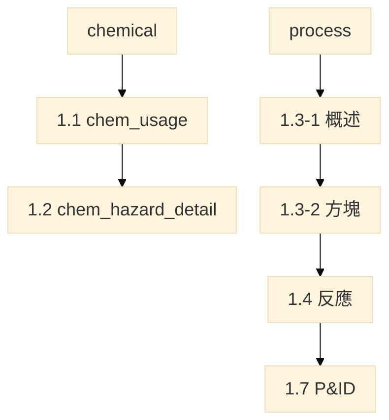

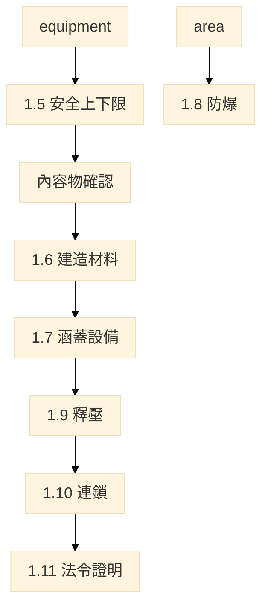

#### `chem_usage`　表1.1-1 危害性化學品製造、處置、使用

選 `cas`＋`process_id`。帶出：中英文名、CAS、操作部門、所在區域、最大存量（同 CAS＋製程歸屬量加總）。人員填：月用量、最大庫存、管制法規；危／有／高燃／高毒得依危害說明建議勾選後改勾。

| 欄位 | 型別 | 來源 |
| --- | --- | --- |
| process_id, cas | PK | 選 1.0-4 |
| name_zh, name_en | text | 帶出 |
| operating_dept_id | text FK | 帶出製程操作部門 |
| max_inventory_kg | num | 帶入加總，不符可改 |
| monthly_use_kg | num | 人員填；危害成分總量 |
| is_dangerous | bool | 危；H2xx 建議勾 |
| is_harmful | bool | 有；H3xx／H4xx 建議勾 |
| is_highly_flammable | bool | 高燃；H220–H223 建議勾 |
| is_highly_toxic | bool | 高毒；H300/301/310/311/330/331 建議勾 |
| area_id | text FK | 帶出所在區域 |
| control_regulation | text | 人員填 |

#### `chem_hazard_detail`　表1.2-1 高度危害化學品清單與危害

| 欄位 | 型別 | 來源 |
| --- | --- | --- |
| process_id, cas | PK | 選 1.0-4 |
| name_zh, name_en | text | 帶出 |
| concentration_wt_pct | num | 得自 1.0-4 成分比例；多列由人員確認 |
| threshold_qty | num | 管制數量；人員填 |
| appearance | enum | 固／液／氣，見 §6.8 |
| odor | text | 人員填 |
| vapor_pressure_mmhg | num | 得自 SDS，人員確認 |
| boiling_c, flash_c | num | 同上 |
| explosion_limit_pct | text | 同上 |
| twa_stel_ceiling | text | 同上 |
| physical_hazard_cns | enum | 危害說明→CNS 15030 物理性危害類，見 §6.8 |
| health_hazard_cns | enum | 危害說明→CNS 15030 健康危害類，見 §6.8 |
| incompatible_air_water | bool | H260／H261 建議勾是 |
| thermal_chemical_stability | text | 人員填 |

#### `process_overview`　表1.3-1

選表1.0-2 製程編號，帶出名稱。每製程一列概述。

| 欄位 | 型別 | 說明 |
| --- | --- | --- |
| process_id | PK FK | 選 1.0-2，帶出名稱、連續／批次、有無反應 |
| overview | text | 製程概述 |

#### `process_flow_block`　表1.3-2（每製程最多 15 格；線上填，不另傳方塊圖）

方塊是該製程的運作順序，不是另打一套名稱。所屬製程必選表1.0-2，後續可由方塊追回製程清單。方塊得選**該製程**已列設備（表1.0-3），帶出名稱與類型；未對到設備者只填方塊名稱。下一序號連同製程內下一方塊，空白＝本製程結束。物流接往另一製程者，選表1.0-2 的下一製程，不得另打名稱。

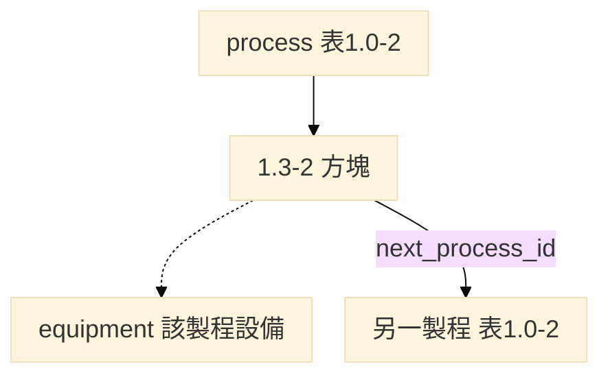

| 欄位 | 型別 | 說明 |
| --- | --- | --- |
| process_id | PK FK | 選 1.0-2；帶出名稱。與 seq_no 合為列鍵 |
| seq_no | PK | 1～15 |
| block_name | text | 方塊名稱；有選設備則帶出，可改 |
| equipment_id | text FK | 可空；限該 process_id 之設備 |
| description | text | 說明 |
| next_seq_no | int | 同製程下一方塊；空白＝本製程結束 |
| next_process_id | text FK | 可空；接往 1.0-2 另一製程，不得等於 process_id |

#### `process_reaction`　表1.4-1

僅 `has_reaction=是` 之製程。反應種類可複選。

| 欄位 | 型別 | 說明 |
| --- | --- | --- |
| reaction_id | PK | |
| process_id | FK | |
| reaction_kinds | enum[] | 氧化、硝化、鹵化、有機金屬化、偶氮化、氫化、裂解／熱分解、聚合、磺化、縮合、其他 |
| equation | text | 最多十五式 |
| heat | text | 反應熱 |

#### `equipment_limit`　表1.5-1 安全上下限

選設備編號。內容物自該製程已列化學品選取，人員確認；**不得**把該製程全部化學品自動寫入。不得填品質管制用操作界限。

| 欄位 | 型別 | 說明 |
| --- | --- | --- |
| equipment_id | PK FK | 帶出名稱 |
| p_max, p_min, p_design, p_safe_hi, p_safe_lo | num | kg/cm²G |
| t_c | num | 溫度 ℃；第八章查詢必備 |
| flow_m3h | num | 流量 |
| composition_pct | text | 組成 % |
| volume_l | num | 容積 L |
| note | text | |

`equipment_content`（equipment_id, process_id, cas）：該設備實際裝填或流經之物質。無製程化學品者註明。

#### `design_code`／`equipment_material`　表1.6-1

建造材料與材質類別只填一次。第八章表8.1-1 帶出，不得另填一套。材質類別必須是本署劣化機制查詢選項；規格名稱（如 SS316L）須先歸入類別。

| 欄位 | 型別 | 說明 |
| --- | --- | --- |
| equipment_id | PK FK | 帶出名稱 |
| material_category | enum | 對劣化機制查詢，見 §6.2 |
| construction_material／material | text | 規格名稱，與設備清單同步 |
| spec／code_name | text | 設計規範及標準名稱；人員填 |
| corrosion_allowance | text | 選填 |

#### `pid_drawing`／`pid_covering`　表1.7-1

未填圖號及日期者該列未完成。涵蓋設備選已建立設備。

| pid_drawing | 型別 | 說明 |
| --- | --- | --- |
| drawing_no, revision | PK | 圖號＋版次 |
| process_id | FK | 所屬製程 |
| name | text | 設備／系統／製程／區域名稱 |
| issue_date | date | 最新制修訂日期 |
| eval_record_no | text | 評估紀錄編號 |
| file_path | text | 圖檔 |

`pid_covering`：`(drawing_no, revision, equipment_id)`。

#### `explosion_zone`　表1.8-1 防爆區域劃分

區域選 1.0-5；指標化學品選 CAS，帶出 SDS 物化性質，人員確認。詳圖得存廠備查。

| 欄位 | 型別 | 說明 |
| --- | --- | --- |
| area_id | PK FK | 帶出區域名稱 |
| location, floor | text | 位置、樓層 |
| indicator_cas | text | 指標化學品 |
| component | text | 成分 |
| flash_c, boiling_c, rel_density, expl_limit, autoignition_c | num/text | 得自 SDS |
| vent_type | enum | N 自然／A 人工，見 §6.9 |
| vent_level | enum | VH 高度／VM 中度／VL 低度，見 §6.9 |
| vent_availability | enum | A 良好／B 中等／C 差，見 §6.9 |
| leak_grade | enum | C 連續／P 主要／S 次要 |
| hazard_zones | enum[] | 0／1／2 區，可複選 |
| equipment_selection | text | 例：IIC T1 |

#### `relief_device`　表1.9-1

引用已標安全關鍵之設備。無安全關鍵設備則本節註明、免填。釋放物選 CAS；安裝位置帶出設備所在區域；P&ID 得自 1.7 帶入。

| 欄位 | 型別 | 說明 |
| --- | --- | --- |
| relief_id | PK | 釋壓裝置編號 |
| equipment_id | FK | 安全關鍵設備 |
| device_type | enum | 釋壓裝置類型，見 §6.10 |
| calc_doc_no | text | 計算書標號；人員填 |
| spec_doc_no | text | 規格文件編號 |
| drawing_no | text | P&ID |
| area_id | FK | 安裝位置（帶出） |
| release_cas | text | 釋放物 |
| phase | enum | 氣體／液體／氣液兩相／固體，見 §6.10 |
| set_pressure | num | kg/cm² |
| design_discharge_m3h | num | 設計排放量 |
| nozzle_mm | text | 出入口尺寸 |
| overpressure_case | text | 過壓計算情境 |
| design_basis | text | 設計依據 |

#### `safety_interlock`　表1.10-1

選設備編號。緊急停車條件見表4.3-1。

| 欄位 | 型別 | 說明 |
| --- | --- | --- |
| interlock_id | PK | 安全連鎖編號／名稱 |
| equipment_id | FK | 系統／單元 |
| impl_type | enum | 硬體／軟體 |
| function_desc | text | 安全功能；人員填 |
| normal_setpoint | text | 正常操作設定值 |
| prealarm_setpoint_action | text | 預警設定值及動作 |
| alarm_setpoint_action | text | 警報設定值及動作 |
| reset_mode | enum | 自動／手動 |

#### `legal_certificate`　表1.11-1

僅 `is_regulated_machinery=是`。編號與設備清單相同，不得另編。無此類型者註明。

| 欄位 | 型別 | 說明 |
| --- | --- | --- |
| equipment_id | PK FK | 帶出名稱 |
| legal_class | enum | 職安法第 16 條類別，見 §6.11 |
| cert_no | text | 檢查合格證號碼 |
| expire_date | date | 合格證有效期限 |

---

### 4.3 第二章　製程危害控制措施

引用：製程、概述、設備、1.9、1.10。嚴重度與可能性由評估小組判定，不自清單帶出。

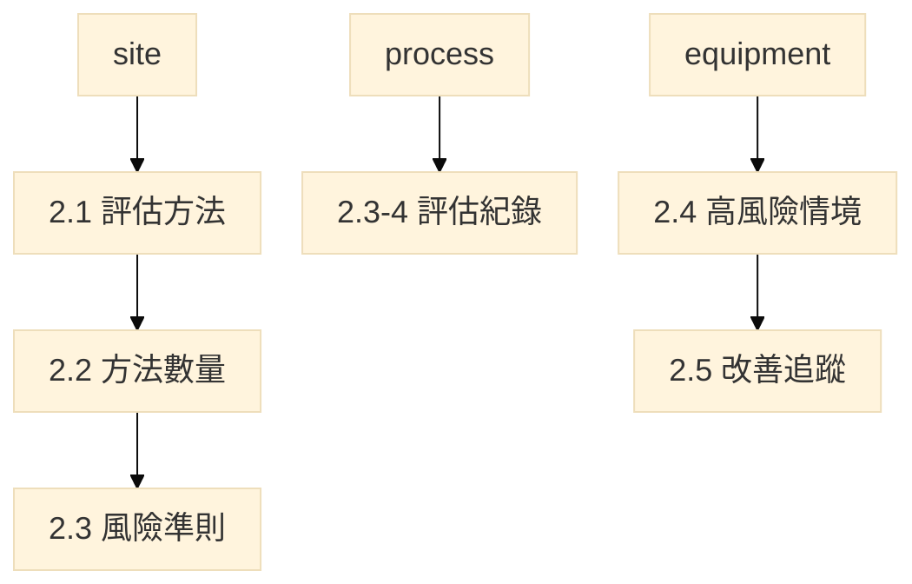

| 實體 | 手冊表 | 欄位 |
| --- | --- | --- |
| pha_method | 2.1-1 | method（七種固定列）、adopted（是否採用）、consideration |
| pha_method_count | 2.2-1 | method、qty_name（問題項／節點／元件／頂端事件）、quantity；未採用者空白 |
| pha_severity_level | 2.3-1 | grade、description、note |
| pha_likelihood_level | 2.3-2 | grade、description、note |
| pha_risk_level | 2.3-3 | grade、action_desc、note |
| pha_record | 2.3-4 | name、doc_date、process_id、method；檔案走 attachment |
| pha_scenario | 2.4-1 | seq、equipment_id（帶出名稱）、scenario、existing_safeguard、note |
| pha_recommendation | 2.5-1 | seq、equipment_id、existing_safeguard、recommendation、due_date、follow_up、note |

場所另登錄改善建議數量、已完成、尚未完成（可作 `pha_recommendation` 彙總或獨立計數欄）。

評估方法固定列：檢核表；如果－結果；如果－結果／檢核表；HAZOP；FMEA；FTA；其他經中央主管機關認可。

---

### 4.4 第三章　勞工參與

十三項固定列出，不得刪列。參與人員或部門選 `dept_id`。

| 實體 | 手冊表 | 欄位 |
| --- | --- | --- |
| worker_participation | 3.1-1 | item_no（1～13 PK）、psm_item、activity、dept_id、note |
| worker_participation_doc | 3.2-1 | name、doc_date（＋attachment） |

十三項名稱：製程安全資訊；製程危害控制措施；標準作業程序；教育訓練；事故調查；承攬管理；動火許可；變更管理；啟動前安全檢查；機械完整性；緊急應變；符合性稽核；商業機密。

---

### 4.5 第四章　標準作業程序

依設備清單**已存在之設備類型**預產生至少一筆 SOP；同類型可增列，刪至一筆不得再刪。場所已聲明不具之類型不產生列。表4.2～4.5 選設備編號，帶出名稱、類型、所屬製程。程序全文為附件。

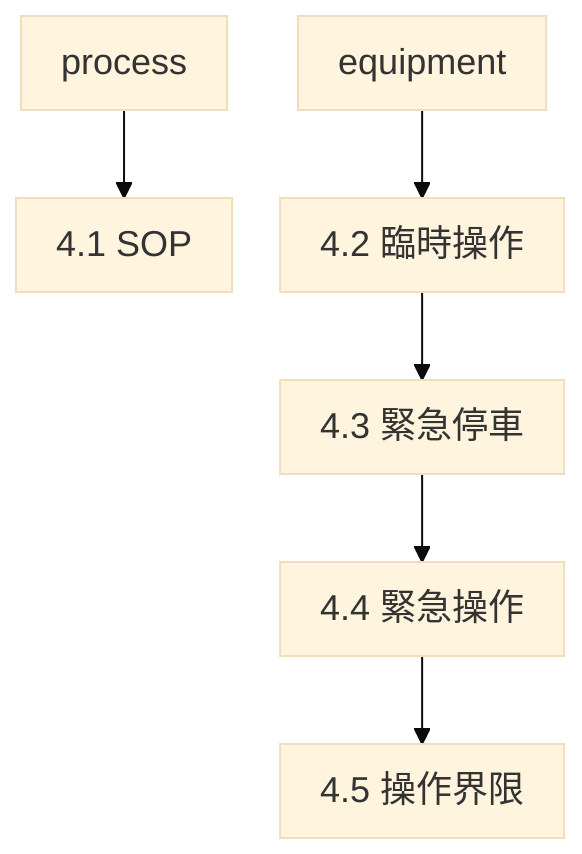

| 實體 | 手冊表 | 欄位 |
| --- | --- | --- |
| sop | 4.1-1 | sop_id PK（場所內唯一）、equipment_type（§6.1 八類）、name、process_id、repr_equipment_id、note |
| sop_temp_operation | 4.2-1 | seq、equipment_id、item、note |
| sop_esd_condition | 4.3-1 | seq、equipment_id、condition、note |
| sop_emergency_operation | 4.4-1 | seq、equipment_id、item、note |
| sop_operating_limit | 4.5-1 | seq、equipment_id、safe_limit（優先帶入 1.5）、deviation_consequence、corrective_action、note |

---

### 4.6 第五章　教育訓練

| 實體 | 手冊表 | 欄位 |
| --- | --- | --- |
| training_sop_course | 5.1-1 | seq、course_name、dept_id、hours、process_id、sop_id、note |
| training_onjob_course | 5.1-2 | seq、course_name、dept_id、hours、process_id、note |

教材、簽到、測驗 → `attachment`。

---

### 4.7 第六章　承攬管理

場所已聲明無承攬者免填。所涉製程或設備選編號。

#### `contractor_incident`　表6.1-1

| 欄位 | 型別 | 說明 |
| --- | --- | --- |
| incident_id | PK | 項次 |
| contractor_name | text | 承攬人／廠商 |
| contract_period | text | 承攬期間 |
| occur_date | date | 事故發生日期 |
| incident_type | enum | 見 §6.13 |
| summary | text | 事故摘要 |
| death_n, disable_n, non_disable_n, lost_days | int | 傷亡與損失日數 |
| cause | text | 得列直接／間接／基本原因 |
| corrective | text | 改善措施 |
| process_id / equipment_id | FK | 所涉製程或設備（擇一或並存） |

無事故據實註明。選商、告知、評核 → attachment。

---

### 4.8 第七章　啟動前安全檢查

無新建或重大修改、尚未引入危害性化學品、或無適用案件者據實註明。

#### `pssr_record`　表7.1-1

| 欄位 | 型別 | 說明 |
| --- | --- | --- |
| pssr_id | PK | 項次 |
| equipment_id | FK | 帶出名稱、所屬製程 |
| exec_time | text/date | 執行時間 |
| recommendation | text | 改善建議 |
| due_date | date | 預定完成日期 |
| follow_up | text | 追蹤檢核結果 |
| note | text | |

---

### 4.9 第八章　機械完整性

表8.0-1 是連線查詢**條件對照**，不另開填報列。條件不齊全不得連線帶出。查詢結果僅建議，人員確認後寫入表8.1-1，不匯入填報介面。

設備八類對六大類：壓力容器與儲槽→壓力容器與儲槽；管線系統→管線(包括管線組件如閥)；釋放及排放系統→釋放及排放系統和設備；緊急停車系統→緊急停車系統；控制系統→控制系統；動力來源中之泵浦→泵浦(轉動設備)；裝卸及輸送、其他由人員歸入六類之一。編號與第一章相同。

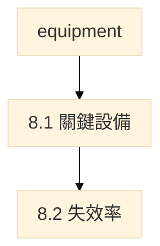

#### 表8.0-1　連線查詢必備（不建資料列）

| 查詢條件 | 來源 | 不齊全時 |
| --- | --- | --- |
| 材質類別 | equipment_material.material_category（與設備清單同步） | 不得帶出建議 |
| 操作溫度 ℃ | equipment_limit.t_c，查詢時人員確認 | 不得帶出建議 |
| 內容物 | equipment_content | 僅能作部分篩選 |
| 介質發生條件 | 本署查詢畫面勾選，不開填報表 | 對應機制不得自動帶出 |
| 保溫或防火包覆 | 同上 | CUI 不得自動帶出 |
| 銲道、異種金屬、振動等 | 同上 | 對應機制不得自動帶出 |

CAS 或危害說明不能代替介質發生條件。規格名稱（如 SS316L）須先歸入材質類別。

#### `mi_critical_item`　表8.1-1

不得以全廠設備清單代替關鍵性設備清單。六大類僅得選下列六項，不得自訂。

| 欄位 | 型別 | 來源 |
| --- | --- | --- |
| equipment_id | PK FK | 第一章 |
| process_id | FK | 帶出 |
| area_id | FK | 帶出 |
| mi_class | enum | 六大類；人員選，見 §6.3 |
| contents | text | 內容物候選帶入，人員確認 |
| material_category | enum | 帶出表1.6-1 |
| selected_material | text | 選用材質；帶出表1.6-1，不可在本章另填 |
| damage_mechanism | text | 查詢建議＋人員確認 |
| test_method | enum | 檢查及測試方式，見 §6.12；含其他 |
| test_freq | text | 頻率 |
| procedure_no | text | 檢查測試程序書編號 |
| drawing_no | text | P&ID 帶入 |

#### `mi_failure_rate`　表8.2-1

故障修復次數＝運轉中不能正常運行的修復，不含定期保養。

| 欄位 | 型別 | 說明 |
| --- | --- | --- |
| equipment_id | PK FK | 帶出名稱、類型 |
| cumulative_hours | num | 累計使用時間 |
| repair_count | int | 故障修復次數 |
| failure_rate | num | 失效率 |
| note | text | |

---

### 4.10 第九章～第十四章

下列確認表多為場所層一列（是／否）。執行紀錄為多列並掛主檔編號。

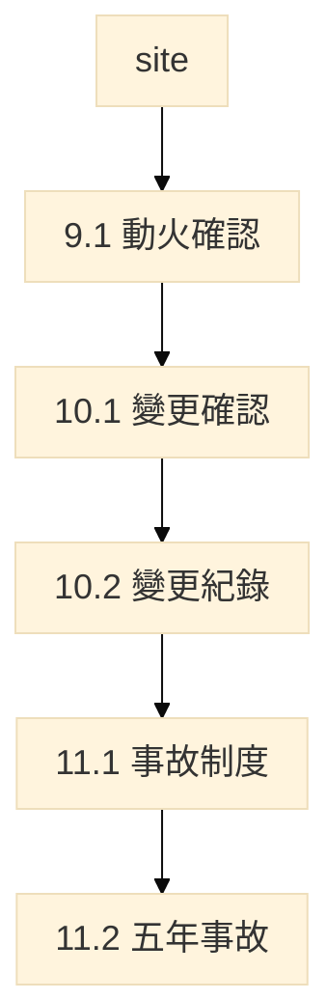

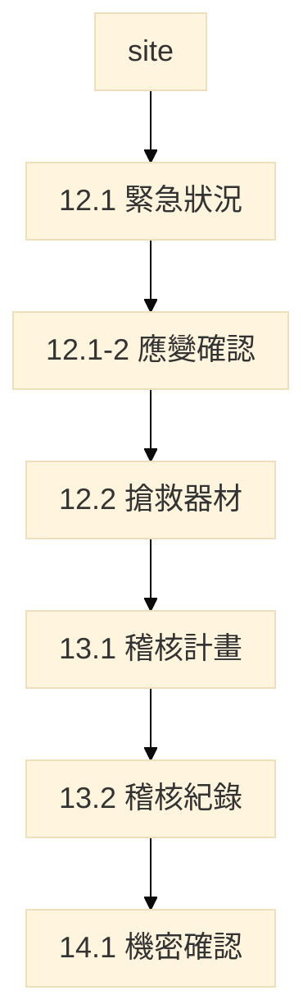

#### `hotwork_confirm`　表9.1-1（各欄是／否）

火災預防及保護措施；核可動火作業日期；動火作業對象；動火作業期間。動火對象如需指明設備或區域，得選主檔編號。程序全文 → attachment。

#### `moc_summary`　表10.1-1

| 欄位 | 型別 | 說明 |
| --- | --- | --- |
| has_mod_definition | bool | 程序已含「製程修改」定義 |
| all_new_no_moc | bool | 全部新建、無需變更管理；是則 10.1-2 免填 |
| rec_count, done_count, open_count | int | 改善建議數量 |

#### `moc_record`　表10.1-2

| 欄位 | 型別 | 說明 |
| --- | --- | --- |
| moc_id | PK | 變更管理編號 |
| process_id / equipment_id / cas | FK | 設備／系統／單元，擇一或多選，帶出名稱 |
| complete_time | date | 完成變更管理時間 |
| recommendation | text | |
| due_date | date | |
| follow_up | text | |
| note | text | |

#### `incident_system_confirm`　表11.1-1（各欄是／否）

含虛驚；含製程事件；已訂調查 SOP（小組至少一人熟知該製程；涉及承攬應含承攬人勞工）；報告含法定項目並保存五年以上；已建立迅速處理建議之系統；報告應與相關作業人員（含承攬人勞工）檢討。

#### `incident_record`　表11.2-1

| 欄位 | 型別 | 說明 |
| --- | --- | --- |
| incident_id | PK | 項次 |
| occur_date | date | |
| is_fire, is_explosion, is_chem_release, is_near_miss | bool | |
| summary | text | |
| death_n, disable_n, non_disable_n, lost_days | int | |
| cause | text | 得列直接／間接／基本 |
| corrective | text | |
| related_to_process | bool | 是否與製程有關 |
| in_class_a | bool | 是否甲類場所 |
| process_id / equipment_id / cas | FK | 所涉編號 |
| note | text | 多個甲類場所時寫名稱 |

成立未滿五年者以成立至送審件數為準。無案件據實註明。

#### `emergency_case`　表12.1-1

每一列應對製程、化學品及區域。集合點僅能選 `is_assembly_point=是` 之區域。無對應者據實註明。

| 欄位 | 型別 | 說明 |
| --- | --- | --- |
| case_id | PK | 項次 |
| emergency_type | enum | 見 §6.13；含其他 |
| process_id | FK | |
| cas | text | 涉及化學品 |
| area_id | FK | 涉及區域 |
| assembly_area_id | FK | 集合點 |
| note | text | |

#### `emergency_plan_confirm`　表12.1-2

固定 15 列（1.1、1.2、1.3 及項次 2～13）。各項是／否；**填否須寫原因**。

| item_no | 確認事項 |
| --- | --- |
| 1.1 | 緊急應變組織架構及權責 |
| 1.2 | 緊急應變控制中心位置及設施 |
| 1.3 | 緊急應變運作流程及說明 |
| 2 | 指派應變協調指揮者並規定責任 |
| 3 | 緊急疏散程序及路徑 |
| 4 | 執行重要操作勞工疏散前程序 |
| 5 | 完全疏散後集合清點 |
| 6 | 搶救與醫療責任 |
| 7 | 火災及其他緊急事件通報方式 |
| 8 | 各項危害物質控制程序 |
| 9 | 急救處理及搜救計畫 |
| 10 | 應變設備置備與外援聯繫 |
| 11 | 災後復原（清空及再進入） |
| 12 | 演練計畫（涵蓋各種緊急狀況）與演練紀錄 |
| 13 | 緊急應變計畫之修正 |

#### `emergency_gear`　表12.2-1

區域選 1.0-5。適用化學品選 CAS。防護衣／濾罐得自 SDS 帶出，人員確認。

| 欄位 | 型別 | 說明 |
| --- | --- | --- |
| gear_id | PK | |
| name | text | 器材名稱 |
| area_id | FK | 區域名稱 |
| qty | num | 存放數量 |
| total_qty | num | 合計（同器材跨區彙總，可計算欄） |
| inspect_freq | text | 檢點頻率 |
| cas | text | 適用化學品 |
| note | text | |

#### `audit_plan`　表13.1-1

| 欄位 | 型別 | 說明 |
| --- | --- | --- |
| plan_id | PK | |
| audit_date | date | |
| audit_time | text | |
| dept_name | text | 受稽核部門 |
| psm_unit | enum | 十四項單元名稱，見 §6.15 |
| auditor | text | 稽核員 |
| note | text | |

尚未第一次稽核者附預定實施計畫。保存最近二次報告至少三年。

#### `audit_summary`　表13.2-1

是否初次申請（是則執行紀錄免填）；最近二次稽核時間；改善建議／已完成／尚未完成數量。

#### `audit_finding`　表13.2-2

不符合／可改進事項；改善措施；負責部門／人員；預計／實際完成日期；說明編號；備註。

#### `trade_secret_confirm`　表14.1-1（各欄是／否）

提供必要資訊供 PSI／危害辨識／操作程序／事故調查／應變／稽核人員作業；得要求遵守保密協議；勞工代表可獲知評估文件中之商業機密但得要求保密。未揭露成分不虛構 CAS，處理見 1.0-4。

---

## 5. 手冊表 → 實體對照（應填一覽）

計 **51** 張應填表（含表8.0-1 條件對照）。另 SDS 為未編號配套實體。

| 手冊表 | 名稱 | 實體 | 主體列鍵 | 附件 |
| --- | --- | --- | --- | --- |
| 1.0-1 | 場所與部門 | site, department | site / dept_id | 組織圖、甲類範圍圖 |
| 1.0-2 | 製程清單 | process | process_id | |
| 1.0-3 | 設備清單 | equipment | equipment_id | 合格證影本 |
| 1.0-4 | 化學品清單 | chemical_component, sds | process+sds+cas | SDS 電子檔 |
| 1.0-5 | 廠區區域 | area + 三關聯表 | area_id | 圖面 |
| 1.1-1 | 危害性化學品使用 | chem_usage | cas+process | 送審 SDS |
| 1.2-1 | 高度危害 | chem_hazard_detail | cas+process | |
| 1.3-1 | 製程概述 | process_overview | process_id | |
| 1.3-2 | 線上流程方塊 | process_flow_block | process+seq | 不另傳方塊圖；選 1.0-2，可掛該製程設備、可接下一製程 |
| 1.4-1 | 化學反應 | process_reaction | reaction_id | |
| 1.5-1 | 安全上下限 | equipment_limit, equipment_content | equipment_id | |
| 1.6-1 | 建造材料與規範 | design_code | equipment_id | |
| 1.7-1 | P&ID 清單 | pid_drawing, pid_covering | drawing+rev | 圖檔 |
| 1.8-1 | 防爆區域 | explosion_zone | area_id | 詳圖備查 |
| 1.9-1 | 釋壓系統 | relief_device | relief_id | 計算書 |
| 1.10-1 | 安全連鎖 | safety_interlock | interlock_id | |
| 1.11-1 | 法令證明 | legal_certificate | equipment_id | 證明文件 |
| 2.1-1 | 評估方法 | pha_method | method | |
| 2.2-1 | 方法數量 | pha_method_count | method | |
| 2.3-1～3 | 風險準則 | pha_*_level | grade | |
| 2.3-4 | 評估紀錄上傳 | pha_record | 檔案列 | 工作表、簽認、會議 |
| 2.4-1 | 高風險情境 | pha_scenario | seq | |
| 2.5-1 | 改善追蹤 | pha_recommendation | seq | |
| 3.1-1 | 勞工參與方式 | worker_participation | item 1～13 | |
| 3.2-1 | 參與程序文件 | worker_participation_doc | 檔案列 | 程序或計畫 |
| 4.1-1 | SOP 清單 | sop | sop_id | 程序全文 |
| 4.2-1 | 臨時操作 | sop_temp_operation | seq | |
| 4.3-1 | 緊急停車條件 | sop_esd_condition | seq | |
| 4.4-1 | 緊急操作 | sop_emergency_operation | seq | |
| 4.5-1 | 操作界限 | sop_operating_limit | seq | |
| 5.1-1 | SOP 訓練 | training_sop_course | seq | 教材、簽到、測驗 |
| 5.1-2 | 在職訓練 | training_onjob_course | seq | 同上 |
| 6.1-1 | 承攬事故 | contractor_incident | incident_id | 選商及告知 |
| 7.1-1 | PSSR 紀錄 | pssr_record | pssr_id | 檢查表 |
| 8.0-1 | 查詢必備 | （條件對照，非列） | — | |
| 8.1-1 | 關鍵設備 | mi_critical_item | equipment_id | 程序、檢測位置圖 |
| 8.2-1 | 失效率 | mi_failure_rate | equipment_id | 檢測紀錄 |
| 9.1-1 | 動火確認 | hotwork_confirm | site 一列 | 程序 |
| 10.1-1 | 變更確認及數量 | moc_summary | site 一列 | 程序 |
| 10.1-2 | 變更執行紀錄 | moc_record | moc_id | |
| 11.1-1 | 事故制度確認 | incident_system_confirm | site 一列 | 程序或報告 |
| 11.2-1 | 五年事故 | incident_record | incident_id | |
| 12.1-1 | 緊急狀況 | emergency_case | case_id | 計畫、路徑圖 |
| 12.1-2 | 應變確認 | emergency_plan_confirm | item_no | |
| 12.2-1 | 搶救器材 | emergency_gear | gear_id | |
| 13.1-1 | 稽核計畫 | audit_plan | plan_id | 程序及報告 |
| 13.2-1 | 稽核確認及數量 | audit_summary | site 一列 | |
| 13.2-2 | 稽核執行紀錄 | audit_finding | seq | |
| 14.1-1 | 商業機密確認 | trade_secret_confirm | site 一列 | 協議範本 |

裝卸佔用有接入製程者，以裝卸設備、製程及化學品登錄，不另立申報單元。

---

## 6. 列舉與帶入規則

入手冊用完整表（含 GHS 中英對照、貼上位置）見 [`2026-09-14-列舉選項-入手冊.md`](./2026-09-14-列舉選項-入手冊.md)。下列為建庫／下拉用值。含「其他」者，選其他須註明。

### 6.1 設備類型（表1.0-3，八類）

壓力容器與儲槽；管線系統；釋放及排放系統；緊急停車系統；控制系統；動力來源；裝卸及輸送；其他。

場所「無某設備類型」聲明（`declare_no_equipment_types`）只得複選上列八類。表4.1-1 作業程序列依已存在之類型產生。

### 6.2 材質類別（對劣化機制查詢）

碳鋼(CS)；低合金；高強度低合金(HSLA)；300系不銹鋼；400系不銹鋼；銅；鎳；鑄鐵；雙相不銹鋼；鈦合金；鋁合金；耐火材料；高分子材料；其他。

### 6.3 機械完整性六大類（表8.1-1）

壓力容器與儲槽；管線(包括管線組件如閥)；釋放及排放系統和設備；緊急停車系統；控制系統（包括監測設備、感應器，警報及連鎖系統）；泵浦(轉動設備)。

不得自訂。八類對六大類見第 8 章。

### 6.4 危害說明 → 1.1／1.2

| 已填危害說明 | CNS 15030 | 1.1 | 1.2 |
| --- | --- | --- | --- |
| H2xx（含 H290） | 物理性危害 | 危 | 對應物理性危害類 |
| H3xx | 健康危害 | 有 | 對應健康危害類 |
| H4xx | 環境危害 | 有 | 1.2 無環境欄 |
| H260、H261 | 物理性危害（禁水） | 危 | 與空氣或水不相容或放熱建議勾是 |
| H220–H223 | 物理性危害 | 危；建議高燃 | 易燃氣體或氣溶膠 |
| H300、H301、H310、H311、H330、H331 | 健康危害 | 有；建議高毒 | 急性毒性 |

「高燃」「高毒」依高壓氣體勞工安全規則，危害說明僅建議勾選，不符以人員改勾為準。同一物質兼具物理性與健康（或環境）危害者，危、有均勾。

### 6.5 特化／優先管理參考表（帶入用，非申報主表）

選成分 CAS 後得帶入物化性質、不相容、不適材質、建議防護具，供 1.2 及應變器材參考。混合物仍以該 SDS 整體分類與物化性質為準。建議實體：`ref_priority_chemical`（cas, name, is_specified, is_priority, h_codes, exposure_limits, flash_boil_expl, incompatible, unsuitable_material, ppe, filter）。

### 6.6 化學品角色（表1.0-4）

原料；中間產物；產物；副產物；觸媒；清洗劑；其他。

填「原物料」視同「原料」。選其他須註明。

### 6.7 成分危害說明 GHS H（表1.0-4，可複選）

下拉用代碼；畫面顯示「代碼　中文」。英文供對照，不另存一欄。完整中英表見入手冊檔 §2。未列之代碼不得自創；SDS 有而清單無者選「其他」並填該代碼。

**物理性（H2xx）**

H200 不穩定爆炸物；H201 爆炸物，整體爆炸危害；H202 爆炸物，嚴重拋射危害；H203 爆炸物，火災、爆轟或拋射危害；H204 火災或拋射危害；H205 火災時可能發生整體爆炸；H206 火災、爆轟或拋射危害（減敏劑減少時風險增加）；H207 火災或拋射危害（減敏劑減少時風險增加）；H208 火災危害（減敏劑減少時風險增加）；H220 極度易燃氣體；H221 易燃氣體；H222 極度易燃氣膠；H223 易燃氣膠；H224 極度易燃液體和蒸氣；H225 高度易燃液體和蒸氣；H226 易燃液體和蒸氣；H227 可燃液體；H228 易燃固體；H229 加壓容器：加熱可能爆炸；H230 即使沒有空氣也可能發生爆炸性反應；H231 即使沒有空氣，於升壓及／或升溫下也可能發生爆炸性反應；H232 暴露於空氣中可能自燃；H240 加熱可能爆炸；H241 加熱可能起火或爆炸；H242 加熱可能起火；H250 暴露於空氣中會自燃；H251 自發加熱：可能起火；H252 大量時自發加熱：可能起火；H260 與水接觸放出可自燃的易燃氣體；H261 與水接觸放出易燃氣體；H270 可能引起或加劇燃燒；氧化劑；H271 可能引起火災或爆炸；強氧化劑；H272 可能加劇燃燒；氧化劑；H280 內含加壓氣體；加熱可能爆炸；H281 內含冷凍氣體；可能造成低溫灼傷或傷害；H290 可能腐蝕金屬。

**健康（H3xx）**

H300 吞食致命；H301 吞食有毒；H302 吞食有害；H303 吞食可能有害；H304 吞食並進入呼吸道可能致命；H305 吞食並進入呼吸道可能有害；H310 皮膚接觸致命；H311 皮膚接觸有毒；H312 皮膚接觸有害；H313 皮膚接觸可能有害；H314 造成嚴重皮膚灼傷和眼睛損傷；H315 造成皮膚刺激；H316 造成輕微皮膚刺激；H317 可能造成皮膚過敏；H318 造成嚴重眼睛損傷；H319 造成嚴重眼睛刺激；H320 造成眼睛刺激；H330 吸入致命；H331 吸入有毒；H332 吸入有害；H333 吸入可能有害；H334 吸入可能造成過敏或氣喘病症狀或呼吸困難；H335 可能造成呼吸道刺激；H336 可能造成昏昏欲睡或眩暈；H340 可能造成遺傳性缺陷；H341 懷疑造成遺傳性缺陷；H350 可能致癌；H350i 吸入可能致癌；H351 懷疑致癌；H360 可能對生育能力或胎兒造成傷害；H360F 可能對生育能力造成傷害；H360D 可能對胎兒造成傷害；H360FD 可能對生育能力造成傷害；可能對胎兒造成傷害；H360Fd 可能對生育能力造成傷害；懷疑對胎兒造成傷害；H360Df 可能對胎兒造成傷害；懷疑對生育能力造成傷害；H361 懷疑對生育能力或胎兒造成傷害；H361f 懷疑對生育能力造成傷害；H361d 懷疑對胎兒造成傷害；H361fd 懷疑對生育能力造成傷害；懷疑對胎兒造成傷害；H362 可能對母乳哺育的兒童造成傷害；H370 對器官造成傷害；H371 可能對器官造成傷害；H372 長期或重複暴露會對器官造成傷害；H373 長期或重複暴露可能對器官造成傷害。

**環境（H4xx）**

H400 對水生生物毒性非常大；H401 對水生生物有毒；H402 對水生生物有害；H410 對水生生物毒性非常大並具有長期持續影響；H411 對水生生物有毒並具有長期持續影響；H412 對水生生物有害並具有長期持續影響；H413 可能對水生生物造成長期持續有害影響；H420 危害公衛及環境；破壞臭氧層。

另：其他（須填 SDS 所載代碼）。

### 6.8 外觀與 CNS 15030 危害類（表1.2-1）

外觀：固；液；氣。

物理性危害類：爆炸物；易燃氣體；氣膠；氧化性氣體；加壓氣體；易燃液體；易燃固體；自反應物質及混合物；發火性液體；發火性固體；自熱物質及混合物；遇水放出易燃氣體之物質及混合物；氧化性液體；氧化性固體；有機過氧化物；金屬腐蝕物；退敏感化爆炸物。

健康危害類：急性毒性；皮膚腐蝕／刺激；嚴重損傷／刺激眼睛；呼吸道或皮膚致敏；生殖細胞致突變性；致癌性；生殖毒性；特定標的器官系統毒性－單次暴露；特定標的器官系統毒性－重複暴露；吸入性危害。

帶入規則仍依 §6.4。人員得改選。

### 6.9 防爆通風與區域（表1.8-1）

| 欄 | 選項 |
| --- | --- |
| 通風型式 | N 自然；A 人工 |
| 通風等級 | VH 高度；VM 中度；VL 低度 |
| 通風可用度 | A 良好；B 中等；C 差 |
| 洩漏等級 | C 連續；P 主要；S 次要 |
| 危險區域 | 0 區；1 區；2 區（可複選） |

依 CNS 3376-10。設備選用等級（如 IIC T1）仍為文字。

### 6.10 釋壓裝置類型與流相（表1.9-1）

類型：安全閥（彈簧式）；安全閥（先導式）；爆破片；爆破片與安全閥組合；呼吸閥；緊急排放閥；其他。

流相：氣體；液體；氣液兩相；固體。

### 6.11 危險性機械及設備類別（表1.11-1）

依《危險性機械及設備安全檢查規則》第 2 條。僅 `is_regulated_machinery=是` 時填。

危險性機械：固定式起重機；移動式起重機；人字臂起重桿；升降機；營建用提升機；吊籠。

危險性設備：鍋爐；壓力容器；高壓氣體特定設備；高壓氣體容器。

### 6.12 檢查及測試方式（表8.1-1）

目視檢查；超音波測厚；非破壞檢測；功能測試；洩漏測試；試壓；其他。

此為填報下拉，不是劣化機制查詢結果。查詢建議由人員確認後填入；方法與頻率仍應對應該設備可能之損壞機制，不是只填一項交差。選其他須註明。

### 6.13 事故類型與緊急狀況

表6.1-1、表11.2-1 事故類型：火災；爆炸；化學品外洩；墜落；物體飛落；被夾被捲；感電；虛驚；其他。

表12.1-1 緊急狀況：火災；爆炸；毒性氣體洩漏；化學品外洩；地震；風災／水災；停電；其他。

### 6.14 防護衣與濾罐（SDS、表12.2-1）

防護衣等級：A 級；B 級；C 級；D 級；其他。

濾罐型式：有機蒸氣；酸性氣體；氨氣／胺類；粉塵／微粒；多用途；其他。

得自 SDS 帶出，人員確認。未帶入者應變表仍由人員選。

### 6.15 評估方法、勞工參與、十四項單元

表2.1-1 評估方法（七種固定列，不得刪）：檢核表；如果－結果；如果－結果／檢核表；HAZOP；FMEA；FTA；其他經中央主管機關認可。

表3.1-1 十三項（固定列出，不得刪列）：製程安全資訊；製程危害控制措施；標準作業程序；教育訓練；事故調查；承攬管理；動火許可；變更管理；啟動前安全檢查；機械完整性；緊急應變；符合性稽核；商業機密。

表13.1-1 十四項單元：製程安全資訊；製程危害控制措施；勞工參與；標準作業程序；教育訓練；承攬管理；啟動前安全檢查；機械完整性；動火許可；變更管理；事故調查；緊急應變；符合性稽核；商業機密。

### 6.16 附件種類

SDS；P&ID；程序；會議；合格證；計畫；報告；圖面；其他。

### 6.17 其餘已齊短選項

| 欄 | 選項 |
| --- | --- |
| 製程 mode | 連續；批次 |
| 動力型式 power_kind | 泵浦；氣動；其他（僅類型＝動力來源） |
| 操作分類 phase_class | 液體；氣體；後段處理 |
| 純物質或混合物 | 純物質；混合物 |
| 比例基準 | 重量比；體積比；重量／體積比 |
| 反應種類 | 氧化；硝化；鹵化；有機金屬化；偶氮化；氫化；裂解／熱分解；聚合；磺化；縮合；其他（可複選） |
| 連鎖型式 | 硬體；軟體 |
| 復歸 | 自動；手動 |

---

## 7. 填報資料流

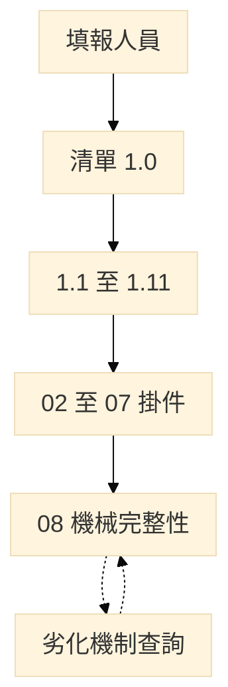

帶入規則：

- 清單：同一事實只填一次。
- PSI：選編號，系統帶出名稱與已填屬性；危害說明建議勾選，人員確認或改選。
- 02～07：選製程／設備／化學品／部門；帶出名稱、類型、1.5 上下限、1.10 停車條件。方法、風險分數、是非、附件內容不帶出。
- 08：帶入材質、溫度、內容物候選、P&ID、區域。材質＋溫度＋內容物齊全，才得於查詢畫面勾選介質／保溫／機械條件；建議由人員確認後寫入表8.1-1。條件不齊者不得連線帶出。

---

## 8. 與現行示範庫的差異（備註）

2026-09-08 起，demo（`psm/db.py`）已含 SDS 獨立表、`chemical_cite`，以及區域與製程／設備／化學品的關聯表。交給開發時以 demo 的資料表為準；手冊表號對應見本檔各節。

| 項目 | V7.3 本檔 | 現行 db.py（2026-09-08） |
| --- | --- | --- |
| 化學品列 | 製程＋SDS＋CAS | `chemical` PK＝cas+process，必填 `sds_id`；混合物比例欄在同一表 |
| SDS | 獨立實體 | `sds`；同一 CAS 兩製程列連同一 `sds_id` |
| 引用 | CAS＋製程合併 | `chemical_cite`；pec／存量／HAZOP 連 cite |
| 設備所在區域 | `area_equipment` 多對多 | 已建三張關聯表；`equipment.area_code` 僅廠區圖快取、可空 |
| 1.1／1.2／1.3 方塊 | 獨立實體 | 仍為 `filing_row` 視圖，不得另造名稱主檔 |
| 表1.0-4 角色 | 原料等 | 接受「原物料」與「原料」 |
| 第八章 | `mi_critical_item`、失效率 | 檢查列較簡；查詢不入庫 |
| 確認事項長表 | 12.1-2 十五列 | 部分仍在 flag |

本草案供事業單位及審查參考。法規條文及送審表號如有修正，以主管機關最新公告為準。
