# V8.3 資料表結構（手冊規劃導出）

- 來源：[`石化及化學工廠製程安全管理參考手冊-V8.3.docx`](../石化及化學工廠製程安全管理參考手冊-V8.3.docx)
- 導出日期：2026-09-17；引用鍵於 2026-09-22 對齊 V8.3
- 檔名仍沿用 `2026-09-17-V8.2-資料表結構.md`，以免既有連結失效
- 對照底稿：[`2026-09-07-V7.3-資料表結構.md`](./2026-09-07-V7.3-資料表結構.md)
- 範圍：甲類工作場所第一次線上填報；十四項對應《製程安全評估定期實施辦法》
- 原則：手冊表是填報視圖；同一事實只填一次。後續單元選第一章已建立之編號，帶出名稱與已填屬性，不得另打一套。

本檔兩層並列：

1. **實體層**：建議正規化資料表（PK／FK／基數），供建庫。
2. **視圖層**：手冊表號與欄位，對到實體層。

不納入系統欄位：第八章表8.3.1、表8.3.2 腐蝕環路查詢參考（不匯入線上填報介面）；附表1.0.4-1 危害代號轉換、附表1.0-4-2 內建資料庫格式（帶入用，非應填）；第十四章商業機密以上傳程序書檢核、無填報表。審查辦法附件一安全衛生管理基本資料亦不納入。

架構圖一律直向、不把多個節點塞進同一橫列；關閉 `useMaxWidth`。關係圖不列欄位（欄位見各節表）。第一次填報另附 DAG（誰必須先存在）；主檔 ER 是骨架，不是同一張圖。變更回寫製程安全資訊（Process Safety Information, PSI）、檢查更新場所現況、事故餵回評估不畫在填報 DAG。

預覽：`docs/2026-09-17-V8.2-資料表結構.preview.html`。

---

## 1. 架構總覽

填報順序：先建立表1.0-1 部門、表1.0-2 製程、表1.0-3 設備、表1.0-4 化學品，以及表1.0-5 區域之編號、名稱與圖面，再填表1.1 至 1.11。其後各單元引用清單編號。平台分三階段建立跨單元連結。

英文縮寫第一次出現用全名：製程安全管理（Process Safety Management, PSM）；管線儀表圖（Piping and Instrumentation Diagram, P&ID）；安全資料表（Safety Data Sheet, SDS）；製程危害控制措施（Process Hazard Analysis, PHA）；標準作業程序（Standard Operating Procedure, SOP）；機械完整性（Mechanical Integrity, MI）；啟動前安全檢查（Pre-Startup Safety Review, PSSR）；變更管理（Management of Change, MOC）。後文只用縮寫。

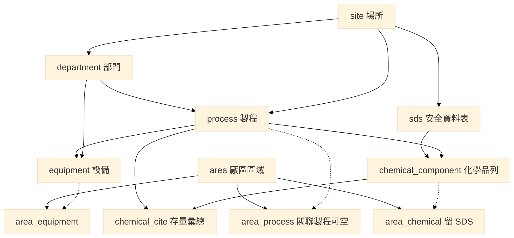

實線＝先有主檔才能建列。`chemical_component` 是填報列（製程＋SDS＋CAS）。`chemical_cite` 只給可加總的存量（CAS＋製程）。`area_process` 虛線＝集合點等區域可以沒有製程，不得為了建區域虛構製程。`area_equipment`／`area_chemical` 虛線＝清單齊備後才勾選，開表得空；區域化學品連化學品列，不連彙總。

下圖只說明**變更案件結案**時，SOP、訓練、PSSR 如何勾稽，以及劣化查詢不得回寫清單。第一次填報不要依此鎖填寫順序。新送件變更管理得僅交計畫書。

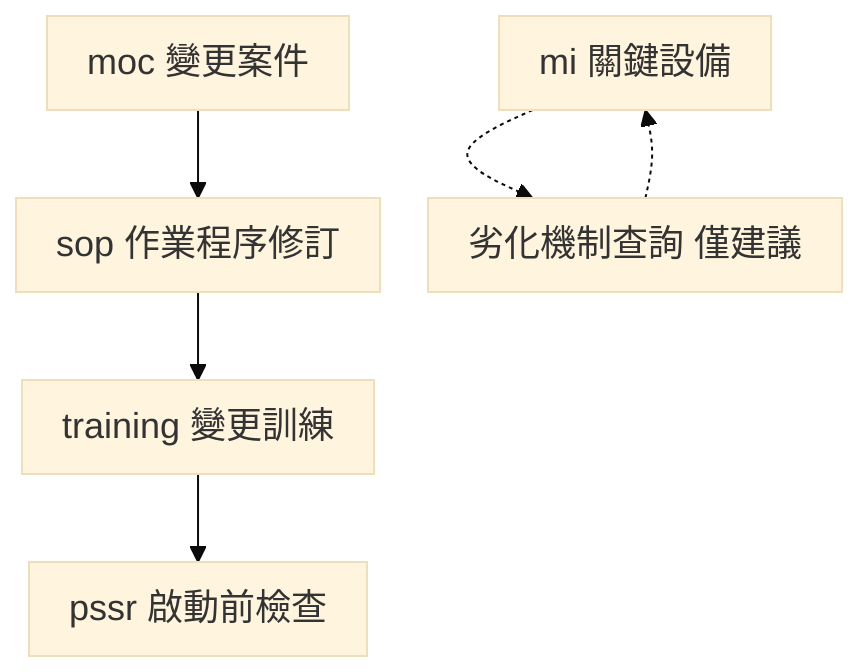

上圖虛線＝查詢結果由人員確認後寫入表8.1-1，不回寫表1.0-3，也不是填報表。同一份文件只上傳一次，他表選既有版次；見通則四。建庫仍用 `attachment`，示範庫尚未另立共用文件頂點。

三階段語意（手冊「申報架構與線上風險評估」）：

| 階段 | 做什麼 | 不得做什麼 |
| --- | --- | --- |
| 一 | 以製程、設備、化學品、部門、區域編號為唯一鍵；後續單元選號帶名 | 另打一套名稱；把該製程全部化學品自動寫入每一台設備內容物 |
| 二 | 變更案件能對到 SOP 修訂、訓練及 PSSR 結案 | 自動裁罰；無變更紀錄卻因訓練勾選「變更訓練」而視為缺漏 |
| 三 | 材質類別、操作溫度、內容物齊全後，連線劣化機制查詢，人員確認後填入表8.1-1 | 查詢結果匯入填報介面、代替風險評分、自動判定漏列、代填檢查逾期；把篩選結果寫回設備主檔 |

### 1.1 第一次填報 DAG

這張只畫組裝順序：誰必須先存在，下一步才能填。精靈從場所到製程／設備／化學品再到「建立 (1)」，這一段是 DAG；送審快照是凍結的圖。變更回寫 PSI、檢查更新場所現況、事故餵回評估不畫在這裡。

實線＝先有才能建。區域編號、名稱與圖面得於填設備清單前建立。關聯製程可空，集合點不必先有製程。關聯設備與關聯化學品於清單齊備後勾選，開表時得空，故不畫成與設備互相等待。SDS 掛場所，化學品列同時要製程與 SDS。表1.7-1 的 PHA 分析編號第一次得空，待第二章完成後回填，故不畫成 PSI 與 PHA 互相等待。後續各章從清單或第一章**選編號**，彼此多半可並行，不要做成一條龍鎖表。

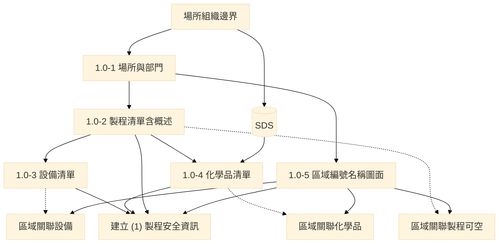

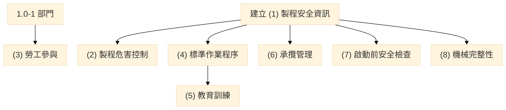

上圖同層＝可並行；僅訓練選 4.1，故 (4)→(5)。不要做成 (2)→(4)→(3)→(5) 一條龍。

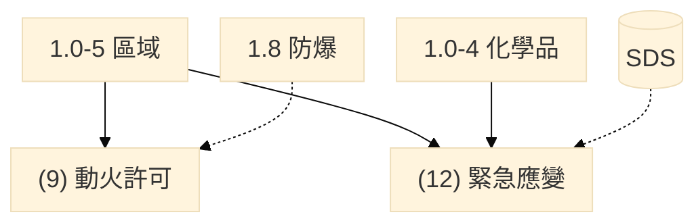

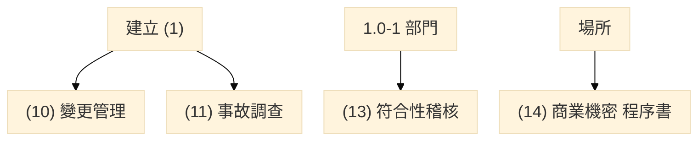

| 區塊 | DAG 上的意思 | 對到實體 |
| --- | --- | --- |
| 場所組織邊界 | 甲類範圍與部門先存在。表1.0-1不聲明無承攬或無動火；無某設備類型者不列入設備清單 | `site`、`department` |
| 1.0-2 製程清單含概述 | 製程編號由事業單位編定，是後面選取的鍵；概述不再另表 | `process` |
| 1.0-3 設備清單 | 編號＝現場位號；設備屬製程 | `equipment` |
| SDS → 1.0-4 | 填報列＝製程＋SDS＋成分化學文摘社登記號（Chemical Abstracts Service, CAS No.）。1.1 存量可彙總成 CAS＋製程；1.2、內容物、1.5、1.8、變更、事故、應變留著 SDS | `sds`、`chemical_component`、`chemical_cite` |
| 1.0-5 區域 | 編號／名稱／圖面可先建；關聯製程可空；關聯設備／化學品清單齊備後勾選，化學品留 SDS | `area`、三張關聯表 |
| 建立 (1) | 清單齊備後填 1.1～1.11；1.3 只枚舉已有製程，不得新增主檔 | 第一章視圖 |
| (2)(4)～(8) | 選第一章已有編號；訓練選 4.1。彼此不互鎖 | 第二、四至八章 |
| (3)(9)(12)(13)(14) | (3)(13) 以部門為主；(9)(12) 以區域為主；(14) 無填報表 | 勞工參與、動火、應變、稽核、程序書 |
| (10)(11) | 新送件得僅交程序／計畫；有案件再掛製程或設備 | 變更、事故 |

### 1.2 填報通則（對應手冊七條）

1. 設備以設備編號（現場位號）為準，部門以部門編號為準，區域以區域編號為準。化學品填報列以製程＋SDS＋CAS 為準。最大存量等可加總欄位才合併為 CAS＋製程；牽涉濃度、物性、不相容或防護具者必須留著 SDS。後續表單自清單選取已建立之編號，帶出名稱與已填屬性，不得另打一套名稱。
2. P&ID、廠區位置圖除上傳附件外，應填圖號、版次、制修訂日期及所屬製程或涵蓋設備。未填前開欄位者，該圖不列入 PSI 圖資列。
3. 無某一類型設備者，設備清單及表4.1-1不得列出該類型，不得為填表而虛構。保養、工程、臨時維修均屬承攬，應填第六章；無職災或虛驚據實註明，不得以無承攬跳過。管線維修或工程動火應填第九章並列舉管制區域。近五年無事故者，於事故調查單元據實註明。
4. 同一份文件、同一版次只上傳一次，並登錄名稱及日期。其他單元選既有文件，不各傳一份完整清單。線上欄位不能代替應檢附的原始表單或程序全文。無應填清單之單元，以上傳程序書或證明文件為準。
5. 各單元應依現行審查要求說明管理程序或做法、執行結果、使用表單或執行紀錄。
6. 確認事項以是或否填報，填否須寫原因；改以程序書檢核者，上傳程序並勾選所含項目。緊急應變表12.1-1列計畫所含緊急狀況，並對製程、化學品及區域；計畫全文以附件上傳。
7. 嚴重度、可能性、風險等級、是否適用、改善是否完成、評估方法之選用，以及程序全文、會議紀錄、簽認及測驗等附件內容，不得自清單帶出。危害分析仍由製程安全評估小組完成。

---

## 2. 核心主檔 ER

主檔五本：場所、部門、製程、設備、化學品。廠區區域與 SDS 為清單配套實體。化學品填報列以「製程＋SDS＋CAS」存一列。1.1 最大存量才彙總成「CAS＋製程」；1.2、內容物、1.5、1.8、變更、事故、應變留著 SDS。

製程編號、設備編號均由事業單位編定（設備＝現場位號），場所內唯一。系統得另存內部碼，不作為選取鍵。

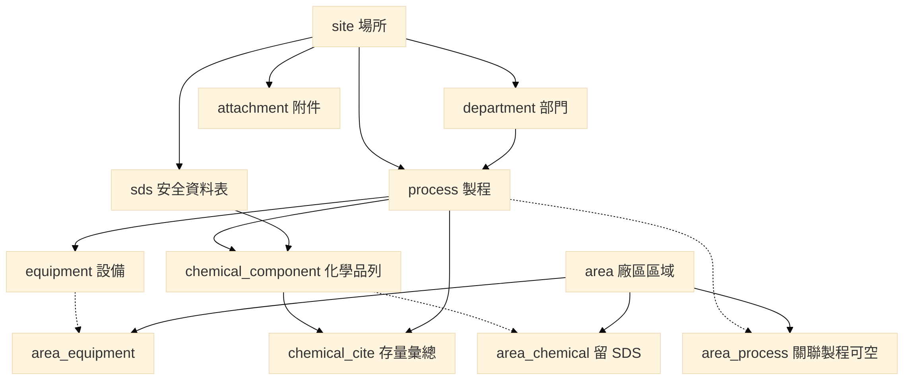

### 2.1 識別鍵

| 對象 | 場所內唯一鍵 | 後續單元選取方式 |
| --- | --- | --- |
| 部門 | `dept_id` | 選部門編號，帶出名稱 |
| 製程 | `process_id`（事業單位編定） | 選製程編號，帶出名稱、概述、操作部門 |
| 設備 | `equipment_id`（＝現場位號） | 選設備編號，帶出名稱、類型、所屬製程、材質類別 |
| 化學品（填報列） | `process_id`＋`sds_id`＋`cas` | 1.2、設備內容物、1.5、1.8、應變、事故有化學品時選這一列 |
| 化學品（存量彙總） | `cas`＋`process_id` | 只給 1.1。同一 CAS 於同一製程多列時，最大存量參考各列歸屬量加總 |
| 區域 | `area_id` | 選區域編號，帶出名稱、是否集合點 |
| SDS | `sds_id` | 與化學品列勾稽；防護衣／濾罐得帶入應變表 |

設備所在區域不在設備清單另開欄，而由 **表1.0-5 關聯設備** 勾選（`area_equipment`）。開表時該兩欄得空。

---

## 3. 十四項掛件與引用關係

實線＝選編號；虛線＝帶入後人員確認。箭頭是引用，不是必須填完上一張才能開下一張。嚴重度、可能性、風險等級、是／否、附件全文不得自清單帶出。

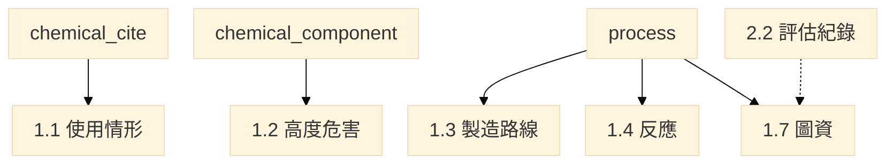

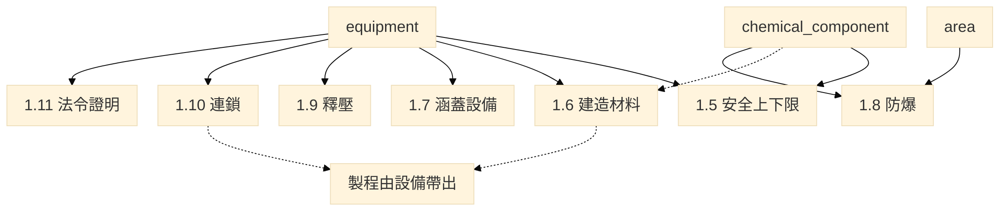

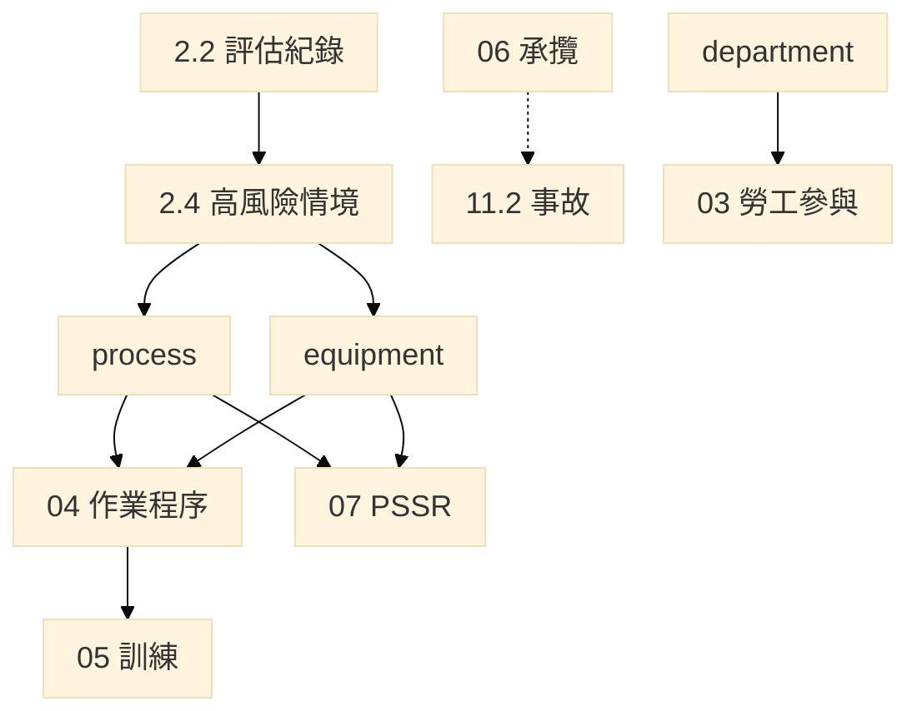

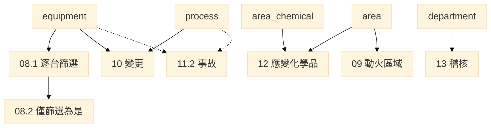

章與主檔依賴：

| 章 | 必引主檔 | 可帶入、人員確認 | 本單元自填、不得帶出 |
| --- | --- | --- | --- |
| 01 製程安全資訊 | 清單自建 | SDS／特化表物化性質、危害說明→危有 | 安全上下限數值、熱安定性、連鎖設定 |
| 02 危害控制 | 2.2 不掛製程；2.4 另選製程與設備 | 名稱編號。不以評估紀錄篩製程 | 評估方法、數量、情境、改善；嚴重度／可能性由小組填 |
| 03 勞工參與 | 部門 | 部門名稱 | 十三項參與方式；程序改附件 |
| 04 作業程序 | 製程、設備、1.5、1.10 | 設備類型預產生 SOP 列；1.5 上下限 | 程序名稱、臨時／緊急項目、偏移後果 |
| 05 教育訓練 | 製程、部門、4.1 | 程序名稱、部門名稱 | 課程、時數、對象 |
| 06 承攬 | 承攬人、期間；送出前關聯 11.2 | 摘要、日期、製程、設備自 11.2 帶出 | 未關聯可暫存。事故本文不在本章另存 |
| 07 PSSR | 製程、設備 | 名稱、所屬製程 | 執行時間、改善、追蹤 |
| 08 機械完整性 | 全份設備清單逐台篩；8.2 只接篩選為是者 | 1.5 內容物、1.6 材料、1.7 圖號。1.5 未確認者只是候選 | 損壞機制、方法頻率、失效率；不得回寫設備主檔 |
| 09 動火 | 得選區域、防爆區 | 是否已列防爆 | 列舉動火區域及防護原因 |
| 10 變更 | 製程、設備 | 名稱；訓練得選 5.1-1 | 變更編號、完成時間、改善追蹤；新送件得僅交計畫書 |
| 11 事故 | 事故只登本章。製程、設備、化學品可空 | 有化學品時留 SDS | 五年事故列；制度改程序書。第六章只來引用 |
| 12 緊急應變 | 區域已確認的關聯化學品與集合點 | 防護衣／濾罐自 SDS。集合點可以沒有製程 | 緊急狀況、器材；計畫全文附件。不從 1.0-4 另挑一套，也不虛構全廠製程 |
| 13 稽核 | 部門（填報主體非三清單） | — | 計畫、不符合事項 |
| 14 商業機密 | 不以三清單為主體 | — | 無填報表；程序書檢核 |

---

## 4. 實體表一覽（建議建庫）

型別慣例：`text` 字串；`int` 整數；`num` 數量；`bool` 是非；`date` 日期；`enum` 限定選項。未標必填者見各表「必填」欄。

### 4.1 場所與清單

#### `site`　場所（表1.0-1 場所欄）

| 欄位 | 型別 | 必填 | 說明 |
| --- | --- | --- | --- |
| site_id | text PK | 是 | 系統產生 |
| company_name | text | 是 | 事業單位名稱 |
| site_name | text | 是 | 場所名稱 |
| class_a_scope | text | 是 | 甲類範圍；圖資另上傳 |
| worker_count | int | 是 | 場所勞工人數；宜區分廠區與承攬商 |

表1.0-1不設無承攬、無動火、無某設備類型或近五年無事故勾選。無某類型者不列入 `equipment`；表4.1-1依已存在類型產生。保養、工程、臨時維修均屬承攬，應填表6.2-1。管線維修或工程動火應填表9.1-1。近五年無事故於表11.2-1據實註明。

組織系統圖走 `attachment`。

#### `department`　部門（表1.0-1 部門欄）

| 欄位 | 型別 | 必填 | 說明 |
| --- | --- | --- | --- |
| dept_id | text PK | 是 | 場所內唯一 |
| site_id | text FK | 是 | → site |
| name | text | 是 | 名稱只在此維護 |
| headcount | int | 是 | 該部門人數 |

#### `process`　製程清單（表1.0-2）

概述併入本表，不再另開表1.3-1 概述列。

| 欄位 | 型別 | 必填 | 說明 |
| --- | --- | --- | --- |
| process_id | text PK | 是 | 場所內唯一，**由事業單位編定** |
| site_id | text FK | 是 | → site |
| name | text | 是 | 製程名稱 |
| overview | text | 是 | 製程概述（目的與操作流程） |
| operating_dept_id | text FK | 是 | → department |
| mode | enum | 是 | 連續／批次 |
| has_reaction | bool | 是 | 是 → 須填 1.4、1.5 反應上下限 |
| has_overpressure | bool | 是 | 是 → 須填 1.10；若 1.0-3 已列釋放設備則填 1.9 |
| is_downstream | bool | 是 | 是否後段處理／汙染控制單元 |

#### `equipment`　設備清單（表1.0-3）

| 欄位 | 型別 | 必填 | 說明 |
| --- | --- | --- | --- |
| equipment_id | text PK | 是 | 與現場位號相同 |
| site_id | text FK | 是 | → site |
| process_id | text FK | 是 | → process |
| maint_dept_id | text FK | 是 | → department（可與操作部門不同） |
| name | text | 是 | 正式名稱 |
| alias | text | 否 | 俗稱；勾稽不用俗稱 |
| equipment_type | enum | 是 | 八類擇一，見 §6.1 |
| power_kind | enum | 類型＝動力來源時 | 泵浦／氣動／其他 |
| phase_class | enum | 是 | 粉狀固體／粒狀固體／液體／氣體／後段處理 |
| material_category | enum | 是 | 對劣化機制查詢材質選項，見 §6.2；規格名稱見 1.6 |
| is_safety_critical | bool | 是 | 第一次由人員填；MI 篩選**不得回寫**本欄 |
| is_regulated_machinery | bool | 是 | 職安法第 16 條；是者須填 1.11 |
| is_high_pressure_gas | bool | 是 | 高壓氣體特定設備或容器；是者須檢附竣工／定期檢查，於 1.11 說明 |

控制系統與緊急停車系統應分列。槽組含儲槽與泵者分列兩筆。無某類型者不列入本表。所在區域見 `area_equipment`。

#### `sds`　安全資料表（清單配套；電子檔掛 1.0-4）

| 欄位 | 型別 | 必填 | 說明 |
| --- | --- | --- | --- |
| sds_id | text PK | 是 | SDS 代號 |
| site_id | text FK | 是 | → site |
| substance_or_mixture_name | text | 是 | 純物質或混合物名稱 |
| version | text | 是 | 版本 |
| revise_date | date | 是 | 制修訂日期 |
| file_path | text | 是 | 電子檔 |
| component_cas_list | text | 是 | 所列成分 CAS（與 chemical_component 勾稽） |
| ppe_level | enum | 否 | 防護衣等級，見 §6.14；得帶入表12.2-1 |
| filter_type | enum | 否 | 濾罐型式，見 §6.14；得帶入表12.2-1 |

未帶入者，應變表仍須由人員填寫，不得僅上傳檔案。混合物仍以該張 SDS 為準。

#### `chemical_component`　化學品清單列（表1.0-4）

一列＝一張 SDS 所載純物質，或混合物 SDS 第三項每一揭露成分。不另開混合物對應表。未揭露或依法保留之成分，不虛構 CAS。

| 欄位 | 型別 | 必填 | 說明 |
| --- | --- | --- | --- |
| row_id | int PK | 是 | 系統列號 |
| process_id | text FK | 是 | → process；同一物質不同製程分列 |
| sds_id | text FK | 是 | → sds |
| purity_or_mixture | enum | 是 | 純物質／混合物 |
| mixture_name | text | 混合物必填 | 純物質免填 |
| phase_state | enum | 是 | 常用狀況相態：固態／液態／氣態。對照附表管制量相態，作為是否列入管制量的依據 |
| cas | text | 是 | 化學品代號＝成分 CAS No. |
| name | text | 是 | 成分名稱 |
| role | enum | 是 | 原料／中間產物／產物／副產物／觸媒／清洗劑／其他，見 §6.6 |
| h_codes | enum[] | 是 | 成分危害說明（全球化學品統一分類及標示制度 Globally Harmonized System, GHS H）；下拉可多筆，中英文見 §6.7 |
| pct_low | num | 混合物必填 | 成分比例下限 |
| pct_high | num | 混合物必填 | 上限；範圍者歸屬量採上限 |
| pct_basis | enum | 混合物必填 | 重量比／體積比／重量／體積比 |
| mixture_qty | num | 混合物必填 | 混合物總量 |
| attributed_qty | num | 是 | 純物質填該物質數量；混合物＝總量×比例 |
| conversion_note | text | 總量與比例基準不同時 | 換算式及資料來源 |

引用規則：1.1 以 **CAS＋製程** 選取，同一 CAS 於同一製程多列時，最大存量參考各列 `attributed_qty` 加總。1.2、設備內容物、1.5、1.8、應變與有化學品的事故改選 **製程＋SDS＋CAS**，不吃這份彙總。比例拆分只供數量歸屬，不取代混合物整體 GHS 分類。危害說明帶入 1.1／1.2 定性欄，不據以判斷防護、材質或評估缺漏。毒性、反應及物化性質得自內建資料庫帶入供參考，由人員確認。常用狀況相態依操作狀態填寫。氯化氫、氟化氫之附表管制量相態為氣態，常用狀況為液態或固態者不列入管制量；其餘列管物質的管制量相態供對照，仍以純物質公斤對規定數量。

#### `area`　廠區區域（表1.0-5）

| 欄位 | 型別 | 必填 | 說明 |
| --- | --- | --- | --- |
| area_id | text PK | 是 | 流水號或自定義；場所內唯一 |
| site_id | text FK | 是 | → site |
| name | text | 是 | 作業區域名稱 |
| worker_count | int | 是 | 勞工／承攬商工作人數；僅巡檢填 0 |
| is_assembly_point | bool | 是 | 是者可供表12.1-1 集合點選取 |
| drawing_no | text | 是 | 圖面 |
| drawing_rev | text | 是 | 版次 |
| drawing_file | text | 是 | 上傳檔案 |

關聯製程、設備、化學品以三張關聯表存放。關聯製程可空，集合點註明不適用，不得虛構製程。關聯設備、化學品先依已勾選製程帶出候選，**清單齊備後勾選，開表時得空**。關聯化學品留著 SDS。

| 關聯表 | PK | 說明 |
| --- | --- | --- |
| area_process | area_id, process_id | 關聯製程；可零列 |
| area_equipment | area_id, equipment_id | 關聯設備；即設備所在區域 |
| area_chemical | area_id, process_id, sds_id, cas | 關聯化學品；留 SDS |

#### `attachment`　附件登錄（各章共用）

計畫、規章、圖檔上傳，並登錄名稱及日期。P&ID／廠區位置圖另須圖號、版次、制修訂日期及所屬製程或涵蓋設備，未填者不列入 PSI 圖資列。

| 欄位 | 型別 | 必填 | 說明 |
| --- | --- | --- | --- |
| attachment_id | int PK | 是 | |
| site_id | text FK | 是 | |
| unit_no | int | 是 | 1～14 |
| table_no | text | 是 | 手冊表號 |
| name | text | 是 | 文件名稱 |
| doc_date | date | 是 | 日期 |
| process_id | text FK | 視表 | 如評估紀錄所屬製程 |
| equipment_id | text FK | 視表 | 如檢測位置圖 |
| kind | enum | 是 | 附件種類，見 §6.16 |
| path | text | 是 | |

---

### 4.2 第一章　製程安全資訊（1.1～1.11）

下列兩張是各表掛哪個主檔，不是填寫先後。1.4 僅 `has_reaction=是` 才填；1.9、1.11 僅符合條件之設備才填。

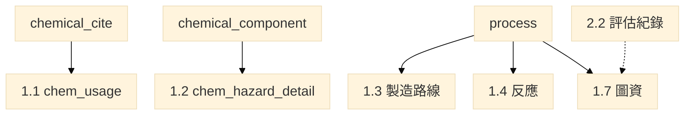

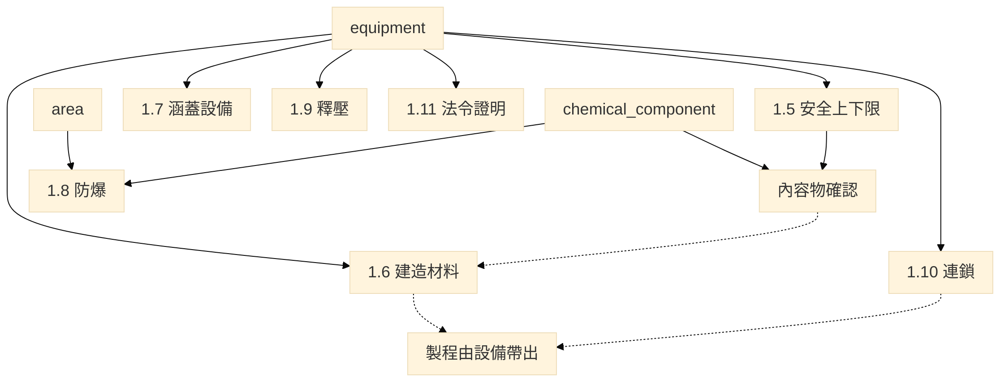

#### `chem_usage`　表1.1-1 危害性化學品製造、處置、使用

選 `cas`＋`process_id`（存量彙總）。帶出：中英文名、CAS、操作部門。人員填：最大存量、平均使用量、管制法規；危／有／高燃／高毒得依危害說明建議勾選後改勾，不依 H 碼自動判定高燃或高毒。存放地點選表1.0-5。同一 CAS 多張 SDS 時，最大存量可參考歸屬量加總，不把各列濃度併成一筆。

| 欄位 | 型別 | 來源 |
| --- | --- | --- |
| process_id, cas | PK | 選 1.0-4 |
| name_zh, name_en | text | 帶出 SDS |
| operating_dept_id | text FK | 帶出製程操作部門 |
| max_inventory_kg | num | 人員填；單位公斤、以月計 |
| monthly_use_kg | num | 人員填；平均使用量 |
| is_dangerous | bool | 危；H2xx 建議勾 |
| is_harmful | bool | 有；H3xx／H4xx 建議勾 |
| is_highly_flammable | bool | 高燃；H220–H223 建議勾 |
| is_highly_toxic | bool | 高毒；H300/301/310/311/330/331 建議勾 |
| area_id | text FK | 選 1.0-5 存放地點 |
| control_regulation | text | 人員填 |

#### `chem_hazard_detail`　表1.2-1 高度危害化學品清單與危害

| 欄位 | 型別 | 來源 |
| --- | --- | --- |
| process_id, sds_id, cas | PK | 選化學品列，留 SDS |
| name_zh, name_en | text | 帶出該張 SDS |
| concentration_wt_pct | num | 得自該列成分比例；不取彙總 |
| threshold_qty | num | 管制數量；符合甲類通報清單者得帶入，人員確認 |
| appearance | enum | 固／液／氣，見 §6.8 |
| odor | text | 人員填 |
| vapor_pressure_mmhg | num | 得自 SDS，人員確認 |
| boiling_c, flash_c | num | 同上 |
| explosion_limit_pct | text | 同上 |
| twa_stel_ceiling | text | 同上 |
| physical_hazard_cns | enum | 危害說明→中華民國國家標準（Chinese National Standards, CNS）15030 物理性危害類，見 §6.8 |
| health_hazard_cns | enum | 危害說明→CNS 15030 健康危害類，見 §6.8 |
| incompatible_air_water | bool | H260／H261 建議勾是；反應性數據 |
| thermal_chemical_stability | text | 人員填 |

#### `process_route`／`process_route_block`　表1.3-1 製造流程方塊圖

方塊流程圖說明各條製造路線枚舉哪些製程。場所可能有多組不同路線，須逐一列出。系統帶入表1.0-2 的製程名稱，選擇後帶出該製程已列設備與化學品，使用者應確認。**本表不另建製程先後指標**；缺漏之設備或化學品應回表1.0-3、1.0-4 補列，本表不得新增主檔。製程之間可以重複枚舉。

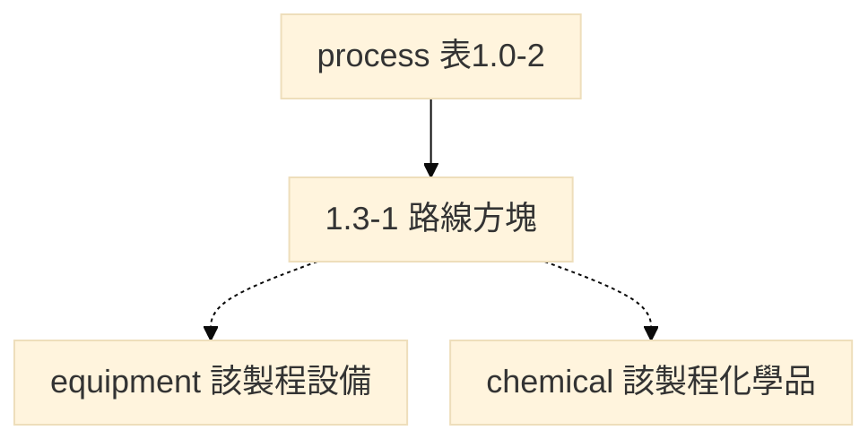

| 欄位 | 型別 | 說明 |
| --- | --- | --- |
| route_id | PK | 流程編號；系統流水號 |
| seq_no | PK | 方塊序號 |
| process_id | FK | 選 1.0-2；帶出名稱、概述 |
| note | text | 備註 |

`process_route_equipment`：`(route_id, seq_no, equipment_id)`，限該 `process_id` 已列設備。  
`process_route_chemical`：`(route_id, seq_no, process_id, cas)`，限該製程已列化學品。

#### `process_reaction`　表1.4-1

僅 `has_reaction=是` 之製程。反應種類可複選。相關設備、化學品依所選製程自 1.0-3、1.0-4 帶入；缺漏回該兩表補列。

| 欄位 | 型別 | 說明 |
| --- | --- | --- |
| reaction_id | PK | |
| process_id | FK | 選 1.0-2 |
| reaction_kinds | enum[] | 氧化、硝化、鹵化、有機金屬化、偶氮化、氫化、裂解／熱分解、聚合、磺化、縮合、其他 |
| equation | text | 主要化學反應式 |
| heat | text | 反應生成熱 |
| note | text | |

`process_reaction_equipment`、`process_reaction_chemical`：該反應列勾選之設備／化學品。

#### `equipment_limit`　表1.5-1 安全上下限

選設備編號。內容物自該製程已列化學品選取，人員確認；**不得**把該製程全部化學品自動寫入。不得填品質管制用操作界限。檢討項目可複選壓力、溫度、流量、組成；未勾選者對應上下限欄免填。

| 欄位 | 型別 | 說明 |
| --- | --- | --- |
| equipment_id | PK FK | 帶出名稱、所屬製程 |
| review_items | enum[] | 壓力／溫度／流量／組成 |
| p_op_range, p_safe_hi, p_safe_lo | num | kg/cm²G；勾選壓力者必填 |
| t_op_range, t_safe_hi, t_safe_lo | num | ℃；勾選溫度者必填；第八章查詢用操作溫度 |
| flow_op_range, flow_safe_hi, flow_safe_lo | num | m³/h；勾選流量者必填 |
| comp_op_range, comp_safe_hi, comp_safe_lo | text | 重量百分濃度；勾選組成者必填 |
| batch_qty | text | 單次操作量；單位不拘 |
| note | text | |

`equipment_content`（equipment_id, cas, sds_id）：該設備實際裝填或流經之物質（表欄「操作化學品」），留著 SDS。無製程化學品者註明，`sds_id` 留空。

#### `design_code`　表1.6-1 建造材料、設計規範及標準

本表是**規範／材質目錄**，不是設備一列一筆。選設備編號，製程由設備帶出。化學品只帶 1.5 已確認的內容物；1.5 尚未完成時仍可先填材料，未確認的化學品只是候選，不鎖表。同一製程內設備材質不同者應分列，**不得整製程套用同一規範**。規格名稱（如 SS316L）須先歸入材質類別。第八章表8.1-1 帶出，不得另填一套，也不回寫設備主檔。

| 欄位 | 型別 | 說明 |
| --- | --- | --- |
| code_id | PK | |
| spec_name | text | 設計規範及標準名稱（如 CNS、美國石油學會 American Petroleum Institute, API、美國國家標準協會 American National Standards Institute, ANSI） |
| construction_material | text | 建造材料或規格 |
| material_category | enum | 腐蝕劣化規格映射，見 §6.2 |
| scope | text | 適用的設備條件 |

`design_code_process`：`(code_id, process_id)`。  
`design_code_equipment`：`(code_id, equipment_id)`，自所選製程設備篩選。  
`design_code_chemical`：`(code_id, process_id, cas)`，自所選製程化學品篩選。

設備清單的 `material_category` 須與本表映射一致。

#### `pid_drawing`　表1.7-1 管線儀表圖清單

製程流程圖（Process Flow Diagram, PFD）與 P&ID 成對。未填圖號及日期者該列未完成。PHA 分析編號**第一次得空**，第二章完成後回填；未填本欄不影響本列完成。

| 欄位 | 型別 | 說明 |
| --- | --- | --- |
| drawing_no | PK | 圖號 |
| process_id | FK | 所屬製程；帶出名稱 |
| issue_date | date | 最新修正日期 |
| pha_record_no | text | 得填；第一次可空 |
| file_path | text | 圖檔；無圖檔者備註說明 |
| note | text | |

`pid_covering`：`(drawing_no, equipment_id)`，自該製程設備帶入。化學品清單同製程帶入供確認，不另建主檔。

#### `explosion_zone`　表1.8-1 防爆區域劃分

區域選 1.0-5；指標化學品選該區域已勾選之 CAS，帶出 SDS 物化性質，人員確認。詳圖得存廠備查。未規劃防爆區域者據實註明。

| 欄位 | 型別 | 說明 |
| --- | --- | --- |
| area_id | PK FK | 帶出區域名稱 |
| location, floor | text | 防爆區域位置、樓層 |
| indicator_cas | text | 指標化學品 |
| flash_c, boiling_c, rel_density, expl_limit, autoignition_c | num/text | 得自 SDS／1.2 |
| vent_type | enum | N 自然／A 人工，見 §6.9 |
| vent_level | enum | VH 高度／VM 中度／VL 低度，見 §6.9 |
| vent_availability | enum | A 良好／B 中等／C 差，見 §6.9 |
| leak_grade | enum | C 連續／P 主要／S 次要 |
| hazard_zones | enum[] | 0／1／2 區，可複選 |
| equipment_selection | text | 例：IIC T1 |

#### `relief_device`　表1.9-1

帶入表1.0-3 設備類型為「釋放及排放系統」者。釋放物選 CAS；P&ID 選 1.7。

| 欄位 | 型別 | 說明 |
| --- | --- | --- |
| equipment_id | PK FK | 釋放及排放系統設備 |
| device_type | enum | 釋壓裝置類型，見 §6.10 |
| calc_doc_no | text | 計算書／規格書；附件 |
| drawing_no | text | 選 1.7-1 |
| location | text | 安裝位置 |
| release_cas | text | 釋放物 |
| phase | enum | 氣體／液體／氣液兩相／固體，見 §6.10 |
| set_pressure | num | kg/cm² |
| design_discharge_m3h | num | 設計排放量 |
| nozzle_mm | text | 出口尺寸 |
| overpressure_case | text | 過壓計算情境 |
| design_basis | text | 設計依據 |

#### `safety_interlock`　表1.10-1

列鍵掛**設備**。製程由該設備帶出，不另選、也不把整條製程套成同一組連鎖。連鎖或安全儀裝系統（Safety Instrumented System, SIS）／偵測抑制系統名稱由人員填。緊急停車條件見表4.3-1。

| 欄位 | 型別 | 說明 |
| --- | --- | --- |
| interlock_id | PK | 安全連鎖編號；系統編碼 |
| equipment_id | FK | 選 1.0-3；製程由設備帶出 |
| process_id | FK | 可空。帶出用，不是選取鍵 |
| impl_type | enum | 硬體／軟體 |
| function_desc | text | 安全功能；人員填 |
| normal_setpoint | text | 正常操作設定值 |
| prealarm_setpoint | text | 預警設計值 Stage1 |
| prealarm_action | text | 預警動作方式 |
| alarm_setpoint | text | 警報設計值 Stage2 |
| alarm_action | text | 警報動作方式 |
| reset_mode | enum | 自動／手動 |

#### `legal_certificate`　表1.11-1

僅 `is_regulated_machinery=是` 或 `is_high_pressure_gas=是`。編號與設備清單相同，不得另編。無此類型者註明。

| 欄位 | 型別 | 說明 |
| --- | --- | --- |
| equipment_id | PK FK | 帶出名稱 |
| legal_class | enum | 職安法第 16 條類別，見 §6.11 |
| last_inspect_date | date | 上次檢查時間 |
| cert_no | text | 檢查合格證號碼 |
| expire_date | date | 合格證有效期限 |

---

### 4.3 第二章　製程危害控制措施

2.2 評估紀錄不掛製程。2.4 先選評估編號，再另選製程與設備，不以評估紀錄篩掉其他製程。嚴重度與可能性由評估小組判定，不自清單帶出。風險矩陣（最高 10×10）及方法數量統計含在評估紀錄的「考量問題數」，不再另開獨立改善表。

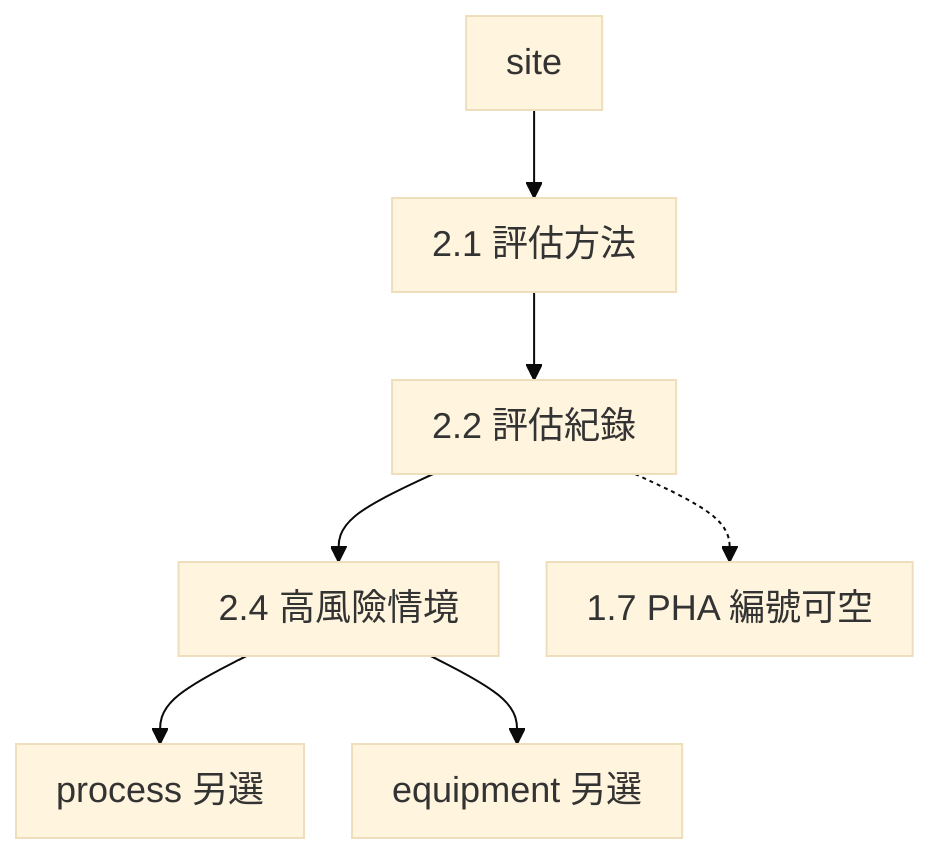

| 實體 | 手冊表 | 欄位 |
| --- | --- | --- |
| pha_method | 2.1-1 | method（七種，可複選）、adopted_reason、note |
| pha_record | 2.2-1 | method、question_count；不掛 process_id。檔案走 attachment |
| pha_scenario | 2.4 | 先選 assessment_id，再選 process_id、equipment_id（製程整體情境可無設備） |

評估方法固定列：檢核表；如果－結果；如果－結果／檢核表；危害及可操作性分析（Hazard and Operability Study, HAZOP）；失誤模式與影響分析（Failure Mode and Effects Analysis, FMEA）；故障樹分析（Fault Tree Analysis, FTA）；其他經中央主管機關認可。

表1.7-1 的 PHA 分析編號得於本單元完成後回填，對應 `pha_record`。第一次填報可空，不與 1.7 互相鎖表。沒有 2.4、圖號也沒回填時，這份評估就是尚未掛到製程。

---

### 4.4 第三章　勞工參與

十三項固定列出，不得刪列。參與人員或部門選 `dept_id`。程序書改本表附件欄，不再另開表3.2-1。

| 實體 | 手冊表 | 欄位 |
| --- | --- | --- |
| worker_participation | 3.1-1 | item_no（1～13 PK）、psm_item、activity、dept_id、doc_path、doc_date、note |

十三項名稱：製程安全資訊；製程危害控制措施；標準作業程序；教育訓練；事故調查；承攬管理；動火許可；變更管理；啟動前安全檢查；機械完整性；緊急應變；符合性稽核；商業機密。

---

### 4.5 第四章　標準作業程序

系統依表1.0-3 **已存在之設備類型**預產生至少一筆 SOP；同類型可增列，刪至一筆不得再刪。設備清單未列之類型不產生列。表4.2～4.4 選製程／設備編號，帶出名稱。程序全文為附件。表4.3 含緊急停車條件與緊急操作（不再另開緊急操作表）。表4.4 操作界限依表1.5-1 已填上下限之設備帶入。

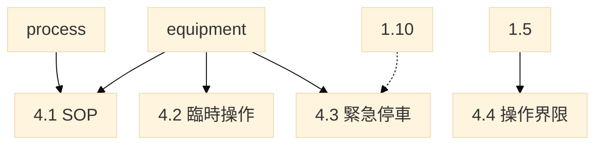

| 實體 | 手冊表 | 欄位 |
| --- | --- | --- |
| sop | 4.1-1 | sop_id PK、process_id、repr_equipment_id（可空）、doc_no、name、revise_date、note；列依設備類型預產生 |
| sop_temp_operation | 4.2-1 | seq、process_id、equipment_id、item、doc_no、revise_date、note |
| sop_esd_condition | 4.3-1 | seq、interlock_id（選 1.10，可空）、process_id、equipment_id、condition、emergency_item、revise_date、note |
| sop_operating_limit | 4.4-1 | seq、equipment_id（自 1.5-1 帶入）、process_id、cas、safe_limit、deviation_consequence、corrective_action、note |

---

### 4.6 第五章　教育訓練

僅表5.1-1（製程概述及 SOP 訓練）。勾選「製程修改或變更訓練」者，表10.1-2 得選本課程；首次送件無變更紀錄者，不因此視為缺漏。

| 實體 | 手冊表 | 欄位 |
| --- | --- | --- |
| training_course | 5.1-1 | seq、course_name、sop_id、process_id、equipment_id、audience（員工／承攬商／其他）、dept_id、is_moc_related、initial_hours、retrain_freq、retrain_hours、note |

教材、簽到、測驗 → `attachment`。

---

### 4.7 第六章　承攬管理

保養、工程、臨時維修均屬承攬，應填表6.2-1；無職災或虛驚據實註明，不得以無承攬免填。本章只存承攬人、期間，以及一筆指向表11.2-1 的關聯。事故摘要、日期、製程、設備不在這裡另寫。草稿可以先不關聯，送出前必須連到已存在的事故；這不是第十一章填完才能開第六章。

#### `contractor_incident`　表6.2-1

| 欄位 | 型別 | 說明 |
| --- | --- | --- |
| incident_id | PK | 承攬列項次，不是另一份事故編號 |
| contractor_name | text | 承攬人／廠商 |
| contract_period | text | 承攬期間 |
| linked_incident_id | FK | 送出前指向表11.2-1。摘要、日期、製程、設備、傷亡自該列帶出 |

無事故據實註明。選商、告知、評核 → attachment。

---

### 4.8 第七章　啟動前安全檢查

無新建或重大修改、尚未引入危害性化學品、或無適用案件者據實註明。

#### `pssr_record`　表7.1-1

| 欄位 | 型別 | 說明 |
| --- | --- | --- |
| pssr_id | PK | 項次 |
| process_id | FK | 帶出名稱 |
| equipment_id | FK | 帶出名稱 |
| exec_time | text/date | 執行時間 |
| recommendation | text | 檢查結果與改善建議 |
| due_date | date | 預定完成日期 |
| follow_up | text | 追蹤檢核結果 |
| note | text | |

---

### 4.9 第八章　機械完整性

表8.0-1 是連線查詢**條件對照**，不另開填報列。條件不齊全不得連線帶出。查詢結果僅建議，人員確認後寫入表8.1-1，不匯入填報介面。表8.3.1、表8.3.2 僅供廠內整理查詢建議時參考，**不列入應填、不入庫**。

表8.1-1 對設備清單逐台篩選，設備主檔不設「是否安全關鍵」作為答案。篩選結果不得回寫設備主檔。表8.2-1 只列篩選為是的設備。表8.0-1、表8.3-1、表8.3-2 是查詢，不是填報表。

設備檢查、測試及預防性維修（Inspection, Testing and Preventive Maintenance, ITPM）；風險基礎檢測（Risk-Based Inspection, RBI）、可靠度導向保養（Reliability-Centered Maintenance, RCM）、保護層分析（Layer of Protection Analysis, LOPA）僅作方法說明，不是另開填報表。

設備八類對六大類：壓力容器與儲槽→壓力容器與儲槽；管線系統→管線(包括管線組件如閥)；釋放及排放系統→釋放及排放系統和設備；緊急停車系統→緊急停車系統；控制系統→控制系統；動力來源中之泵浦→泵浦(轉動設備)；裝卸及輸送、其他由人員歸入六類之一。編號與第一章相同。

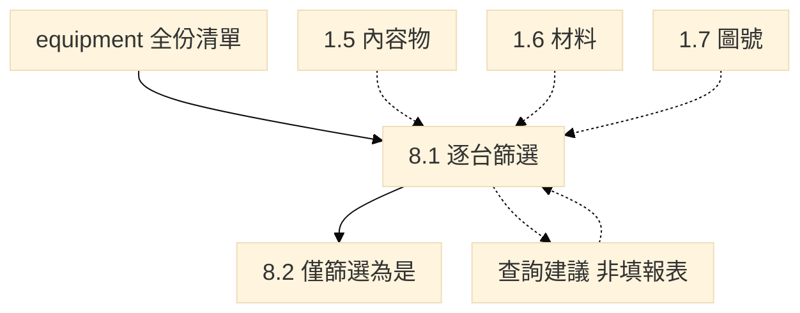

#### 表8.0-1　連線查詢必備（不建資料列）

| 查詢條件 | 來源 | 不齊全時 |
| --- | --- | --- |
| 材質類別 | equipment.material_category 與 design_code | 不得帶出建議 |
| 操作溫度 ℃ | equipment_limit 溫度欄，查詢時人員確認 | 不得帶出建議 |
| 內容物 | equipment_content | 僅能作部分篩選 |
| 介質發生條件 | 本署查詢畫面勾選，不開填報表 | 對應機制不得自動帶出 |
| 保溫或防火包覆 | 同上 | 保溫層下腐蝕不得自動帶出 |
| 銲道、異種金屬、振動等 | 同上 | 對應機制不得自動帶出 |

CAS 或危害說明不能代替介質發生條件。提示可能之劣化機制（如高溫氫侵蝕 High Temperature Hydrogen Attack, HTHA、應力腐蝕龜裂 Stress Corrosion Cracking, SCC、氫脆）及非破壞檢測（Nondestructive Testing, NDT）建議，由人員確認後填入表8.1-1。

#### `mi_critical_item`　表8.1-1

不得以全廠設備清單代替關鍵性設備清單。損壞機制由人員選填（得參考查詢建議）。

| 欄位 | 型別 | 來源 |
| --- | --- | --- |
| seq | int | 項次 |
| equipment_id | PK FK | 設備清單逐台一列；須已在 1.0-3 |
| equipment_type | enum | 帶出 |
| contents | text | 內容物候選帶入，人員確認 |
| material | text | 帶出表1.6-1 |
| damage_mechanism | text | 查詢建議＋人員確認 |
| test_method | enum | 檢查及測試方式，見 §6.12；含其他 |
| test_freq | text | 頻率 |
| procedure_no | text | 檢查測試程序書編號 |
| drawing_no | text | P&ID 帶入 |
| note | text | |

#### `mi_failure_rate`　表8.2-1

故障修復次數＝運轉中不能正常運行的修復，不含定期保養。失效率＝失效次數／運行時間（單位百萬小時），系統換算。

| 欄位 | 型別 | 說明 |
| --- | --- | --- |
| equipment_id | PK FK | 只列 8.1 篩選為是者；帶出名稱、類型、內容物 |
| cumulative_hours | num | 設備總運行時間 |
| repair_count | int | 運行時間失效次數 |
| failure_rate | num | 失效率（計算欄） |
| note | text | |

---

### 4.10 第九章～第十四章

確認長表多改為程序書上傳。執行紀錄為多列並掛主檔編號。

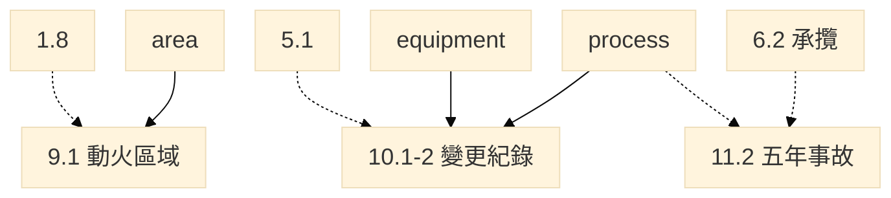

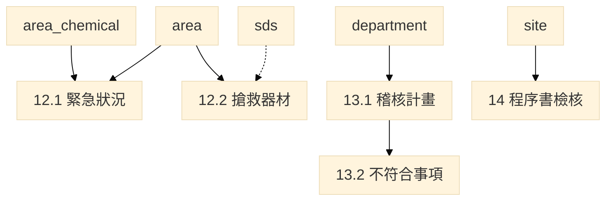

#### `hotwork_zone`　表9.1-1 動火許可區域

本單元填報主體為動火**管制區域**，不以製程、設備、化學品清單為主。管制區域選表1.0-5；是否防爆帶出表1.8-1。管線維修或工程動火應列舉管制區域並說明防護原因，並上傳動火許可程序書。不得以無動火跳過本單元。

| 欄位 | 型別 | 說明 |
| --- | --- | --- |
| area_id | PK FK | 選 1.0-5，帶出名稱 |
| is_explosion_zone | bool | 帶出是否已列 1.8-1 |
| explosion_note | text | 帶出防爆說明 |
| protection_reason | text | 列舉動火區域防護原因 |

#### `moc_record`　表10.1-2 變更管理執行紀錄

新送件得僅交計畫書。教育訓練得選表5.1-1 已有課程，可空。設備／系統／單元可選製程或設備。

| 欄位 | 型別 | 說明 |
| --- | --- | --- |
| moc_id | PK | 變更管理編號 |
| process_id | FK | 選 1.0-2 |
| equipment_id | FK | 選 1.0-3 |
| name | text | 變更管理名稱 |
| start_time | date | 預期變更開始時間 |
| description | text | 變更項目說明 |
| due_date | date | 預定完成時間 |
| follow_up | text | 追蹤稽核紀錄 |
| training_course_id | FK | 選 5.1-1，可空 |
| note | text | |

不再另開表10.1-1 確認長表；「製程修改」定義及程序改附件。

#### `incident_record`　表11.2-1 近五年事故概述

制度確認改程序書，不再另開表11.1-1。成立未滿五年者以成立至送審件數為準。無案件據實註明。

| 欄位 | 型別 | 說明 |
| --- | --- | --- |
| incident_id | PK | 項次 |
| occur_date | date | |
| incident_type | enum | 職業災害／虛驚 |
| is_fire, is_explosion, is_chem_release, is_other | bool | 事故特性，可複選 |
| summary | text | |
| casualty | text | 虛驚免填 |
| lost_days | int | 虛驚免填 |
| cause | text | |
| process_id / equipment_id | FK | 所涉編號 |
| corrective | text | |
| note | text | |

#### `emergency_case`　表12.1-1 工作場所緊急狀況

每一列應對製程、化學品及區域。集合點僅能選 `is_assembly_point=是` 之區域。計畫全文、組織架構、控制中心及運作流程以附件上傳（不再另開表12.1-2 十五列確認）。

| 欄位 | 型別 | 說明 |
| --- | --- | --- |
| case_id | PK | 項次 |
| emergency_type | enum | 見 §6.13；含其他 |
| description | text | 緊急狀況描述 |
| process_id | FK | |
| equipment_id | FK | 得自製程帶入 |
| cas | text | 涉及化學品 |
| area_id | FK | 涉及區域 |
| assembly_area_id | FK | 集合點 |
| note | text | |

#### `emergency_gear`　表12.2-1 搶救設備與器材

區域選 1.0-5。關聯製程、化學品自該區域**已勾選項目**帶出，**不以表1.3-1 反查區域**。防護衣／濾罐得自內建庫或 SDS 帶出，人員確認。

| 欄位 | 型別 | 說明 |
| --- | --- | --- |
| gear_id | PK | |
| area_id | FK | 區域名稱 |
| name | text | 器材名稱 |
| qty | num | 存放數量 |
| inspect_freq | text | 檢點頻率 |
| note | text | |

#### `audit_plan`　表13.1-1

| 欄位 | 型別 | 說明 |
| --- | --- | --- |
| plan_id | PK | |
| audit_date | date | |
| dept_id | text FK | 受稽核部門 |
| psm_unit | enum | 十四項單元名稱，見 §6.15 |
| auditor | text | 稽核員 |
| conclusion | text | 稽核結論 |
| note | text | |

尚未第一次稽核者附預定實施計畫。保存最近二次報告至少三年。

#### `audit_finding`　表13.2-1 不符合事項

本版將確認及數量與執行紀錄併為本表（不再另開 13.2-2）。

| 欄位 | 型別 | 說明 |
| --- | --- | --- |
| finding_id | PK | |
| description | text | 不符合／可改善事項 |
| corrective | text | 改善措施 |
| dept_id | FK | 負責部門 |
| due_date | date | 預期完成時間 |
| actual_date | date | 實際完成時間 |
| note | text | |

#### 第十四章　商業機密（無填報表）

提供必要資訊供 PSI／危害辨識／操作程序／事故調查／應變／稽核人員作業；得要求遵守保密協議；勞工代表可獲知評估文件中之商業機密但得要求保密。未揭露成分不虛構 CAS，處理見 1.0-4。以上傳程序書檢核，不建 `trade_secret_confirm` 列。

---

## 5. 手冊表 → 實體對照（應填一覽）

計 **37** 張應填表（含表8.0-1 條件對照）。另 SDS 為未編號配套實體。附表1.0.4-1、附表1.0-4-2、表8.3.1、表8.3.2 不列入應填。第十四章無填報表。

V7.3 為 51 張；本版拿掉概述獨立表、風險準則三表、獨立改善表、參與程序表、緊急操作表、在職訓練表、承攬／變更／事故／應變／稽核確認長表，以及商業機密確認表。

| 手冊表 | 名稱 | 實體 | 主體列鍵 | 附件 |
| --- | --- | --- | --- | --- |
| 1.0-1 | 場所與部門 | site, department | site / dept_id | 組織圖、甲類範圍圖 |
| 1.0-2 | 製程清單 | process | process_id | |
| 1.0-3 | 設備清單 | equipment | equipment_id | 合格證影本 |
| 1.0-4 | 化學品清單 | chemical_component, sds | process+sds+cas | SDS 電子檔 |
| 1.0-5 | 廠區區域 | area + 三關聯表 | area_id | 圖面 |
| 1.1-1 | 危害性化學品使用 | chem_usage | cas+process | 送審 SDS |
| 1.2-1 | 高度危害 | chem_hazard_detail | cas+process | |
| 1.3-1 | 製造流程方塊 | process_route_block | route+seq | 不另傳方塊圖；只選已有製程 |
| 1.4-1 | 化學反應 | process_reaction | reaction_id | |
| 1.5-1 | 安全上下限 | equipment_limit, equipment_content | equipment_id | |
| 1.6-1 | 建造材料與規範 | design_code + 關聯 | code_id | |
| 1.7-1 | P&ID 清單 | pid_drawing, pid_covering | drawing_no | 圖檔 |
| 1.8-1 | 防爆區域 | explosion_zone | area_id | 詳圖備查 |
| 1.9-1 | 釋壓系統 | relief_device | equipment_id | 計算書 |
| 1.10-1 | 安全連鎖 | safety_interlock | interlock_id | |
| 1.11-1 | 法令證明 | legal_certificate | equipment_id | 證明文件 |
| 2.1-1 | 評估方法 | pha_method | method | |
| 2.2-1 | 評估紀錄 | pha_record | process+method | 工作表、簽認、會議 |
| 2.3-1 | 高風險情境 | pha_scenario | seq | |
| 3.1-1 | 勞工參與方式 | worker_participation | item 1～13 | 程序或計畫 |
| 4.1-1 | SOP 清單 | sop | sop_id | 程序全文 |
| 4.2-1 | 臨時操作 | sop_temp_operation | seq | |
| 4.3-1 | 緊急停車 | sop_esd_condition | seq | |
| 4.4-1 | 操作界限 | sop_operating_limit | seq | |
| 5.1-1 | SOP 訓練 | training_course | seq | 教材、簽到、測驗 |
| 6.2-1 | 承攬事故 | contractor_incident | incident_id | 選商及告知、承攬管理程序 |
| 7.1-1 | PSSR 紀錄 | pssr_record | pssr_id | 檢查表 |
| 8.0-1 | 查詢必備 | （條件對照，非列） | — | |
| 8.1-1 | 安全關鍵性設備 | mi_critical_item | equipment_id | 程序、檢測位置圖 |
| 8.2-1 | 失效率 | mi_failure_rate | equipment_id | 檢測紀錄 |
| 9.1-1 | 動火許可區域 | hotwork_zone | area_id | 動火許可程序 |
| 10.1-2 | 變更執行紀錄 | moc_record | moc_id | 程序；新送件得僅交計畫書 |
| 11.2-1 | 五年事故 | incident_record | incident_id | 程序或報告 |
| 12.1-1 | 緊急狀況 | emergency_case | case_id | 計畫、路徑圖 |
| 12.2-1 | 搶救器材 | emergency_gear | gear_id | |
| 13.1-1 | 稽核計畫 | audit_plan | plan_id | 程序及報告 |
| 13.2-1 | 不符合事項 | audit_finding | finding_id | |

裝卸佔用有接入製程者，以裝卸設備、製程及化學品登錄，不另立申報單元。

---

## 6. 列舉與帶入規則

入手冊用完整表（含 GHS 中英對照、貼上位置）見 [`2026-09-14-列舉選項-入手冊.md`](./2026-09-14-列舉選項-入手冊.md)。下列為建庫／下拉用值。含「其他」者，選其他須註明。

### 6.1 設備類型（表1.0-3，八類）

壓力容器與儲槽；管線系統；釋放及排放系統；緊急停車系統；控制系統；動力來源；裝卸及輸送；其他。

設備清單只得使用上列八類。表4.1-1 作業程序列依已存在之類型產生；未列之類型不產生程序列。

### 6.2 材質類別（對劣化機制查詢）

碳鋼(CS)；低合金；高強度低合金(HSLA)；300系不銹鋼；400系不銹鋼；銅；鎳；鑄鐵；雙相不銹鋼；鈦合金；鋁合金；耐火材料；高分子材料；其他。

### 6.3 機械完整性六大類（表8.1-1 歸類用）

壓力容器與儲槽；管線(包括管線組件如閥)；釋放及排放系統和設備；緊急停車系統；控制系統（包括監測設備、感應器，警報及連鎖系統）；泵浦(轉動設備)。

不得自訂。八類對六大類見第 8 章。本版表8.1-1 畫面以設備類型帶出，損壞機制由人員填。

### 6.4 危害說明 → 1.1／1.2

| 已填危害說明 | CNS 15030 | 1.1 | 1.2 |
| --- | --- | --- | --- |
| H2xx（含 H290） | 物理性危害 | 危 | 對應物理性危害類 |
| H3xx | 健康危害 | 有 | 對應健康危害類 |
| H4xx | 環境危害 | 有 | 1.2 無環境欄 |
| H260、H261 | 物理性危害（禁水） | 危 | 與空氣或水不相容或放熱建議勾是 |
| H220–H223 | 物理性危害 | 危；建議高燃 | 易燃氣體或氣溶膠 |
| H300、H301、H310、H311、H330、H331 | 健康危害 | 有；建議高毒 | 急性毒性 |

「高燃」「高毒」依高壓氣體勞工安全規則，危害說明僅建議勾選，不符以人員改勾為準。同一物質兼具物理性與健康（或環境）危害者，危、有均勾。

### 6.5 特化／優先管理參考表（帶入用，非申報主表）

選成分 CAS 後得帶入物化性質、不相容、不適材質、建議防護具，供 1.2 及應變器材參考。混合物仍以該 SDS 整體分類與物化性質為準。建議實體：`ref_priority_chemical`（cas, name, is_specified, is_priority, h_codes, exposure_limits, flash_boil_expl, incompatible, unsuitable_material, ppe, filter, limit_kg, limit_phase）。對應手冊附表1.0-4-2，**不列入應填**。`limit_phase` 為附表管制量相態（固態／液態／氣態）。不相容材質**不得直接改寫**設備材質主檔。

### 6.6 化學品角色（表1.0-4）

原料；中間產物；產物；副產物；觸媒；清洗劑；其他。

填「原物料」視同「原料」。選其他須註明。

### 6.7 成分危害說明 GHS H（表1.0-4，可複選）

下拉用代碼；畫面顯示「代碼　中文」。英文供對照，不另存一欄。完整中英表見入手冊檔 §2。未列之代碼不得自創；SDS 有而清單無者選「其他」並填該代碼。

**物理性（H2xx）**

H200 不穩定爆炸物；H201 爆炸物，整體爆炸危害；H202 爆炸物，嚴重拋射危害；H203 爆炸物，火災、爆轟或拋射危害；H204 火災或拋射危害；H205 火災時可能發生整體爆炸；H206 火災、爆轟或拋射危害（減敏劑減少時風險增加）；H207 火災或拋射危害（減敏劑減少時風險增加）；H208 火災危害（減敏劑減少時風險增加）；H220 極度易燃氣體；H221 易燃氣體；H222 極度易燃氣膠；H223 易燃氣膠；H224 極度易燃液體和蒸氣；H225 高度易燃液體和蒸氣；H226 易燃液體和蒸氣；H227 可燃液體；H228 易燃固體；H229 加壓容器：加熱可能爆炸；H230 即使沒有空氣也可能發生爆炸性反應；H231 即使沒有空氣，於升壓及／或升溫下也可能發生爆炸性反應；H232 暴露於空氣中可能自燃；H240 加熱可能爆炸；H241 加熱可能起火或爆炸；H242 加熱可能起火；H250 暴露於空氣中會自燃；H251 自發加熱：可能起火；H252 大量時自發加熱：可能起火；H260 與水接觸放出可自燃的易燃氣體；H261 與水接觸放出易燃氣體；H270 可能引起或加劇燃燒；氧化劑；H271 可能引起火災或爆炸；強氧化劑；H272 可能加劇燃燒；氧化劑；H280 內含加壓氣體；加熱可能爆炸；H281 內含冷凍氣體；可能造成低溫灼傷或傷害；H290 可能腐蝕金屬。

**健康（H3xx）**

H300 吞食致命；H301 吞食有毒；H302 吞食有害；H303 吞食可能有害；H304 吞食並進入呼吸道可能致命；H305 吞食並進入呼吸道可能有害；H310 皮膚接觸致命；H311 皮膚接觸有毒；H312 皮膚接觸有害；H313 皮膚接觸可能有害；H314 造成嚴重皮膚灼傷和眼睛損傷；H315 造成皮膚刺激；H316 造成輕微皮膚刺激；H317 可能造成皮膚過敏；H318 造成嚴重眼睛損傷；H319 造成嚴重眼睛刺激；H320 造成眼睛刺激；H330 吸入致命；H331 吸入有毒；H332 吸入有害；H333 吸入可能有害；H334 吸入可能造成過敏或氣喘病症狀或呼吸困難；H335 可能造成呼吸道刺激；H336 可能造成昏昏欲睡或眩暈；H340 可能造成遺傳性缺陷；H341 懷疑造成遺傳性缺陷；H350 可能致癌；H350i 吸入可能致癌；H351 懷疑致癌；H360 可能對生育能力或胎兒造成傷害；H360F 可能對生育能力造成傷害；H360D 可能對胎兒造成傷害；H360FD 可能對生育能力造成傷害；可能對胎兒造成傷害；H360Fd 可能對生育能力造成傷害；懷疑對胎兒造成傷害；H360Df 可能對胎兒造成傷害；懷疑對生育能力造成傷害；H361 懷疑對生育能力或胎兒造成傷害；H361f 懷疑對生育能力造成傷害；H361d 懷疑對胎兒造成傷害；H361fd 懷疑對生育能力造成傷害；懷疑對胎兒造成傷害；H362 可能對母乳哺育的兒童造成傷害；H370 對器官造成傷害；H371 可能對器官造成傷害；H372 長期或重複暴露會對器官造成傷害；H373 長期或重複暴露可能對器官造成傷害。

**環境（H4xx）**

H400 對水生生物毒性非常大；H401 對水生生物有毒；H402 對水生生物有害；H410 對水生生物毒性非常大並具有長期持續影響；H411 對水生生物有毒並具有長期持續影響；H412 對水生生物有害並具有長期持續影響；H413 可能對水生生物造成長期持續有害影響；H420 危害公衛及環境；破壞臭氧層。

另：其他（須填 SDS 所載代碼）。

### 6.8 外觀與 CNS 15030 危害類（表1.2-1）

外觀：固；液；氣。

物理性危害類：爆炸物；易燃氣體；氣膠；氧化性氣體；加壓氣體；易燃液體；易燃固體；自反應物質及混合物；發火性液體；發火性固體；自熱物質及混合物；遇水放出易燃氣體之物質及混合物；氧化性液體；氧化性固體；有機過氧化物；金屬腐蝕物；退敏感化爆炸物。

健康危害類：急性毒性；皮膚腐蝕／刺激；嚴重損傷／刺激眼睛；呼吸道或皮膚致敏；生殖細胞致突變性；致癌性；生殖毒性；特定標的器官系統毒性－單次暴露；特定標的器官系統毒性－重複暴露；吸入性危害。

帶入規則仍依 §6.4。人員得改選。

### 6.9 防爆通風與區域（表1.8-1）

| 欄 | 選項 |
| --- | --- |
| 通風型式 | N 自然；A 人工 |
| 通風等級 | VH 高度；VM 中度；VL 低度 |
| 通風可用度 | A 良好；B 中等；C 差 |
| 洩漏等級 | C 連續；P 主要；S 次要 |
| 危險區域 | 0 區；1 區；2 區（可複選） |

依 CNS 3376-10。設備選用等級（如 IIC T1）仍為文字。

### 6.10 釋壓裝置類型與流相（表1.9-1）

類型：安全閥（彈簧式）；安全閥（先導式）；爆破片；爆破片與安全閥組合；呼吸閥；緊急排放閥；其他。

流相：氣體；液體；氣液兩相；固體。

### 6.11 危險性機械及設備類別（表1.11-1）

依《危險性機械及設備安全檢查規則》第 2 條。僅 `is_regulated_machinery=是` 或高壓氣體特定設備時填。

危險性機械：固定式起重機；移動式起重機；人字臂起重桿；升降機；營建用提升機；吊籠。

危險性設備：鍋爐；壓力容器；高壓氣體特定設備；高壓氣體容器。

### 6.12 檢查及測試方式（表8.1-1）

目視檢查；超音波測厚；非破壞檢測；功能測試；洩漏測試；試壓；其他。

此為填報下拉，不是劣化機制查詢結果。查詢建議由人員確認後填入；方法與頻率仍應對應該設備可能之損壞機制，不是只填一項交差。選其他須註明。

### 6.13 事故類型與緊急狀況

表6.2-1、表11.2-1 事故類型：職業災害；虛驚。特性（11.2）：火災；爆炸；化學品洩漏；其他。表6.2 傷亡細節得於摘要或傷亡狀態欄敘明。

表12.1-1 緊急狀況：火災；爆炸；毒性氣體洩漏；化學品外洩；地震；風災／水災；停電；其他。

### 6.14 防護衣與濾罐（SDS、表12.2-1）

防護衣等級：A 級；B 級；C 級；D 級；其他。

濾罐型式：有機蒸氣；酸性氣體；氨氣／胺類；粉塵／微粒；多用途；其他。

得自 SDS 或內建庫帶出，人員確認。未帶入者應變表仍由人員選。

### 6.15 評估方法、勞工參與、十四項單元

表2.1-1 評估方法（七種固定列，不得刪）：檢核表；如果－結果；如果－結果／檢核表；HAZOP；FMEA；FTA；其他經中央主管機關認可。

表3.1-1 十三項（固定列出，不得刪列）：製程安全資訊；製程危害控制措施；標準作業程序；教育訓練；事故調查；承攬管理；動火許可；變更管理；啟動前安全檢查；機械完整性；緊急應變；符合性稽核；商業機密。

表13.1-1 十四項單元：製程安全資訊；製程危害控制措施；勞工參與；標準作業程序；教育訓練；承攬管理；啟動前安全檢查；機械完整性；動火許可；變更管理；事故調查；緊急應變；符合性稽核；商業機密。

### 6.16 附件種類

SDS；P&ID；PFD；程序；會議；合格證；計畫；報告；圖面；其他。

### 6.17 其餘已齊短選項

| 欄 | 選項 |
| --- | --- |
| 製程 mode | 連續；批次 |
| 動力型式 power_kind | 泵浦；氣動；其他（僅類型＝動力來源） |
| 操作分類 phase_class | 粉狀固體；粒狀固體；液體；氣體；後段處理 |
| 純物質或混合物 | 純物質；混合物 |
| 比例基準 | 重量比；體積比；重量／體積比 |
| 反應種類 | 氧化；硝化；鹵化；有機金屬化；偶氮化；氫化；裂解／熱分解；聚合；磺化；縮合；其他（可複選） |
| 連鎖型式 | 硬體；軟體 |
| 復歸 | 自動；手動 |
| 1.5 檢討項目 | 壓力；溫度；流量；組成（可複選） |
| 訓練對象 | 員工；承攬商；其他 |

---

## 7. 填報資料流

本圖是資料帶入條件，不是精靈解鎖順序。清單齊備後即可開 02～14；1.5／1.10 等欄位有填才帶入，未填不得擋開表。

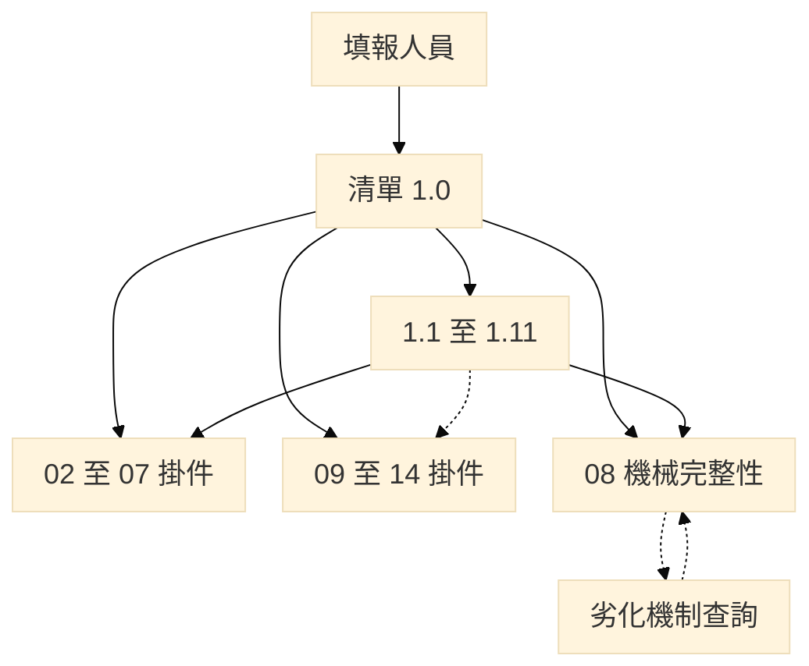

帶入規則：

- 清單：同一事實只填一次。區域關聯製程可空；關聯設備／化學品開表得空，化學品留 SDS。
- PSI：1.1 用 CAS＋製程彙總；1.2、內容物、1.5、1.8 留 SDS。1.6 與 1.10 選設備，製程由設備帶出。1.3 不得新增製程／設備／化學品編號。1.7 PHA 編號第一次得空。
- 02：2.2 不掛製程。2.4 另選製程與設備，不以評估紀錄篩製程。方法、風險分數、是非、附件內容不帶出。
- 06：只存承攬人、期間與 11.2 關聯。送出前要連上，開表不鎖。
- 08：從全份設備清單逐台篩。帶入 1.5、1.6、1.7。8.2 只接篩選為是者。查詢不是填報表，結果不得回寫設備主檔。
- 12：化學品自表1.0-5 已確認的關聯帶出，留 SDS。不以 1.3 反查，也不從 1.0-4 另挑。集合點可以沒有製程。

---

## 8. 與 V7.3、現行示範庫的差異

### 8.1 相對 V7.3 資料表結構

| 項目 | V7.3 | V8.2 |
| --- | --- | --- |
| 應填表 | 51 | 37（含 8.0-1） |
| 製程概述 | 表1.3-1 獨立 | 併入表1.0-2 `overview` |
| 1.3 方塊 | 每製程最多 15 格、next_seq／next_process | 製造路線枚舉已有製程；不另建先後指標 |
| 製程／設備編號 | 設備＝位號；製程場所內唯一 | 二者皆事業單位編定；系統內部碼不作選取鍵 |
| 操作分類 | 液體／氣體／後段處理 | 加粉狀固體、粒狀固體 |
| 1.6 | 設備 1:1 材質列 | 規範目錄＋關聯製程／設備／化學品 |
| 1.7 PHA 編號 | 建議欄 | 第一次得空，第二章後回填 |
| 1.10 | 掛設備 | 掛製程 |
| 1.9 | 安全關鍵設備 | 類型＝釋放及排放系統 |
| 區域關聯 | 開表即填設備／化學品（易成環） | 清單齊備後勾選，開表得空 |
| 第二章 | 2.1～2.5（含風險準則三表） | 2.1、2.2、2.3 |
| 第四章 | 4.1～4.5 | 4.1～4.4（緊急操作併入 4.3） |
| 第五章 | 5.1-1、5.1-2 | 僅 5.1-1 |
| 第六章 | 表6.1-1 | 表6.2-1 |
| 第九章 | 四項是／否確認 | 動火管制區域 |
| 第十～十四章 | 確認長表＋紀錄 | 確認改程序書；14 無填報表 |
| 12.2 區域關聯 | 曾誤從 1.3 反查 | 只從 1.0-5 已勾選帶出 |
| MI 安全關鍵 | 未禁止回寫 | 明確不得回寫 1.0-3 |

### 8.2 相對 V8.1 手冊

| 項目 | V8.1 | V8.2 |
| --- | --- | --- |
| 填報通則 | 六條；程序、計畫、圖資得以附件上傳 | 七條；各單元應上傳完整檔案，清單另傳完整清單表 |
| 表1.0-1 | 曾列無承攬／無動火等聲明 | 不設該等勾選。保養、工程、臨時維修填第六章；管線維修或工程動火填第九章 |
| 敘述 | 前言、架構、各章開頭偏套語 | 改為手冊口吻，欄位說明與法令用語未改 |

### 8.3 相對現行 demo（`psm/db.py`）

交給開發時以 demo 的資料表為準者，下列與本版手冊仍不一致，建庫時應改：

| 項目 | V8.2 本檔 | 現行 db.py |
| --- | --- | --- |
| 化學品列 PK | 製程＋SDS＋CAS | 已改。`chemical_cite` 仍是 CAS＋製程，只給 1.1 |
| `process.overview` | 必填 | 無此欄 |
| `process_id` 語意 | 事業單位編定 | 已是文字 PK，語意可相容 |
| `phase_class` | 五類（含粉狀／粒狀固體） | 三類 CHECK |
| `is_high_pressure_gas` | 獨立欄 | 無；僅 `is_regulated_machinery` |
| `design_code` | 目錄＋多對多 | 若仍 1:1 `equipment_material` 則不足 |
| `process_route` | 1.3-1 | 無；方塊若仍 `filing_row` 須改為只選已有製程 |
| `safety_interlock` | 選設備，製程由設備帶出 | `interlock.equipment_id` 必填，`process_id` 可空 |
| 區域關聯可空 | 開表得空 | 關聯表可空，相容 |
| 8.1 回寫 | 設備主檔不是安全關鍵的來源 | `mi_screen` 逐台篩；`save_mi_screen` 不回寫 `is_safety_critical` |
| 確認長表 | 12.1-2、14.1-1 已刪 | 部分仍在 flag／filing_row |

### 8.4 相對 V8.2 引用鍵（本版已改）

| 項目 | V8.2 圖 | V8.3 |
| --- | --- | --- |
| 化學品 | 後續一律 CAS＋製程 | 1.1 用彙總；濃度敏感列留 SDS |
| 1.0-5 關聯製程 | 開表必選 | 可空。集合點不虛構製程 |
| 1.6、1.10 | 掛製程 | 選設備，製程由設備帶出 |
| 2.2 | 掛單一製程 | 不掛。製程與設備在 2.4 另選 |
| 6.2 | 自存事故並掛製程 | 只存承攬人、期間，送出前關聯 11.2 |
| 8.1／8.2 | 從已標安全關鍵者帶入 | 全份清單逐台篩；8.2 只接篩選為是 |
| 12 | 從化學品清單再選 | 用區域已確認的關聯化學品 |
| 通則四 | 各單元再傳完整清單 | 同一版次只上傳一次。示範庫仍用各章 `attachment`，尚未另立共用文件頂點 |

本檔供事業單位及審查參考。法規條文及送審表號如有修正，以主管機關最新公告為準。
