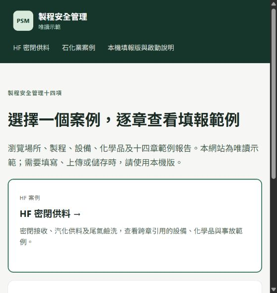

# Pages 與引用檢查（2026-10-19）

檢查起點：`main` 的 `42b639830a35b036b0a39c52026f5a99181135ed`。

## Pages 已發布

- 公開網址：https://fefe9487.github.io/psm-demo/
- GitHub Pages 發布來源：`gh-pages` 分支根目錄，HTTPS 已啟用。
- 發布版本：`609ff4294be537ad82bb2b66bf8eb1ef772abe11`。
- HF 密閉供料與石化業案例各有十四章、各製程步驟及獨立報告，合計 42 個 HTML 頁面。
- 網站為唯讀快照。移除表單送出、編輯事件及執行腳本；保留瀏覽導覽、原生展開區塊及停用的欄位範本。流程編輯器改為可瀏覽的步驟與連接清單。
- 原本以 `/wizard/...`、`/static/...` 表示的根目錄網址，在專案網站 `/psm-demo/` 會指向錯誤位置；匯出器改寫為相對路徑，並檢查所有站內檔案及錨點。
- 只發布 HTML、白名單 CSS、`.nojekyll` 與建置摘要。匯出時在暫存資料庫副本上執行遷移，原始案例、歷史備份及本機附件不會複製到網站。
- `main` 更新不會自動重新匯出；更新方式見 README。

公開網站首頁截圖：

## 已重現的 P1 文件引用錯誤

位置：`psm/wizard_http.py` 的 `wizard_document_create`。

觸發方式：上傳第九章程序書、將同一文件引用至第十章，再由第九章的「修改」儲存文件名稱或替換檔案。

修改前，程式先更新文件，再無條件新增相同的 `filing_document_ref`，違反 `(site_id, step, purpose, document_id)` 主鍵，觸發 `sqlite3.IntegrityError` 並回傳 500。既有關聯使一般文件修改也無法成功。

修正為保留已存在的關聯。新增回歸測試先在原始程式重現唯一鍵衝突；修正後驗證不附新檔與替換檔案兩種修改均成功，文件仍只有一筆，兩章關聯仍各一筆，兩章的文件檢核均通過。

## 驗證

- 完整 pytest：162 passed，約 169 秒。僅有 Starlette 對 AnyIO 別名的相依套件棄用警告。
- 原有測試有一個第一章流程編輯器文案檢查失敗；已將舊版「建立方塊」、舊流程限制改為目前的控制項及「加入流程圖」檢查。
- 靜態匯出：42 頁，1,480 個站內檔案／資源／錨點引用通過，未發現重複 HTML ID。
- 公開網站：42 個 HTML 與 2 個 CSS 均 HTTP 200；內容與本機輸出一致（僅正規化 Windows/Git 換行差異）。
- 瀏覽器確認公開首頁、石化業第一章、章節切換及窄版配置；編輯欄位均停用。
- `qa_v83.py` 檢查範圍從兩個 HF 資料庫擴增至五個：一般示範、一般填報、HF 事故案例、零事故承攬案例、石化業完整案例。五個副本的外鍵與既有跨章引用檢查均通過。

範例仍有待上傳文件及待補欄位，網頁照實保留這些狀態。檢查通過表示所檢查的結構與引用一致，不代表十四章內容已完成。
