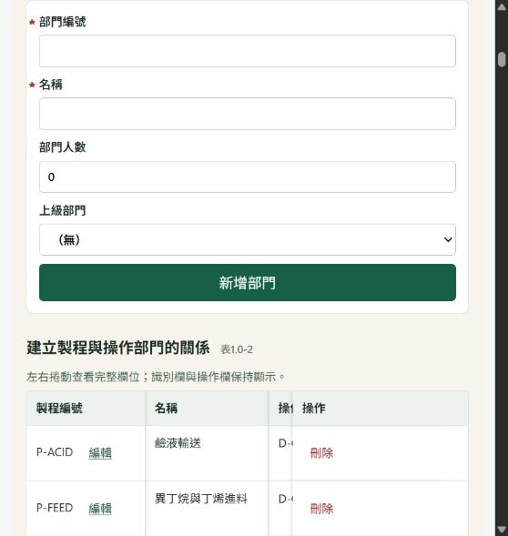

# Pages 與引用檢查（2026-10-19）

檢查起點：`main` 的 `42b639830a35b036b0a39c52026f5a99181135ed`。

## Pages 已發布

- 公開網址：https://fefe9487.github.io/psm-demo/
- GitHub Pages 發布來源：`gh-pages` 分支根目錄，HTTPS 已啟用。
- 網站使用原 FastAPI 與 SQLite，透過 Pyodide 0.27.7 在瀏覽器內執行，原本的表單、驗證、流程圖、刪除與報告處理邏輯均保留。
- HF 密閉供料與石化業案例各有十四章及獨立資料庫。另附示範廠資料，支援原本的進階編輯入口。
- Service Worker 將 `/psm-demo/app/` 的請求轉給原應用程式，並處理網址、重新導向及案例 Cookie。所有原始程式檔案保留原有路由。
- 各訪客的資料與附件存放在自己瀏覽器的 IndexedDB；一般重新整理及執行環境重啟後可保留，清除網站資料後恢復預設。
- 上方「恢復預設案例」只重置目前選擇的範例；不更動另一套案例。
- 首次下載約 19 MB。執行環境及 Python 套件隨網站發布，執行時不需連接 PyPI/CDN。
- 發布檔案包含三個指定範例資料庫，排除歷史備份及本機上傳檔案。
- 首次直接開啟深層網址時，404 頁會先回首頁啟動系統，再接回原本的本網站 `/app/` 路由。
- `main` 更新不會自動重新建置；更新方式見 README。

公開網站首頁截圖：

## 已重現的 P1 文件引用錯誤

位置：`psm/wizard_http.py` 的 `wizard_document_create`。

觸發方式：上傳第九章程序書、將同一文件引用至第十章，再由第九章的「修改」儲存文件名稱或替換檔案。

修改前，程式先更新文件，再無條件新增相同的 `filing_document_ref`，違反 `(site_id, step, purpose, document_id)` 主鍵，觸發 `sqlite3.IntegrityError` 並回傳 500。既有關聯使一般文件修改也無法成功。

修正為保留已存在的關聯。新增回歸測試先在原始程式重現唯一鍵衝突；修正後驗證不附新檔與替換檔案兩種修改均成功，文件仍只有一筆，兩章關聯仍各一筆，兩章的文件檢核均通過。

## 驗證

- 完整 pytest：168 passed，約 179 秒。僅有 Starlette 對 AnyIO 別名的相依套件棄用警告。
- 原有測試有一個第一章流程編輯器文案檢查失敗；已將舊版「建立方塊」、舊流程限制改為目前的控制項及「加入流程圖」檢查。
- 轉接層實測兩套案例的十四章及報告、建立部門、重新開啟後保留資料、上傳文件、跨章引用、修改文件及還原案例。
- 網址改寫保留外站連結、使用者欄位值與 JSON 範例資料；原有四個 JavaScript 檔案改寫後皆通過 Node.js 語法檢查。
- 瀏覽器實測新增部門、儲存、更新列表及編輯既有部門，資料更新成功。原版流程圖與編輯／刪除控制項均能載入。
- `qa_v83.py` 檢查範圍從兩個 HF 資料庫擴增至五個：一般示範、一般填報、HF 事故案例、零事故承攬案例、石化業完整案例。五個副本的外鍵與既有跨章引用檢查均通過。

範例仍有待上傳文件及待補欄位，網頁照實保留這些狀態。檢查通過表示所檢查的結構與引用一致，不代表十四章內容已完成。
