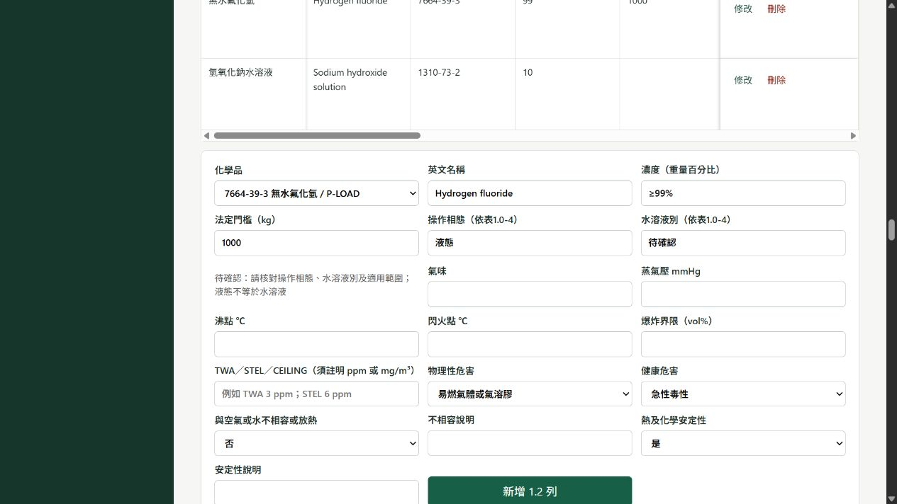

# PSI 表 1.1／1.2：相態、計量判定與單位修正

## 問題與修正結果

原先表 1.2 的外觀型態與表 1.0-4 計量使用的相態各自維護，管制數量只有 CAS 門檻數字，沒有 kg 或計量結果。氯化氫／氟化氫另有「液態即視為水溶液」的推定，可能把需要確認的無水液化情況直接排除。

- 表 1.0-4 分開保存「常用狀況相態」及「水溶液別（依 SDS）」。水溶液別可選水溶液、非水溶液或待確認。
- HCl／HF 已確認為水溶液者不列入甲類數量認定；氣態依公斤計量。無水液化、相態缺漏或相態與水溶液別矛盾時標示待確認，不自動排除或宣告未達量。
- 表 1.1／1.2 的相態、表 1.2 的法定門檻及計量判定，依表 1.0-4 最新資料重新計算。瀏覽舊資料或產生報表時也適用；表單送出的自訂門檻／舊外觀型態不能覆蓋判定。
- 同一 CAS／製程有不同 SDS 或不同相態時併列相態，逐成分計量；同一場所同 CAS 的已確認量合併。示範仍沿用各場所間距在 500 公尺以內的假設。
- 已確認量達門檻但另有未確認資料時，同時顯示達量及待確認；未確認量不被當作 0 而宣告未達。全部不適用者顯示不列入。
- 混合物成分依 CAS＋製程＋SDS 更新既有列，避免編輯時新增重複列。沒有手填 SDS 編號時使用實際建立的 SDS 編號，避免不同 SDS 的成分被錯配。

## 單位與輸入

計算公式為「操作量（kg）×重量百分比（上限）÷100＝純物質量（kg）」。純物質的成分歸屬量直接以 kg 納入。濃度有範圍時仍採上限估算。

表 1.1 最大存量及月用量、表 1.2 法定門檻均標示 kg。氣體也填 kg；L、m³、Nm³ 須先依密度與溫壓條件換算，目前沒有體積自動換算。無效、非有限、負數或超出 0–100% 的輸入不能產生有效計量結果；0 kg 是有效輸入。

蒸氣壓標示 mmHg、沸點及閃火點標示 ℃、爆炸界限標示 vol%。TWA／STEL／CEILING 欄提示填報者自行註明 ppm 或 mg/m³。

## 既有資料相容性

資料庫啟動時為 chemical 表新增 aqueous_status 欄位，預設為空白（待確認），可重複執行。舊 is_aqueous 曾由液態推定，因此不能當作填報者已確認水溶液別的證據。舊 HCl／HF 液態資料須回表 1.0-4 依 SDS 確認。

本次不改寫倉庫內既有 SQLite 快照；測試及畫面檢查均使用獨立資料庫或副本。

## 依據與驗證

判定依據為勞動部[勞動檢查機構辦理甲、乙、丙類危險性工作場所審查檢查注意事項](https://laws.mol.gov.tw/FLAW/PrintFLAWDOC01.aspx?flno=1&id=FL084556)第 1.1.2 點：HCl／HF 以氣態物為規範對象，水溶液狀態不列入，數量依濃度換算為純物質。無水液化情況本次保留人工確認，未自行擴張法規認定。

新增回歸測試涵蓋 HCl／HF 氣態、水溶液、無水液化、舊推定旗標、無效單位與濃度、0 kg、混合物更新、多 SDS、表 1.2 防覆寫、報表連動及既有資料庫欄位升級。並更新既有案例中期待直接排除液態的檢查，以及已過時的流程圖文案與表單定位檢查。

2026-10-22 最終結果：完整測試 **169 passed in 326.53s**；資料庫副本外鍵與跨章關聯檢查、JavaScript 語法與 Git 差異檢查全部通過。

執行方式：

```powershell
python -m pytest -q -o addopts='' -p no:cacheprovider --basetemp data/qa-tmp-psi-final
python scripts/qa_v83.py
node --check psm/static/wizard.js
git diff --check
```

畫面已驗證：液態 HF 帶入 1000 kg 法定門檻，操作相態及水溶液別唯讀，旁列待確認原因。


